# Try Sentinel on Windows with the evaluation installer

This guide is for epidemiologists, public-health professionals, students and
other contributors who want to try Sentinel on their own Windows computer.
You do **not** need to install Visual Studio, .NET, SQL Server, Git or any
other development tools.

> [!WARNING]
> This installer creates a **local evaluation** installation. It is not a
> production deployment and must not be used with real patient, contact,
> laboratory or other sensitive data. Use synthetic or safely de-identified
> data only.

## What you need

- A 64-bit Windows 10 or Windows 11 computer.
- A reliable internet connection. The installer downloads Sentinel and SQL
  Server images the first time it runs.
- Permission to install and run Docker Desktop. If the computer is managed by
  your employer, ask local IT first.

Sentinel's installer runs its local services through Docker Desktop. Docker
Desktop's terms and licensing are separate from Sentinel; in particular,
government entities and larger organisations may need a Docker subscription.
Review Docker's current terms before installing it.

## 1. Install Docker Desktop

1. Open [Docker Desktop for Windows](https://www.docker.com/products/docker-desktop/)
   and download Docker Desktop.
2. Open the downloaded installer and follow its prompts. For most people, the
   default **per-user** installation is suitable.
3. If Docker asks whether to use the **WSL 2** backend, choose it. This is the
   normal choice for Sentinel.
4. Finish the Docker installation and restart Windows if asked.
5. Open **Docker Desktop** from the Windows Start menu. Accept Docker's own
   terms if prompted, then wait until it says that the Docker engine is
   running.

### If Docker says WSL needs to be installed

WSL is a Windows component that Docker Desktop uses to run Linux containers.
It is not a separate Sentinel requirement.

1. Open the Start menu, search for **PowerShell**, right-click it and choose
   **Run as administrator**.
2. Enter the following command, then press Enter:

   ```powershell
   wsl --install
   ```

3. Restart the computer if Windows asks you to.
4. Open Docker Desktop again and finish its first-run prompts.

If this is an organisation-managed device and you cannot install WSL or Docker
Desktop, ask local IT to help. Do not try to work around organisational device
controls.

## 2. Download and open Sentinel Setup

1. Go to [Sentinel releases](https://github.com/christianpeut95/Sentinel/releases/latest).
2. In **Assets**, download the Windows evaluation installer (`Sentinel-Setup-…-evaluation.exe`).
3. Open the downloaded file. Only use an installer obtained from the official
   Sentinel GitHub release.
4. If Windows warns that the publisher is not yet recognised, confirm that the
   file came from the official release page before choosing **More info → Run
   anyway**. Do not bypass a warning for a file received by email, chat or an
   unfamiliar website.

The installer has five steps: **Evaluation notice**, **Prerequisites**,
**Configuration**, **Location services**, and **Review**.

## 3. Complete the Sentinel Setup installer

### Evaluation notice

Read the notice and tick the box confirming that this is a local evaluation
and that you will not use real patient data. Select **Continue**.

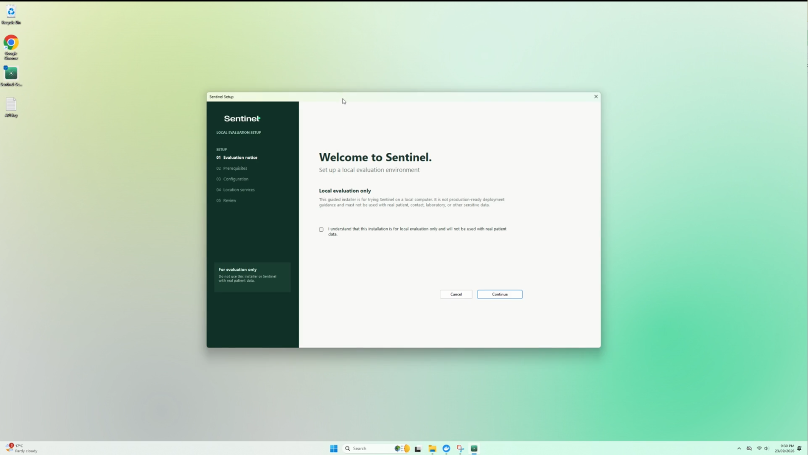

### Prerequisites

Select **Check Docker Desktop**. Continue only once the installer reports that
Docker is ready. If it is not ready, start Docker Desktop, wait a minute or
two, and check again.

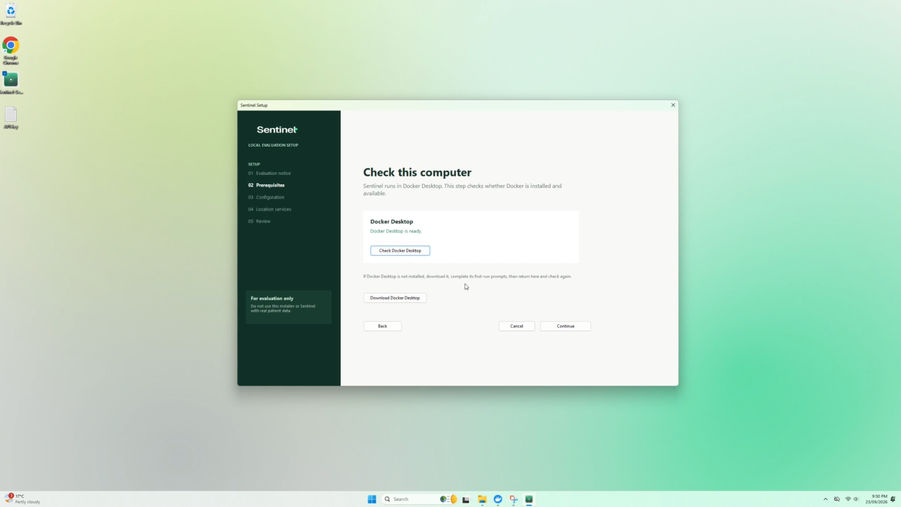

### Configuration

1. **Installation folder**: keep the default folder in your Documents folder
   or choose another empty folder that starts with a drive letter, for example
   `C:\Users\YourName\Documents\Sentinel`.
   This is where the installer stores its local configuration. It is not where
   your clinical data should be kept.
2. **Local port**: leave the suggested port alone. The installer begins at
   `8088` and automatically suggests a different available port if necessary.
3. **Select a Survey Builder**:
   - Choose **SurveyJS Creator** if you want to try the visual survey-design
     screen. Read and accept the applicable SurveyJS Creator terms; the
     installer downloads its compatible files locally.
   - Choose **No visual survey builder** if you only want to explore Sentinel,
     configure existing survey data, or complete surveys. Survey completion
     still works.
4. Select **Continue**.

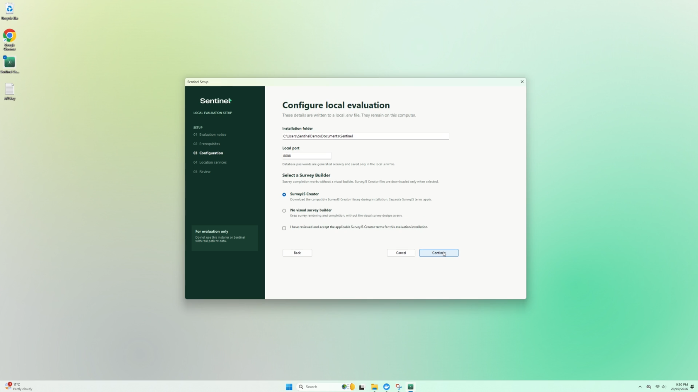

### Location services

Google location services are optional. Sentinel uses the Nominatim
(OpenStreetMap) provider when Google is not configured.

- Leave **Use Google location services** unticked for a first evaluation. The
  installer will use Nominatim and the default country code `AU`.
- Tick it only if you already have suitable Google keys. A server geocoding key
  is required; the browser Places key is optional. The installer masks both
  keys and saves them in the local `.env` file, not in the review screen.

Select **Continue** when ready.


### Review

Check the folder, port and survey-builder choice. Select **Install Sentinel**.
The first installation can take several minutes while Docker downloads the
required images. Keep Docker Desktop running and do not close the installer.

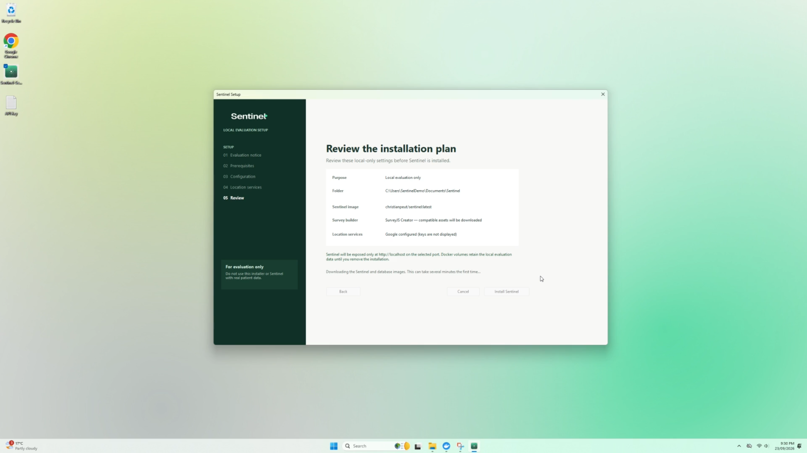

When it finishes, Sentinel Setup:

- starts Sentinel only on this computer at `http://localhost:8088` (or the
  local port you selected);
- creates an `hl7-drop` folder inside the installation folder for future HL7
  test files;
- displays and copies a one-time setup token to your clipboard; and
- opens the Sentinel setup page automatically.

The token is a temporary administrator secret. Do not paste it into a GitHub
issue, email, screenshot or chat message.

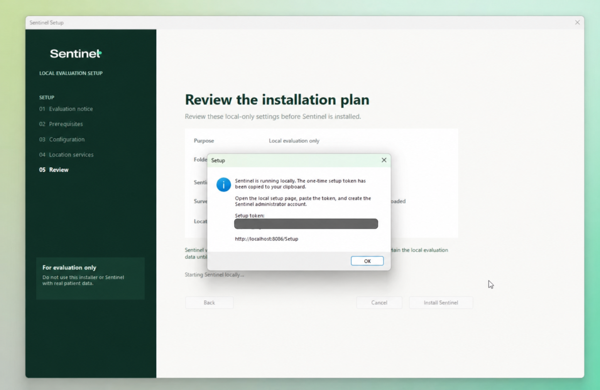

## 4. Complete Sentinel's first-time web setup

If the setup page did not open, open a browser and go to
`http://localhost:8088/Setup`. Replace `8088` if you chose a different port.

1. **Setup token**: paste the token that Sentinel Setup copied to your
   clipboard, then select **Continue**.

   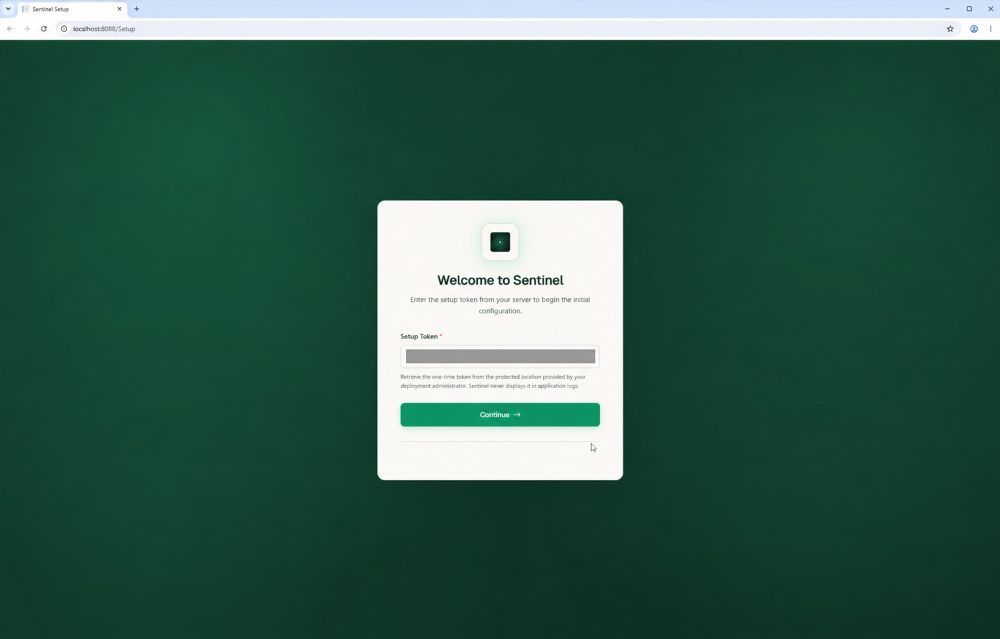

2. **Welcome to Sentinel**: select **Begin setup**.
3. **Database connection**: select **Test Connection**. Once it reports a
   successful connection, select **Next**. The installer has already created
   the local database configuration; do not edit the displayed, masked
   connection string.

   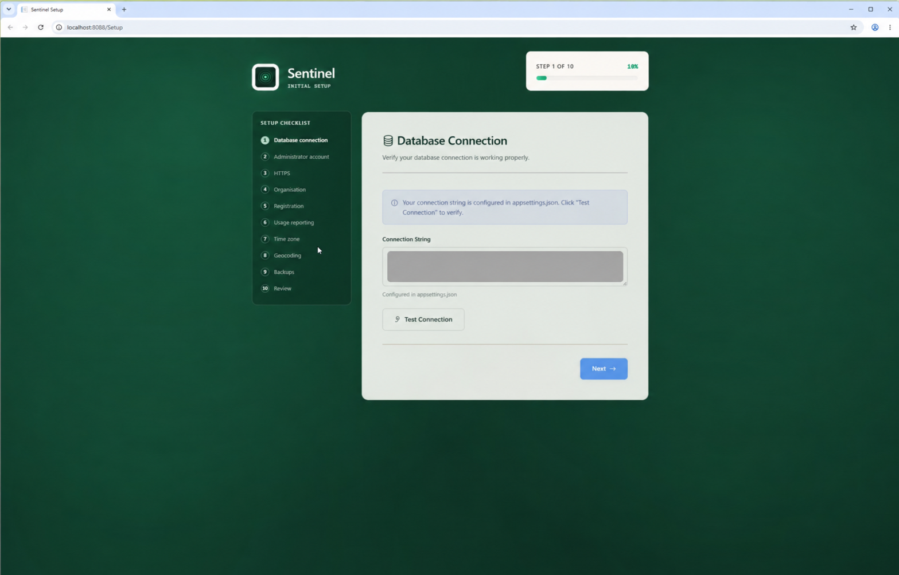

4. **Administrator account**: enter the email address, full name and a unique
   password for the person responsible for this trial. The password must be at
   least 12 characters; a long passphrase is welcome. A recovery email and a
   separate backup administrator are optional.

   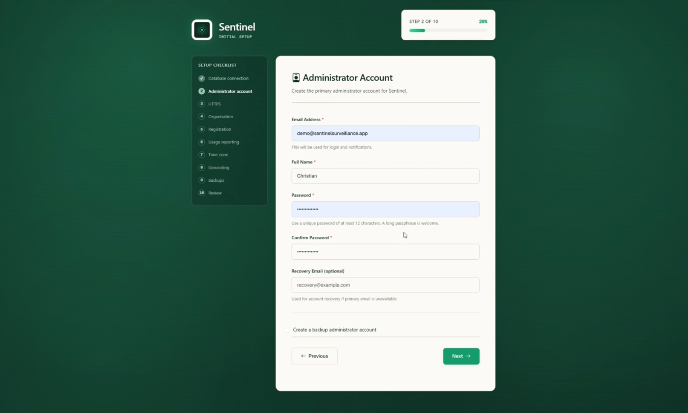

5. **Application address**: for a local evaluation, leave the prefilled
   `http://localhost:8088` address (or your chosen port). Leave **Domain name**
   and **SSL certificate path** empty.

   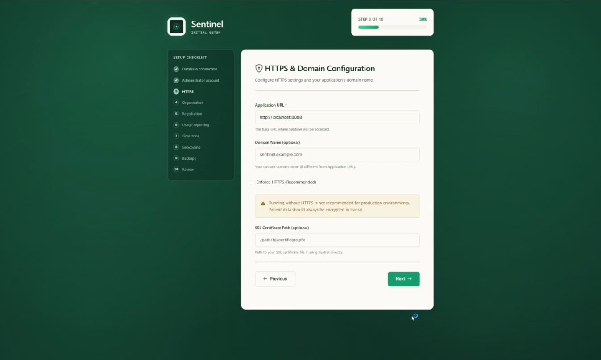

6. **Organisation**: enter the organisation name and select its country or
   region. State/province, city and postal code are optional.

   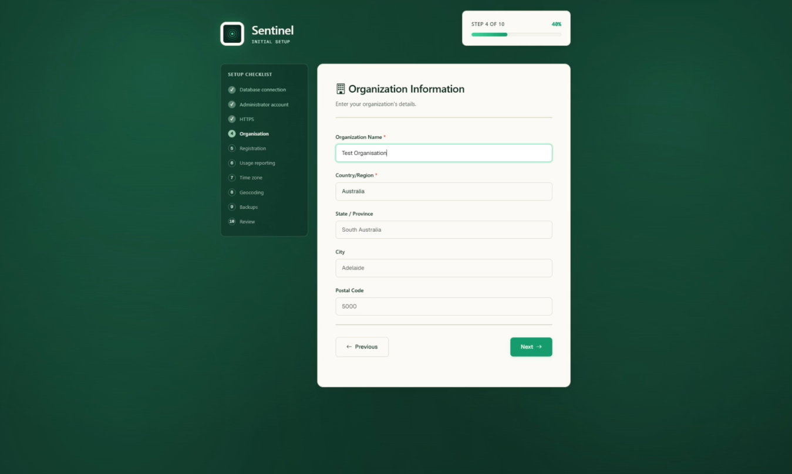

7. **Register Sentinel**: this is optional. To continue without registering,
   select **Continue Setup**. To register the evaluation and optionally hear
   about development updates, complete the form and select **Register with
   Sentinel**; it opens the registration site in a separate tab. Return to the
   Sentinel tab and select **Continue Setup** afterwards.
8. **Optional Feedback & Diagnostics**: both checkboxes are off by default.
   Leave them off unless you want to enable the feedback widget and/or send
   privacy-safe, aggregate usage statistics and coarse error fingerprints.
   These options can be changed later in Sentinel settings.
9. **Regional settings**: choose the organisation's time zone and its date,
   number and language format. New installations initially show Australian
   defaults (Australia/Adelaide and English (Australia)); change both if they
   do not suit your evaluation.

   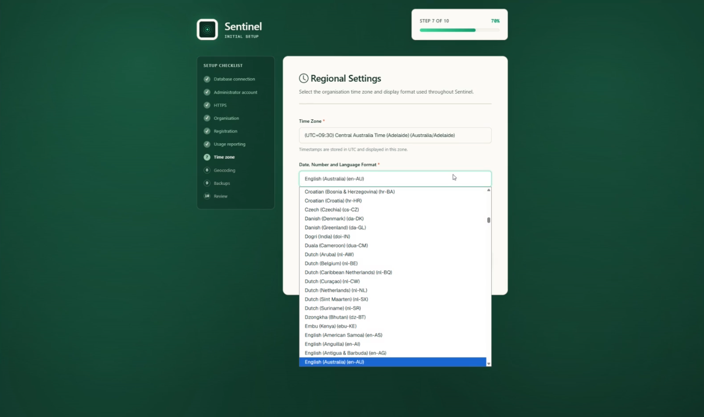

10. **Geocoding**: this is optional. The choice made in Sentinel Setup is
    already available here. Select **Skip for now** unless you have a reason to
    test mapping. Nominatim needs an email address; Google Places autocomplete
    needs a browser API key restricted to approved HTTPS referrers and the Maps
    JavaScript API and Places API.
11. **Backup configuration**: for the local evaluation, leave the supplied
    backup directory (`/var/lib/sentinel/backups`) and the 30-day retention
    period unchanged.
12. **Review & Complete Setup**: check the summary. Interactive pivot reports
    using WebDataRocks are optional; leave them disabled unless you have read
    and accept their separate licence. Select **Complete Setup**.

    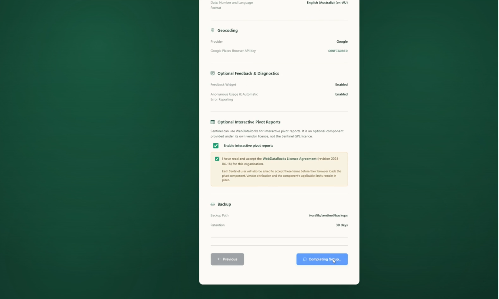

Sentinel creates the administrator account, completes setup, removes the
one-time setup token and redirects you to the sign-in page. Sign in with the
administrator account you just created.

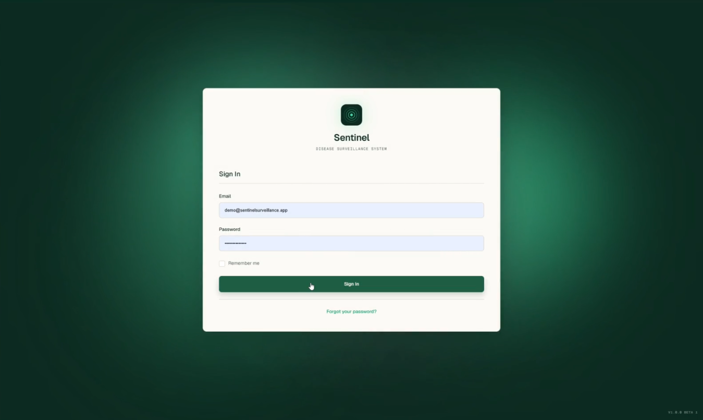

After signing in, you will arrive at the Sentinel dashboard.

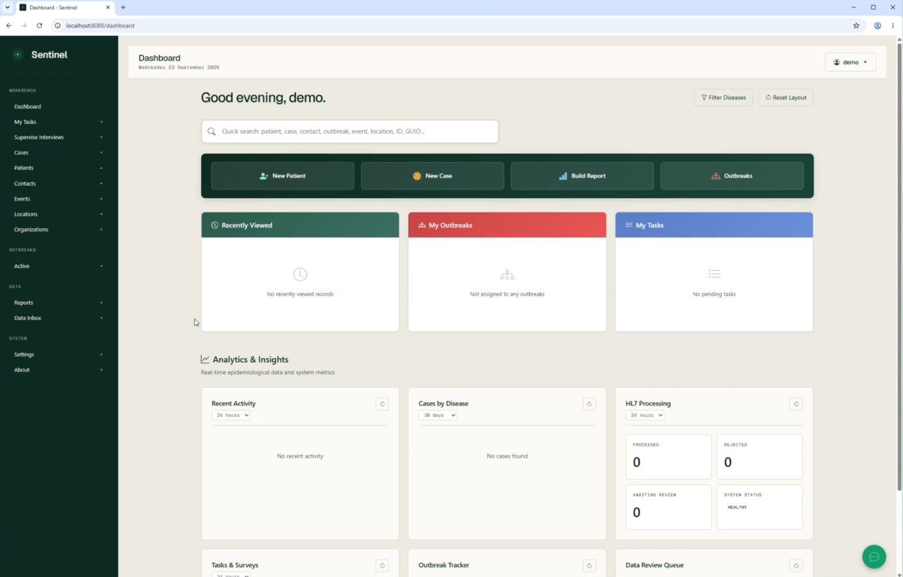


## Quick troubleshooting

| What you see | What to do |
| --- | --- |
| Docker is not ready | Open Docker Desktop, wait until its engine is running, then select **Check Docker Desktop** again. |
| The Sentinel page does not open | Check that the installer finished, then open `http://localhost:8088`. If you selected a different port, use that number instead. |
| Another app is using port 8088 | Go back to **Configuration** before installing and choose another number between 1024 and 65535, such as 8090. |
| The setup token does not work | Do not share it. Return to the installation completion window, copy the token again and paste it exactly once. If it has expired, ask a technically confident colleague or open a safe support request without including the token. |
| Docker or WSL installation is blocked | Ask your local IT team. A managed computer may need approval for Docker Desktop, WSL 2 or virtualisation. |

## Ending an evaluation

This installer is intended for local exploration. When you are done, remove
any synthetic data from Sentinel, then use Docker Desktop to stop and remove
the Sentinel evaluation containers and volumes. This removes the local trial
data. Do not treat the local evaluation installation as a backup or production
environment.

For production deployment, privacy assessment, identity management, backups,
HTTPS, access control and operational ownership require an organisation-led
implementation plan.
