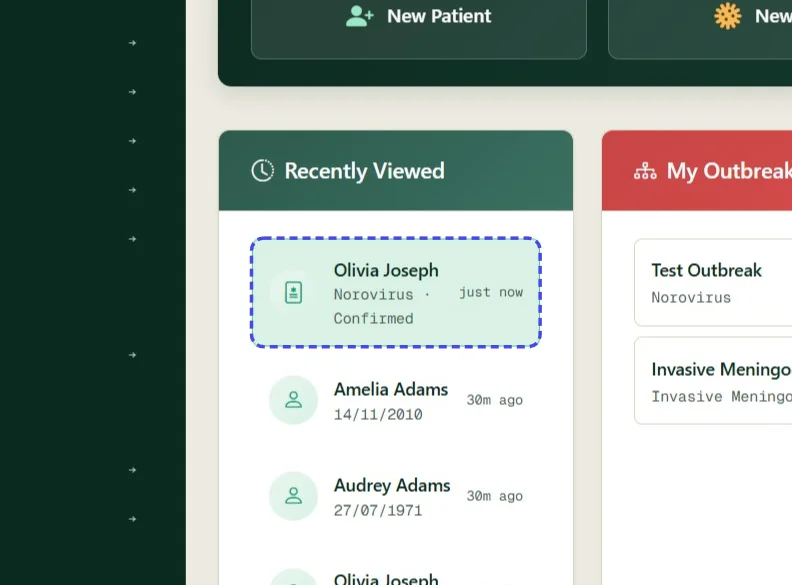
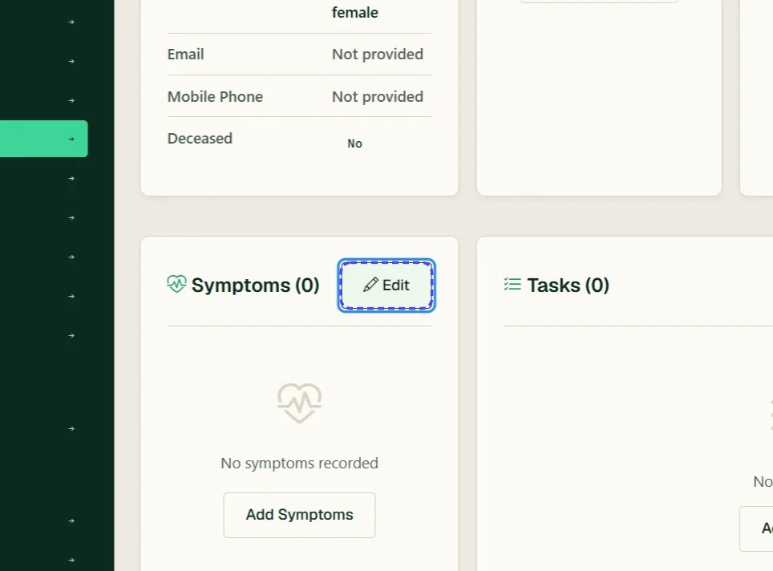
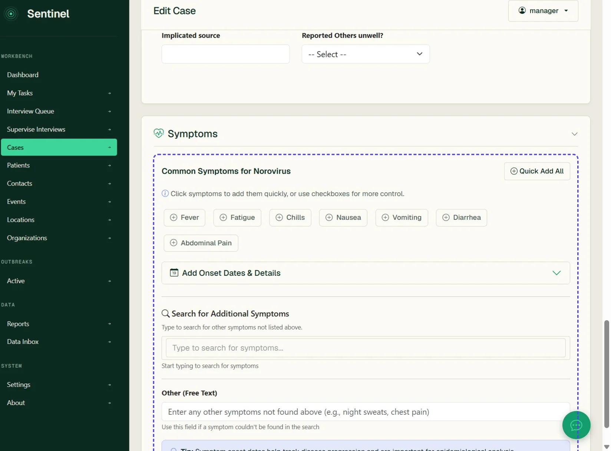
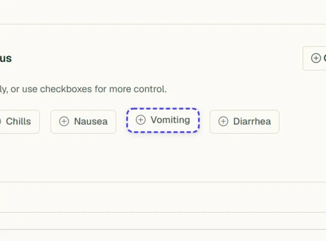
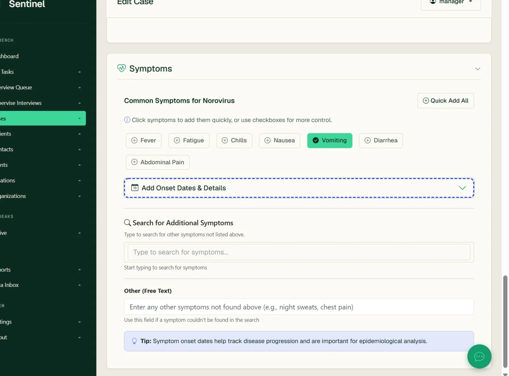
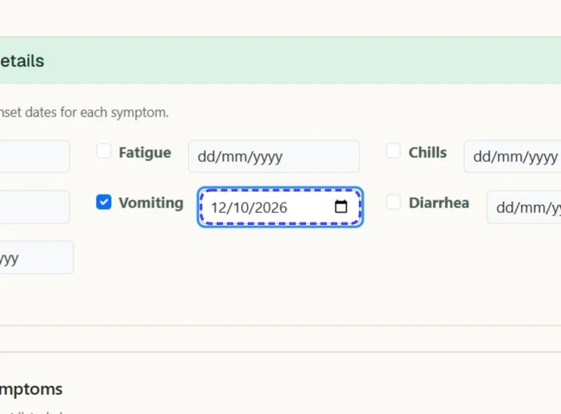
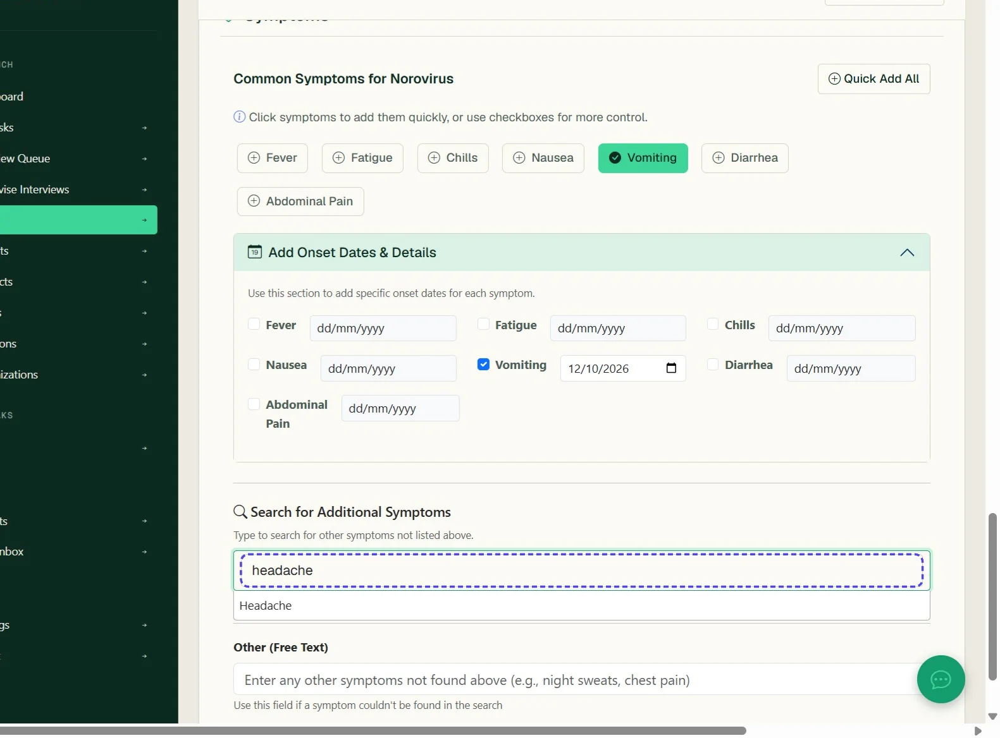
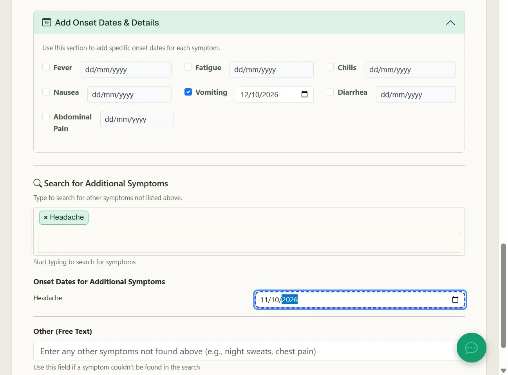
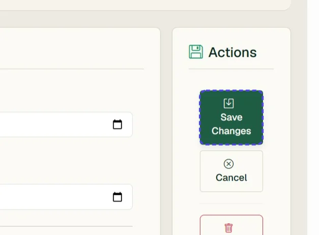
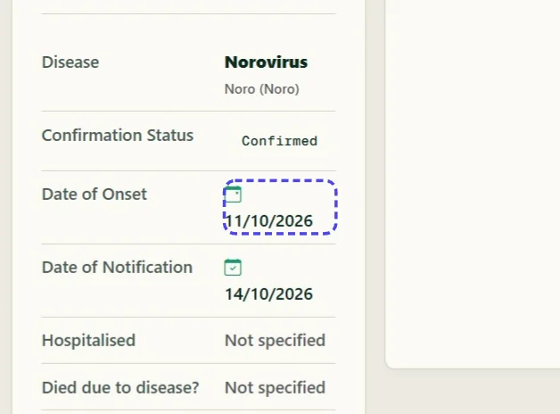

# Add or edit Symptom Data for a Case

*10 steps · Created Oct 14, 2026 · Source: demo.sentinelsurveillance.app*

---

## Step 01: Open a case record

## Step 02: Under symptoms click 'Edit' or 'Add Symptoms'

## Step 03: Scroll down to the Symptoms panel

## Step 04: Select a symptom to add

## Step 05: Click Add Onset Dates & Details

## Step 06: Add the date of onset if known

## Step 07: To add other symptoms not in the list Search for additional symptoms - these can be configured in settings

## Step 08: Add the onset date for the additional symptom

## Step 09: Click Save Changes

## Step 10: Note the date of onset has automatically updated to the earliest symptom onset date

