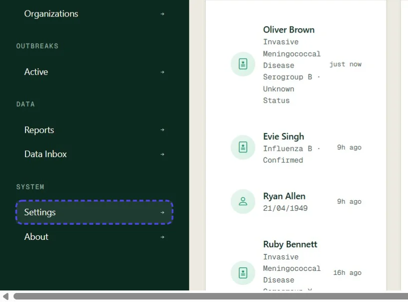
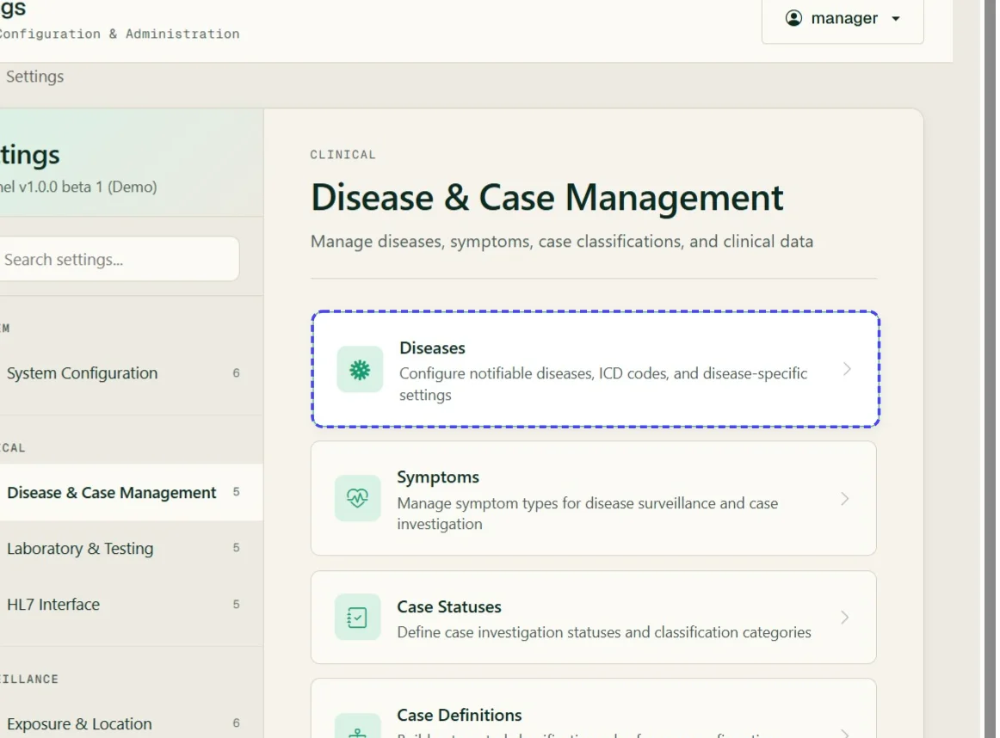
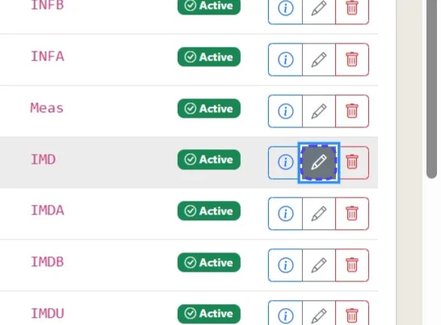
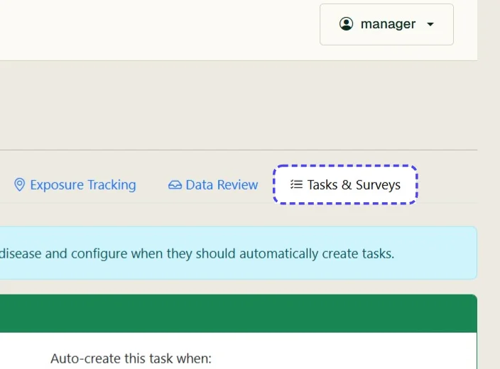
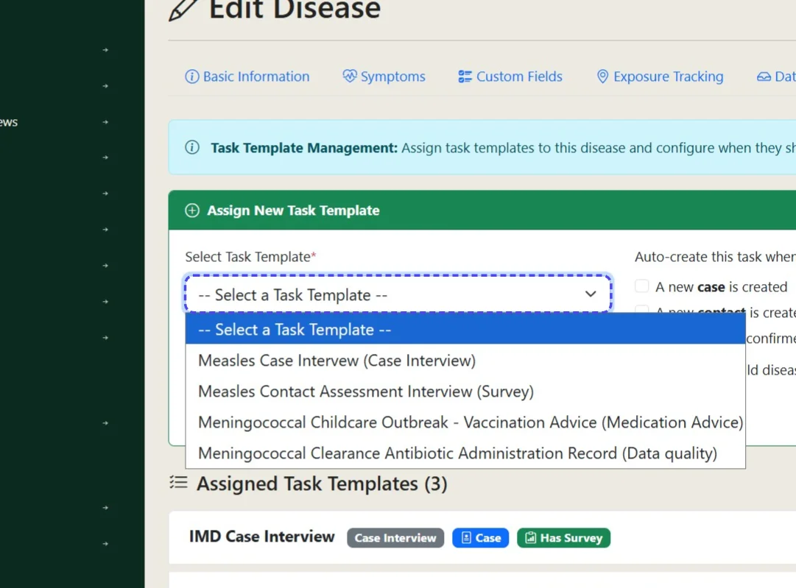
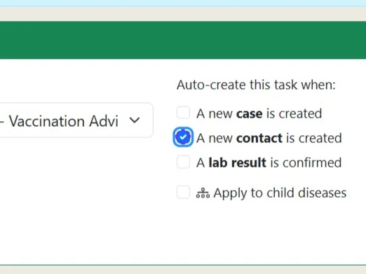
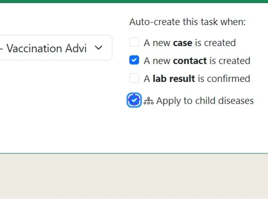
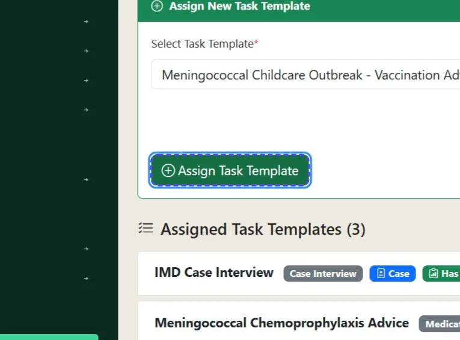
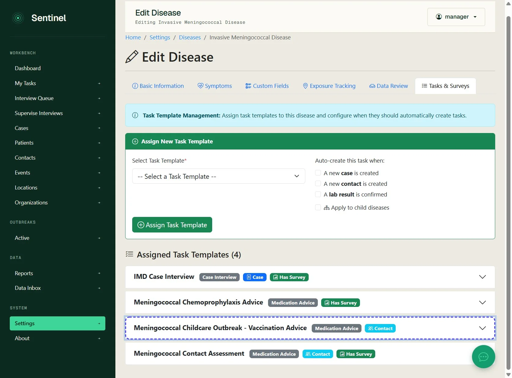

# Assign a task to create automatically for a case or contact

Use Sentinel to automatically create a new task (from an existing task template) for either a case or contact record

*10 steps · Created Oct 14, 2026 · Source: demo.sentinelsurveillance.app*

---

## Step 01: Click link "Settings →"

## Step 02: Click link "Disease & Case Management"

## Step 03: Click link "Diseases"

## Step 04: Click edit for your selected disease

## Step 05: Click Tasks & Surveys

## Step 06: Select the relevant task you want assigned

## Step 07: Select your auto create options

## Step 08: Select if you would like the auto task creation to apply to child diseases

## Step 09: Click Assign Task Template

## Step 10: Your task template automation has been assigned

