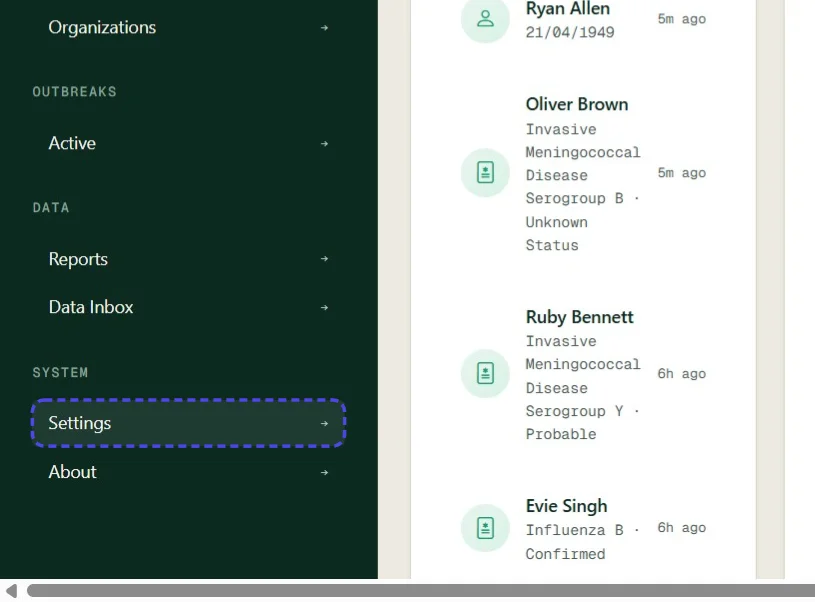
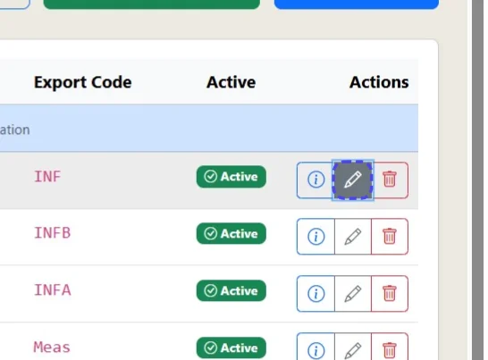
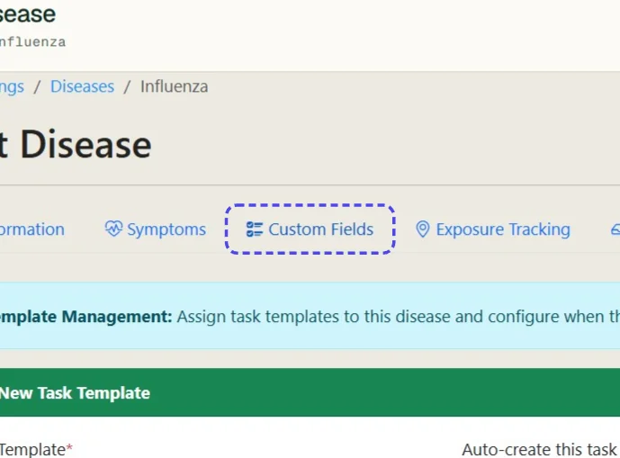
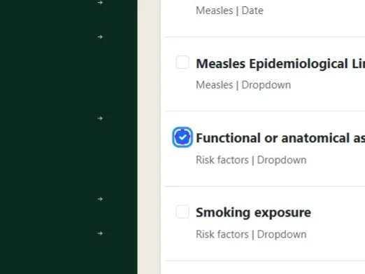
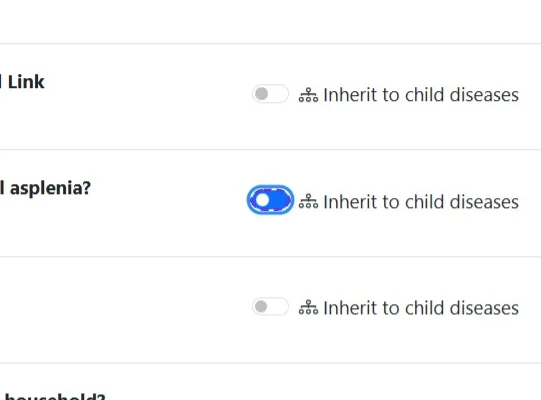
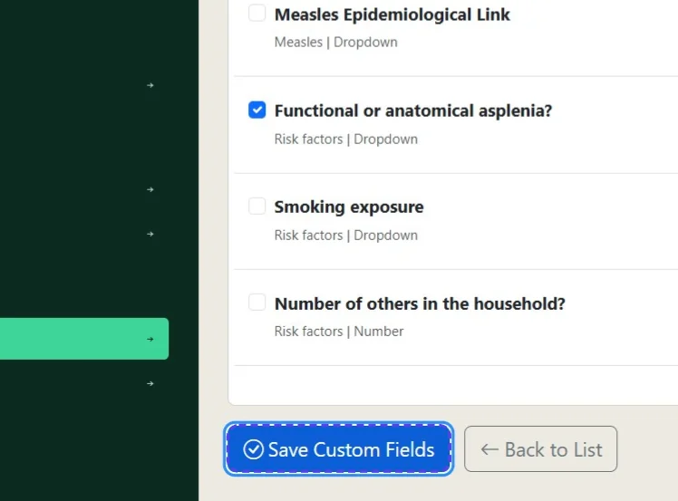
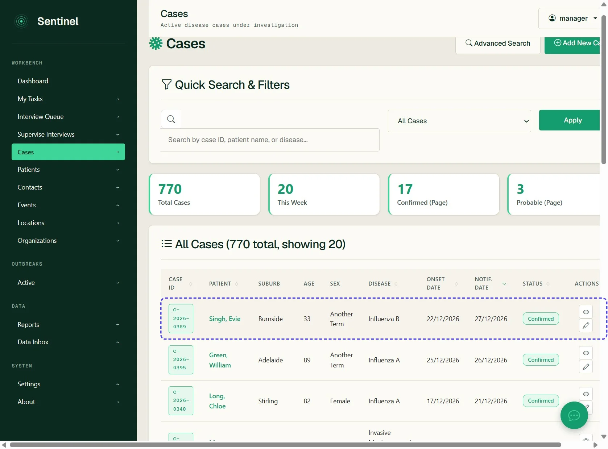
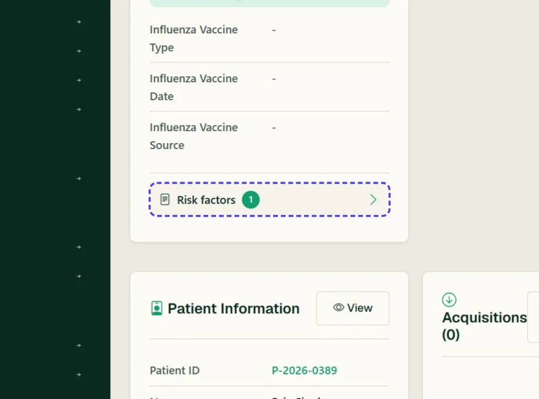
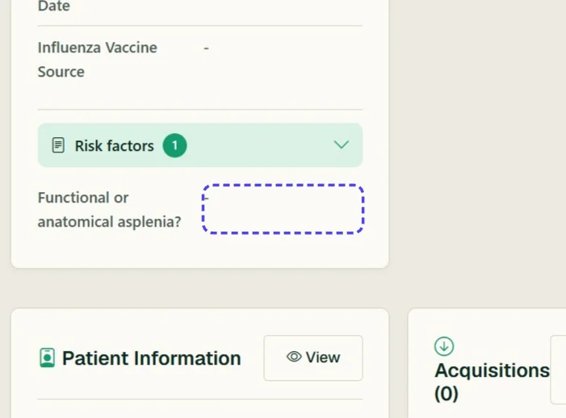

# Assign an existing custom field to a disease

How to use an existing custom field in Sentinel and assign it to a disease in order for it to be collected for cases of that disease

*11 steps · Created Oct 13, 2026 · Source: demo.sentinelsurveillance.app*

---

## Step 01: Click link "Settings →"

## Step 02: Click link "Disease & Case Management"

## Step 03: Click link "Diseases"

## Step 04: Click the edit icon on your selected disease

## Step 05: Click Custom Fields

## Step 06: Check your custom field

## Step 07: Optional: Toggle whether this custom field will inherit to all child diseases

## Step 08: Click Save Custom Fields

## Step 09: Navigate to a case of your modified disease

## Step 10: Open the relevant custom field area

## Step 11: Confirm the custom field appears

