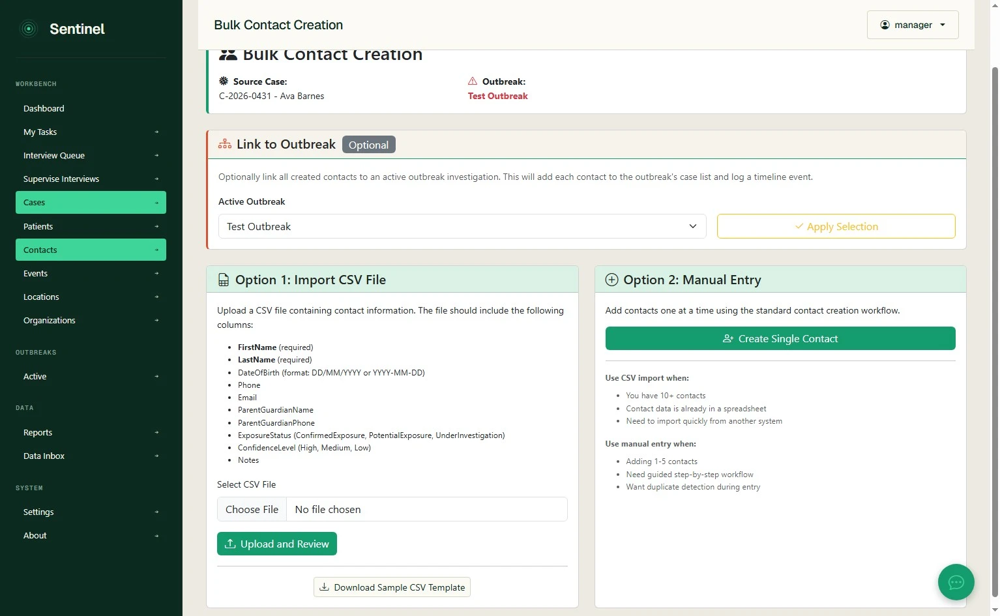
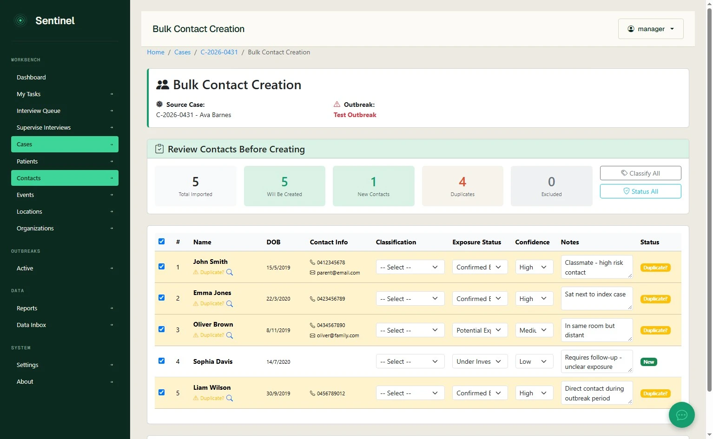
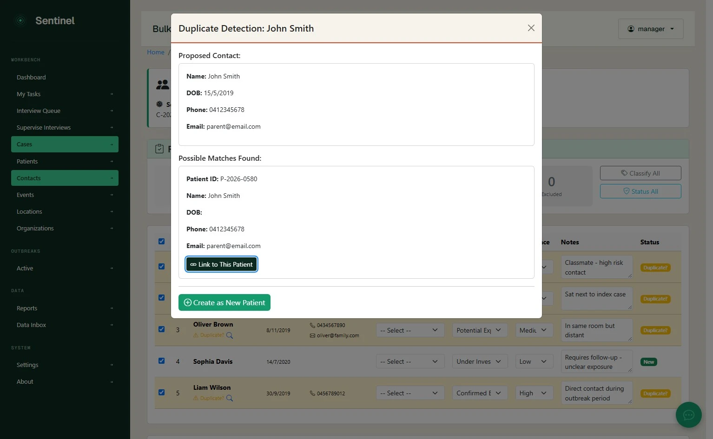
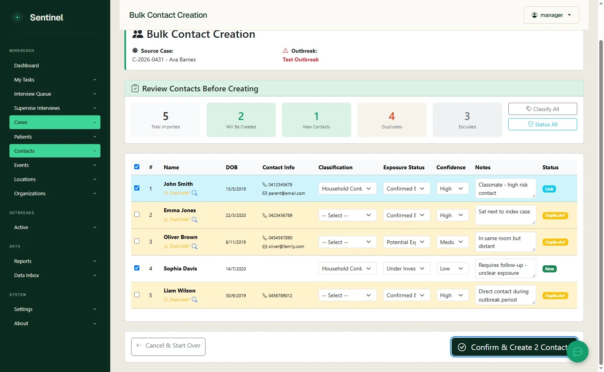
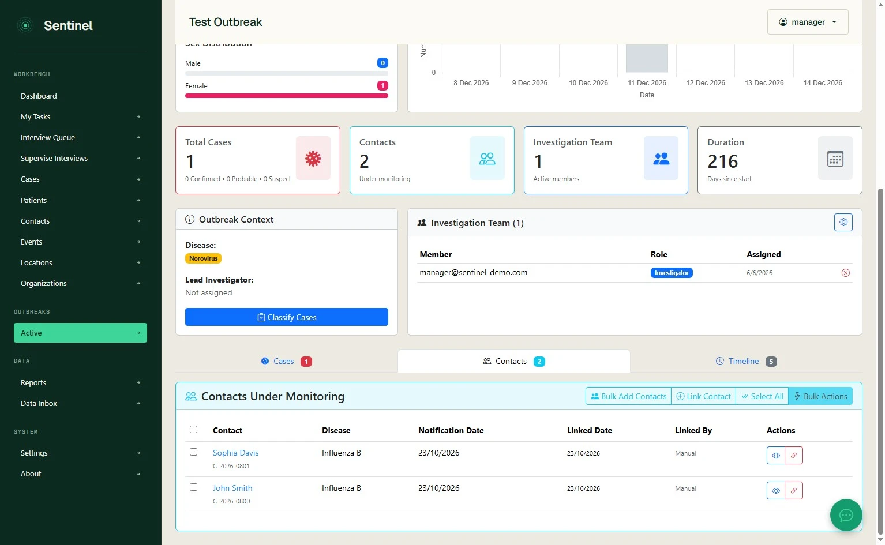
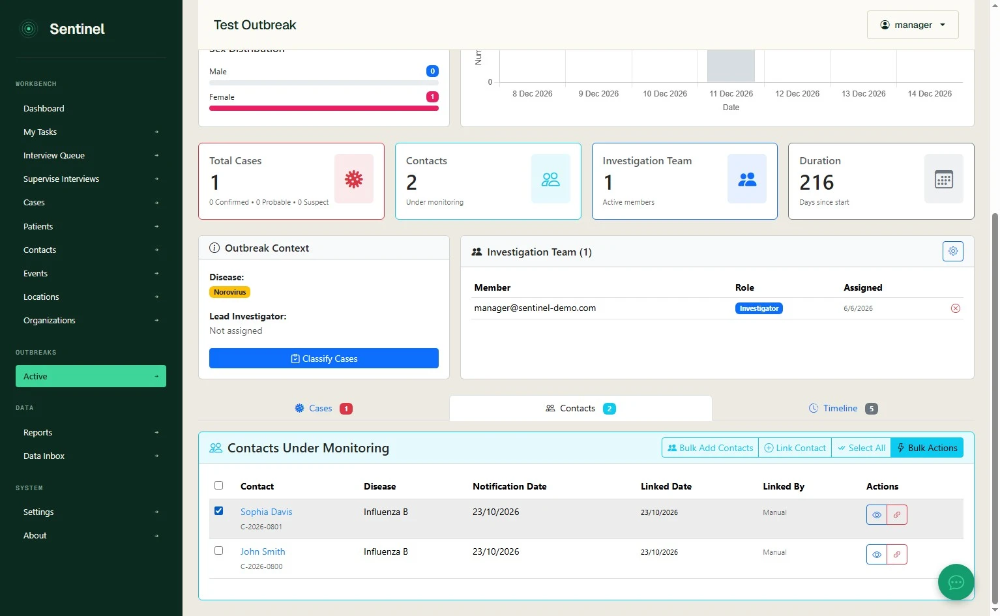
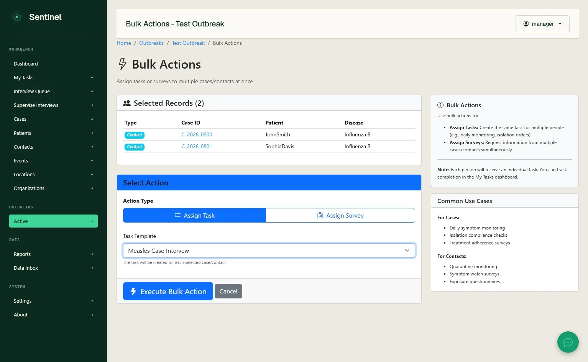
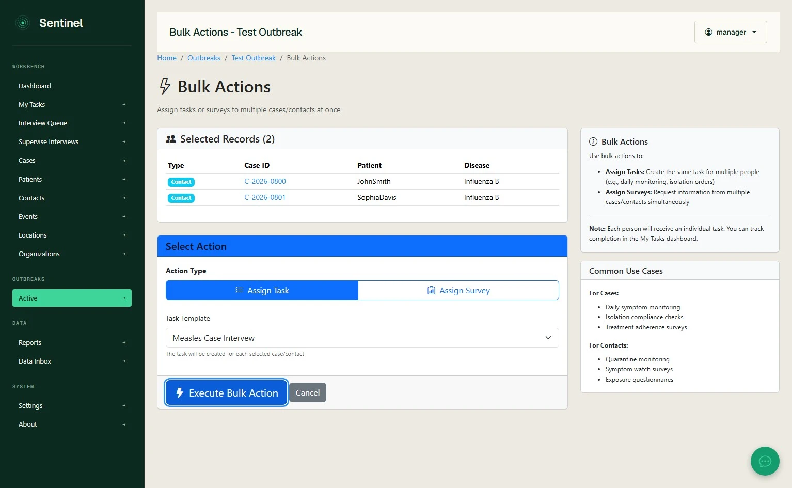

# Bulk-import outbreak contacts and assign tasks

**Sentinel user guide**  
**Workflow:** Add contacts to an existing outbreak from a CSV file, resolve possible duplicate patient records, select contacts to create and apply a task template in bulk.  
**Based on:** Sentinel demo walkthrough recorded 23 October 2026. Screens and labels may differ in subsequent releases.

## Before you start

You need an existing **active outbreak**, an appropriate **source case** within the investigation, permission to manage contacts, a CSV containing contact details, and a suitable task template for any bulk action. Select the correct outbreak before importing.

## 1. Open bulk contact creation

1. From the **Dashboard**, open the relevant active outbreak.
2. Select the **Contacts** tab.
3. Click **Bulk Add Contacts**.
4. On **Bulk Contact Creation**, verify the **Source Case** and **Outbreak** at the top of the screen.
5. If the outbreak association needs to change, select the correct **Active Outbreak** under **Link to Outbreak** and use **Apply Selection** as appropriate before continuing.

*The import screen shows the source case and outbreak association, with CSV and manual entry options.*

> **Important:** A bulk contact import is associated with a source case. Do not proceed if the displayed source case or outbreak is incorrect.

## 2. Prepare and upload a CSV

1. Under **Option 1: Import CSV File**, select **Download Sample CSV Template** and use it as the starting point.
2. Enter one contact per row. The recorded form lists the following fields:

   | CSV field | Details shown in the interface |
   | --- | --- |
   | `FirstName` | Required |
   | `LastName` | Required |
   | `DateOfBirth` | `DD/MM/YYYY` or `YYYY-MM-DD` |
   | `Phone` | Contact phone number |
   | `Email` | Contact email address |
   | `ParentGuardianName` | Where relevant |
   | `ParentGuardianPhone` | Where relevant |
   | `ExposureStatus` | `ConfirmedExposure`, `PotentialExposure`, `UnderInvestigation` |
   | `ConfidenceLevel` | `High`, `Medium`, `Low` |
   | `Notes` | Additional information |

3. Choose the CSV file and click **Upload and Review**.
4. Wait for the **Review Contacts Before Creating** screen. Uploading is a review step; it does not, by itself, finish creating the selected contacts.

**Alternative:** The same screen offers **Option 2: Manual Entry** for entering a smaller number of contacts individually.

## 3. Review duplicates and imported data

1. Review the summary counts, including **Total Imported**, **Will Be Created**, **New Contacts**, **Duplicates** and **Excluded**.
2. Records highlighted in **yellow** indicate potential duplicates. Select the **magnifying-glass** icon to review the possible match.
3. Compare the proposed contact with the existing patient record. Where it is the same person, select **Link to This Patient**. Otherwise, select **Create as New Patient**, where appropriate.
4. Check that the row's status/colour changes to reflect the decision.
5. Tick or untick each row to control whether it is included in the import.
6. Enter the appropriate **Classification**, and review **Exposure Status**, **Confidence** and **Notes**. The interface also offers **Classify All** and **Status All** controls for applying common values.

*Yellow rows indicate possible matches; the summary counts help identify records needing review.*

*Compare demographics and contact information before choosing to link an existing patient or create a new one.*

*Check the inclusion checkboxes and contact classifications before confirmation.*

> **Identity caution:** A suggested duplicate is a possible match, not proof of identity. Review the identifying details before linking a record to an existing patient.

## 4. Confirm creation and inspect the outbreak

1. When the review is complete, click **Confirm & Create [number] Contacts**. The count reflects the currently included records.
2. Return to the outbreak record and open **Contacts**.
3. Confirm that the intended contacts appear in the **Contacts Under Monitoring** table.

*The recorded example shows two contacts visible in the outbreak after confirmation.*

## 5. Assign tasks to several contacts

1. In the outbreak **Contacts** tab, tick the checkboxes beside the contacts who should receive the task. Review the selection carefully.
2. Select **Bulk Actions**.
3. On the **Bulk Actions** page, confirm the **Selected Records** list is correct.
4. Under **Select Action**, choose **Assign Task**. The alternative **Assign Survey** option is also available in the recorded interface.
5. Select the appropriate **Task Template** for those contacts and the public health action required.
6. Click **Execute Bulk Action**.
7. Verify that individual tasks were created for the intended contacts and can be followed up in **My Tasks** or the relevant task view.

*Select only the contacts to receive the action.*

*The bulk action assigns a separate task to each selected record.*

*Review the selected records, action and template before execution.*

> **Capture limitation:** The Mimik recording ends at the **Execute Bulk Action** click and does not include the resulting confirmation or task list. The final verification step is therefore an operational check rather than an observed result.

## Verify your import and task assignment

Check that the expected number of contacts was created, excluded rows were not imported, duplicate resolutions point to the intended patient records, every imported contact belongs to the correct source case and outbreak, and the correct task template was assigned to the intended recipients.

---

*Prepared from a Mimik interaction recording on `demo.sentinelsurveillance.app`. This guide is an edited interpretation of the recorded interface, not an independent live acceptance test.*
