# Create a simple survey field mapping

Mapping is set at the disease level for a task. Mapping will use the most specific disease mapping available on submission of a survey

*14 steps · Created Oct 23, 2026 · Source: demo.sentinelsurveillance.app*

---

## Step 01: From the dashboard, click Settings in the sidebar

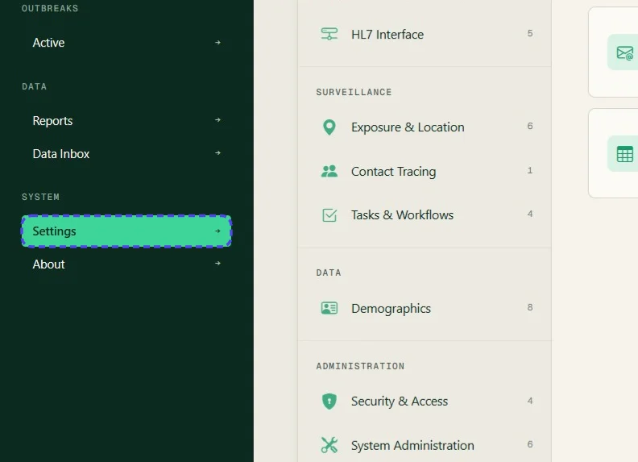

## Step 02: In Settings, click Disease & Case Management

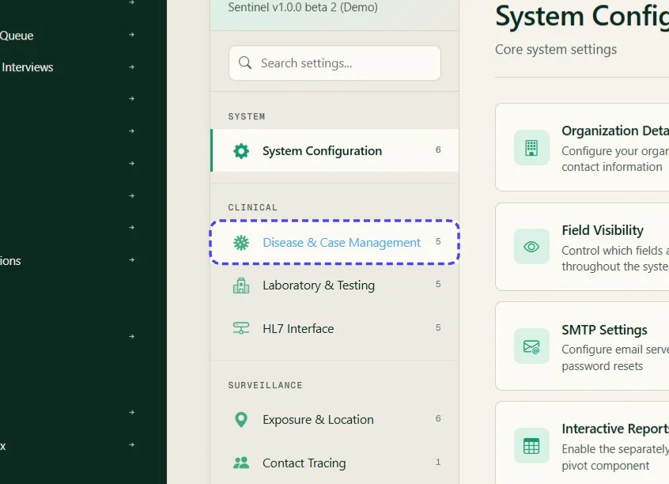

## Step 03: Click Diseases

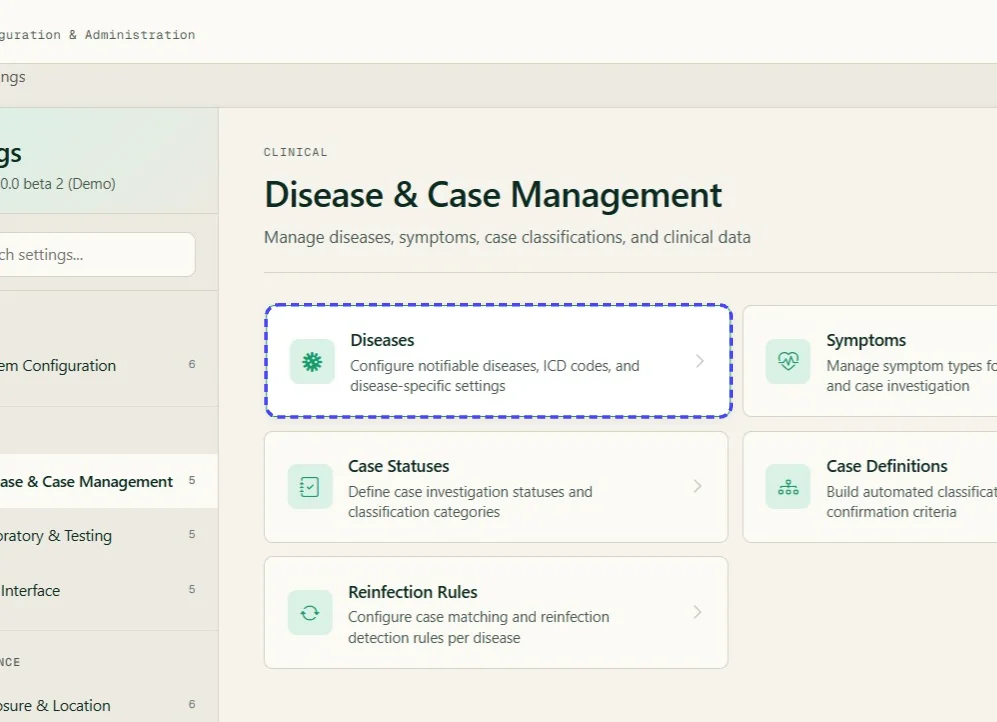

## Step 04: On the Diseases page, click the edit icon next to the disease

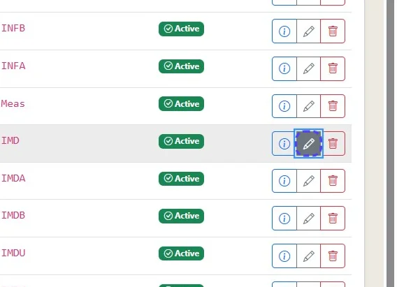

## Step 05: Assign a task template if one is not already assigned

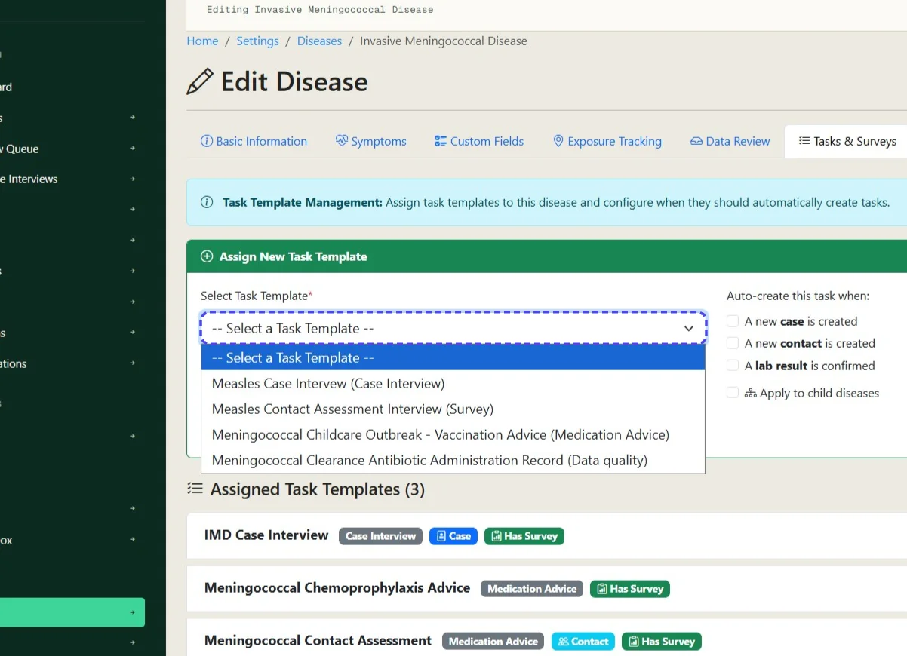

## Step 06: Expand the assigned task template in the disease settings

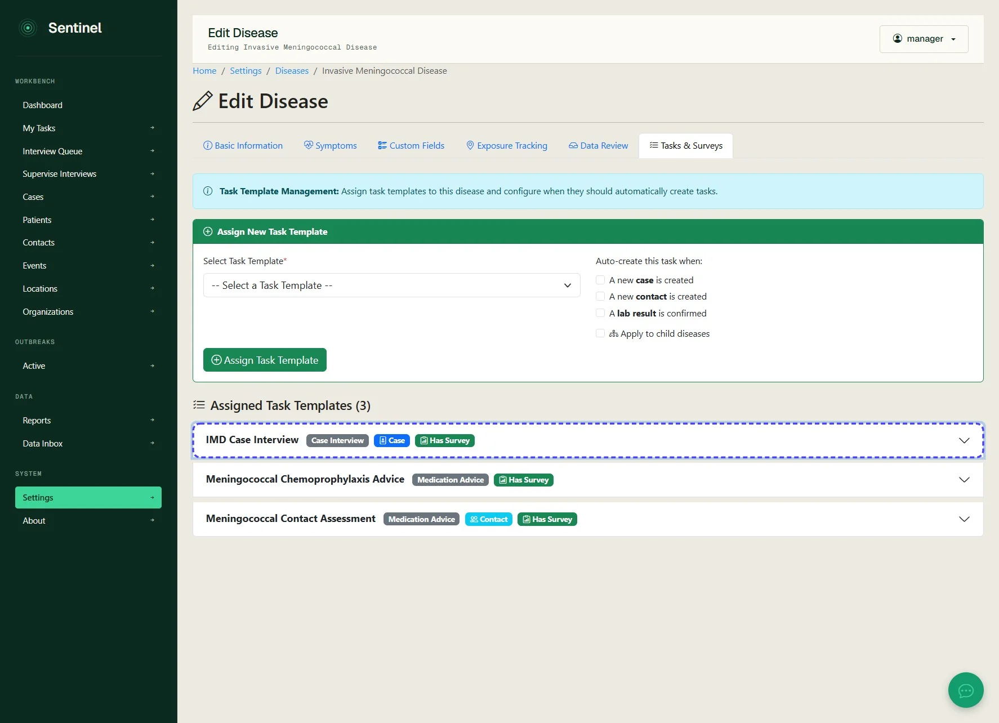

## Step 07: In the task template, click Add Mapping

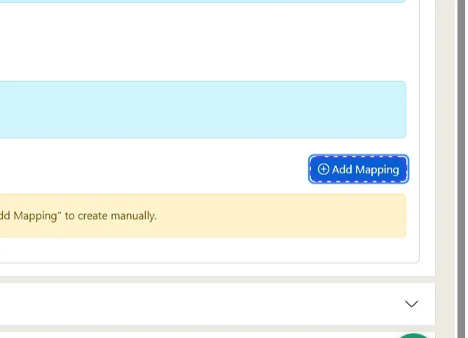

## Step 08: Select the survey question to map

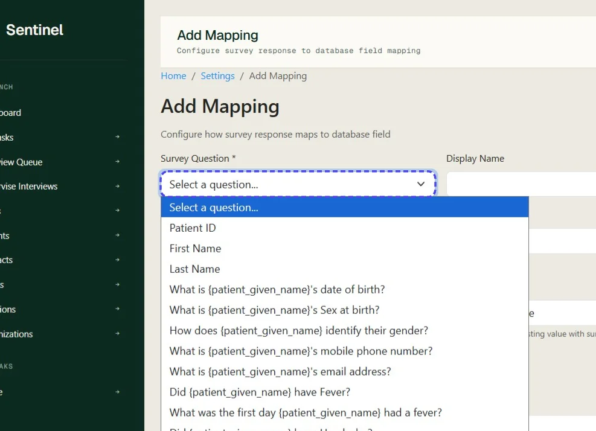

## Step 09: Select the field category for the target entity

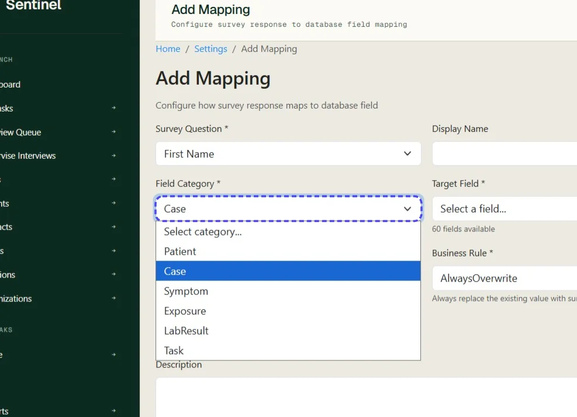

## Step 10: Select the target field

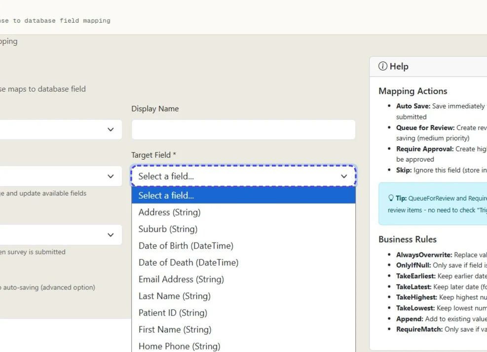

## Step 11: Choose the mapping action

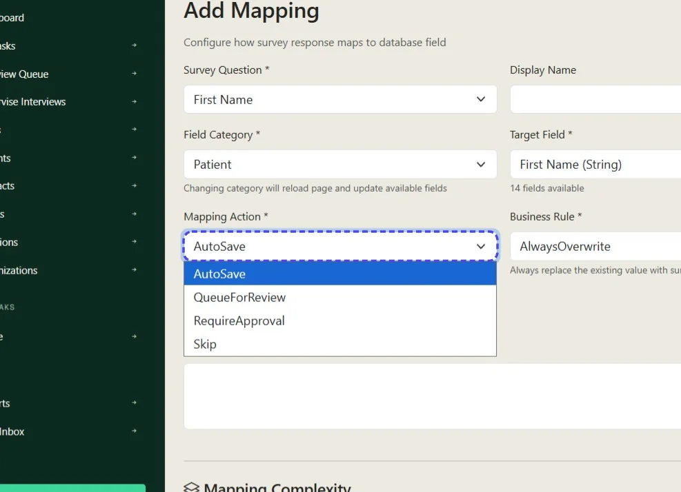

## Step 12: Choose the business rule

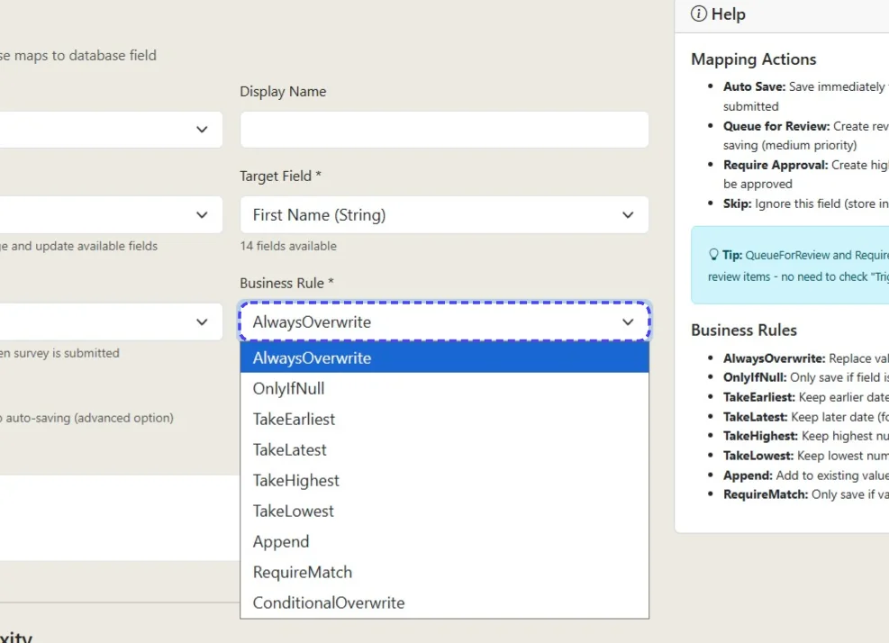

## Step 13: Choose whether to trigger a review queue item

Trigger Review Queue does not stop data being written. Use the mapping action or business rule to control this.

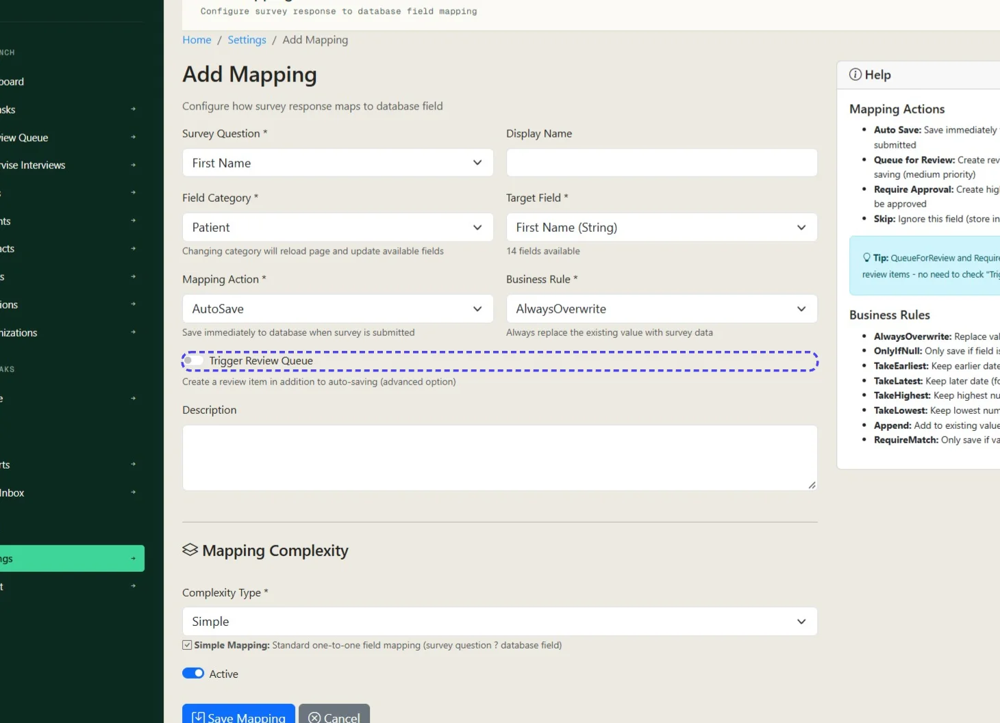

## Step 14: Click Save Mapping

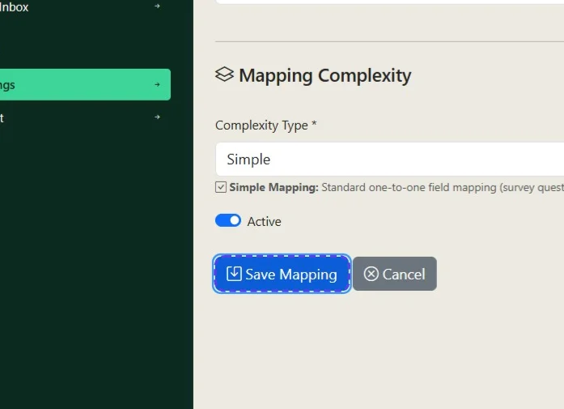
