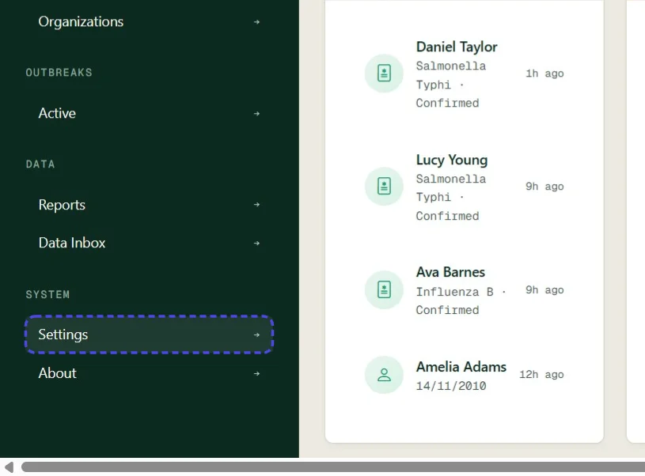
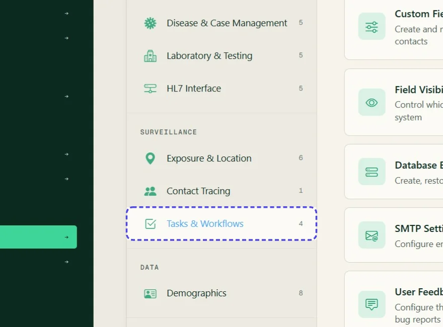
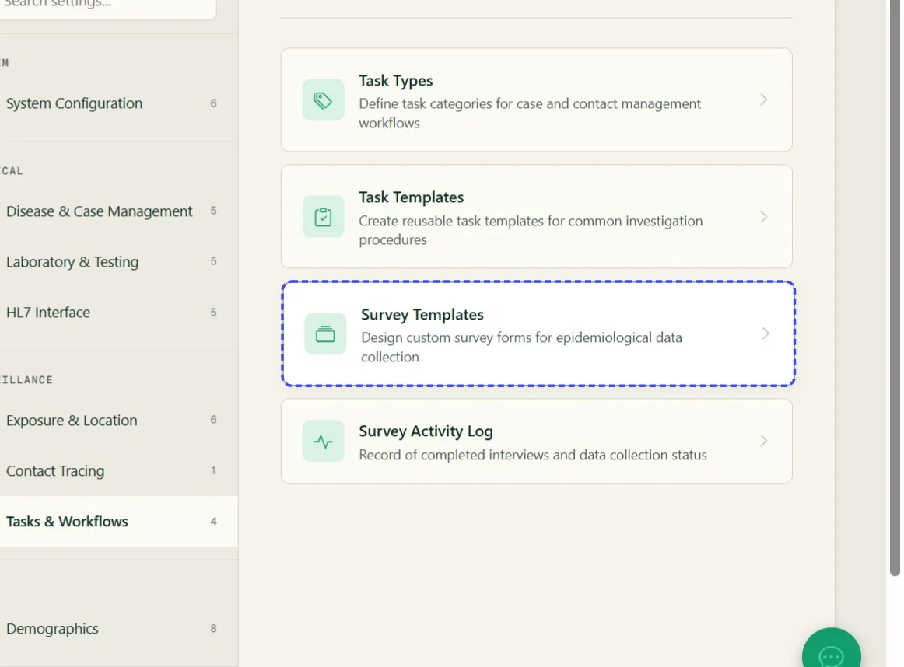
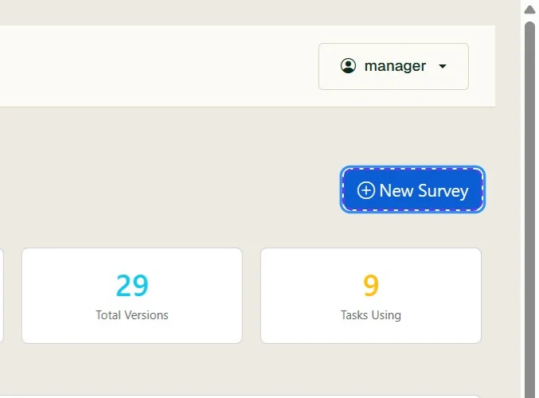
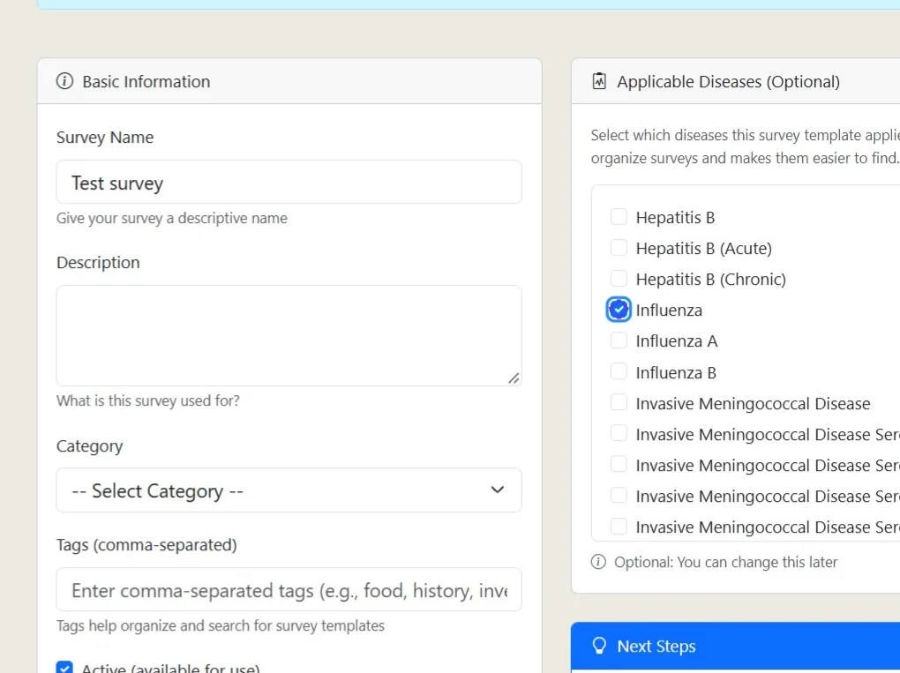
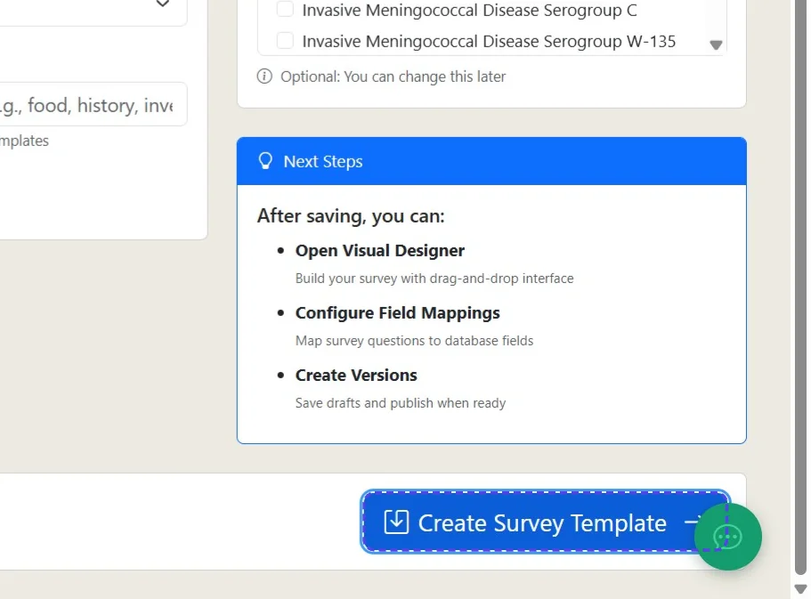
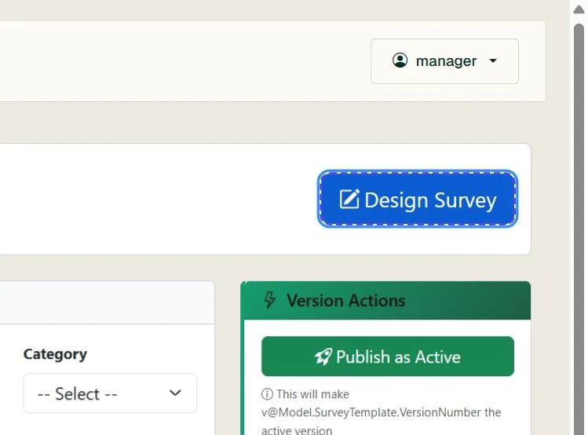

# Create a survey record

*7 steps · Created Oct 23, 2026 · Source: demo.sentinelsurveillance.app*

---

## Step 01: From the dashboard, click Settings in the sidebar

## Step 02: In Settings, click Tasks & Workflows

## Step 03: Click Survey Templates

## Step 04: On the Survey Templates page, click New Survey

## Step 05: Enter the survey details

Enter a survey name and complete the description, category and tags as needed. Select the applicable diseases if required.

## Step 06: Click Create Survey Template

## Step 07: Click Design Survey

Continue with [Editing a survey in the Survey Designer](https://sentinelsurveillance.app/docs/?page=editing-a-survey-in-the-survey-designer). For detailed builder instructions, review the [SurveyJS user guide](https://surveyjs.io/survey-creator/documentation/end-user-guide/user-interface).

