# Create an outbreak and organise its first cases

**Sentinel user guide**  
**Workflow:** Declare an outbreak, link existing cases, set outbreak case definitions, classify cases, add a timeline event and manage the investigation team.  
**Based on:** Sentinel demo walkthrough recorded 23 October 2026. Screens and labels may differ in subsequent releases.

## Before you start

You will need access to Sentinel with permission to manage outbreaks, an outbreak name and primary disease, and a suitable lead investigator. Have any existing case records ready to identify. An associated event or location is optional.

## 1. Declare a new outbreak

1. From the **Dashboard**, locate **Outbreaks** and select **Active**. This opens the outbreak list.
2. Select **Declare New Outbreak**.
3. Enter the **Outbreak Name** and select the **Primary Disease**.
4. If relevant, associate the outbreak with an existing **Location** or **Event**. These fields are optional.
5. Select the **Lead Investigator**.
6. Click **Declare Outbreak**. Sentinel opens the new outbreak record.

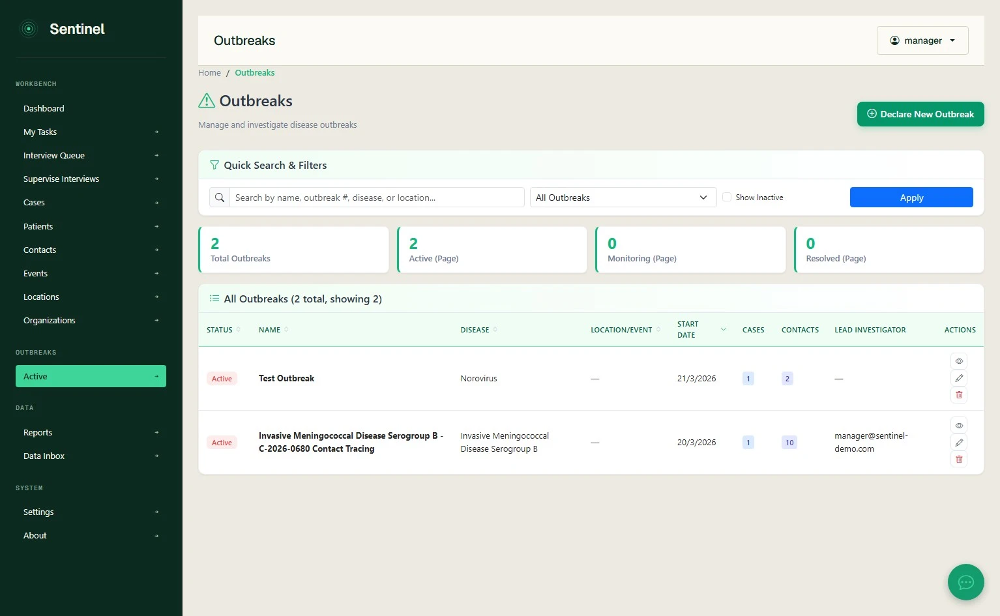
*The active-outbreak listing and declaration button.*

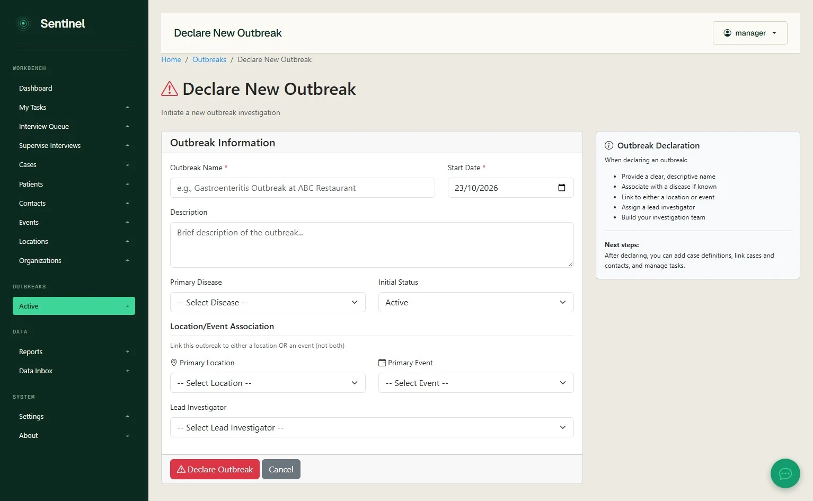
*Enter the outbreak details before declaring it.*

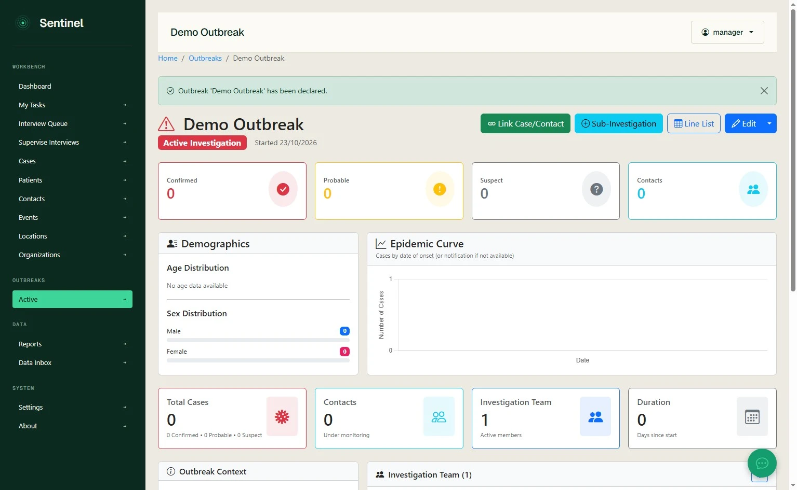
*The new outbreak record provides a central view of the investigation.*

## 2. Link existing cases

1. From the outbreak record, select **Link Case**.
2. Use the **Search Criteria** panel to find the relevant records. Filters in the recorded interface include **Record Type**, **Disease**, **Date Range**, **Patient Name** and **Case ID**.
3. Click **Search** and review the returned cases or contacts.
4. Tick the checkbox beside each record to link. Use **Select All** only if every returned record belongs to the investigation.
5. Click **Link Selected to Outbreak** and check that the records appear in the outbreak.

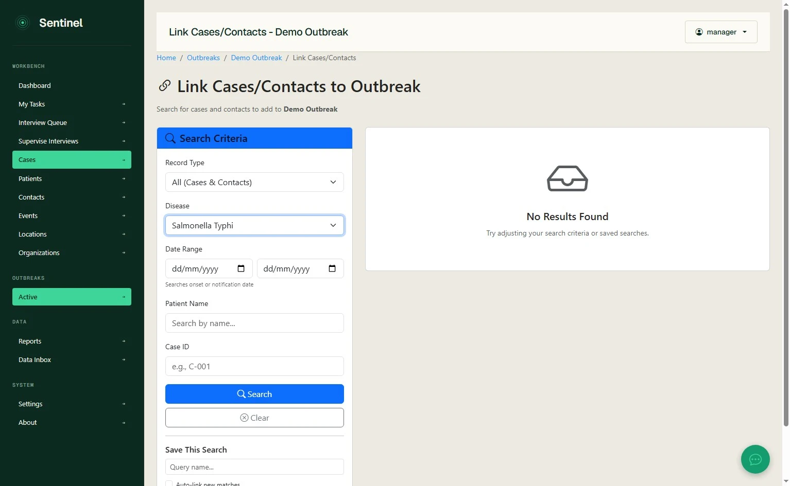
*Search for existing cases and contacts rather than re-entering their information.*

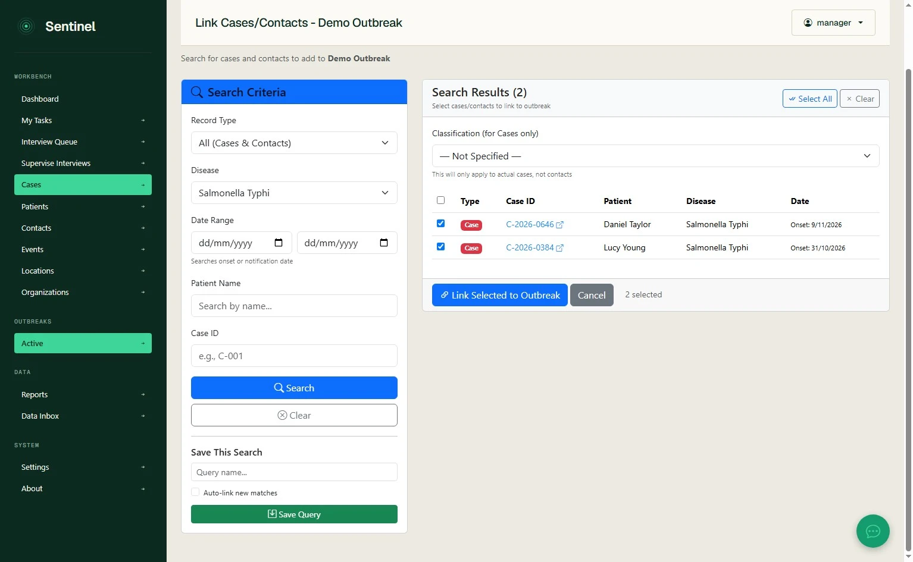
*Review selected records before linking them. The saved-search controls are at the bottom of the left panel.*

**Optional: save the query for ongoing surveillance.** Enter a **Query name** under **Save This Search** and click **Save Query**. Tick **Auto-link new matches** only where future records meeting the search criteria should be linked automatically. Review the search criteria carefully before enabling this option.

> **Important:** The **Classification (for Cases only)** field on this screen applies only to cases, not contacts. Outbreak-specific case definitions and classification can also be managed separately using the next steps.

## 3. Create outbreak-specific case definitions

1. Return to the outbreak record. Open the **More Actions** menu beside the edit controls.
2. Select **Case Definitions**.
3. Select **Create Definition** under the appropriate category: **Confirmed**, **Probable**, **Suspect** or **Not a Case**.
4. Enter a **Definition Name** and **Definition Text**. Optionally include measurable **Criteria Rules** using **Add Criterion**, and additional **Notes** or references.
5. Click **Save Definition**. Repeat for other categories as needed.
6. Return to the outbreak record using **Back to Outbreak**.

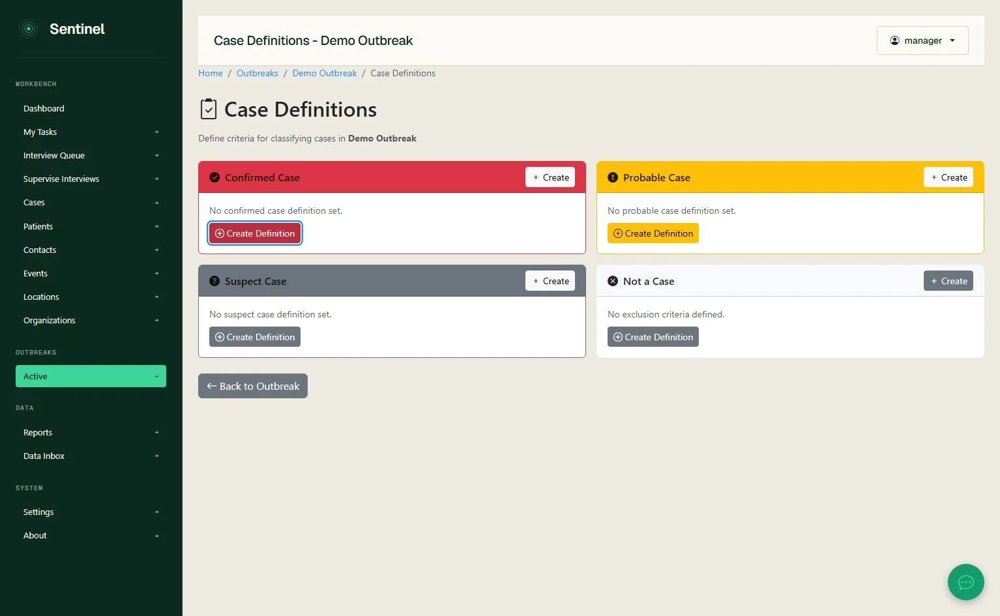
*Separate definitions can be maintained for each outbreak case-classification category.*

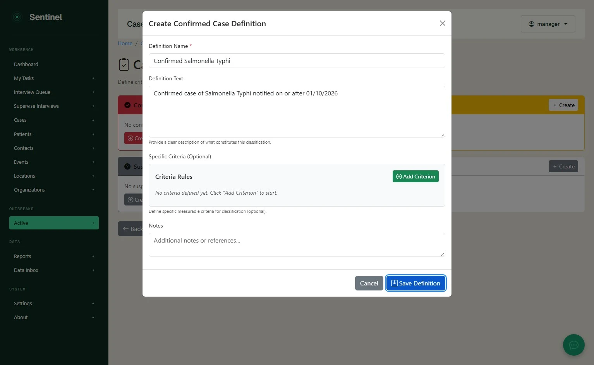
*The definition form includes free-text criteria, optional structured rules and notes.*

**Clinical governance:** Use case definitions approved for the outbreak investigation. Text entered in the demo is illustrative and should not be treated as an official communicable disease case definition.

## 4. Classify the linked cases

1. On the outbreak record, select **Classify Cases**.
2. Review the active case definition and the **Unclassified Cases** list.
3. To classify a single case, select **Classify** beside the case, choose the appropriate category and confirm.
4. To give several cases the **same** classification, tick the relevant records, select **Bulk Classify**, choose a classification and confirm using **Bulk Classify** in the dialog.
5. Check the **Summary** and classification list to verify the result.

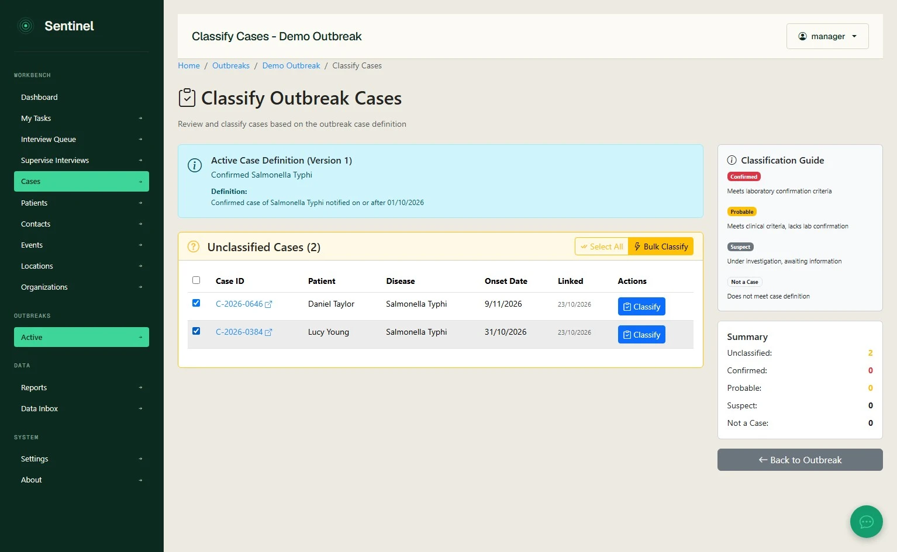
*Individual and bulk classification controls appear in the case classification screen.*

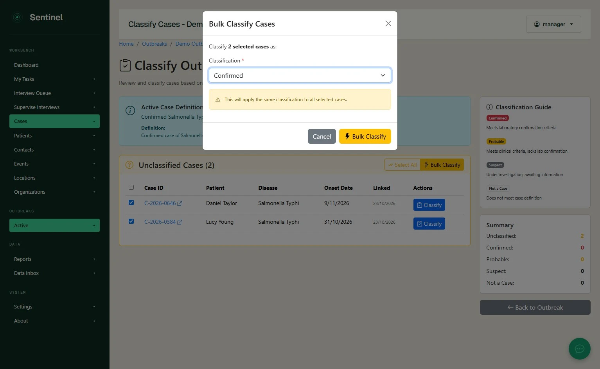
*Bulk classification applies one selected category to every selected case. Check the selection before confirming.*

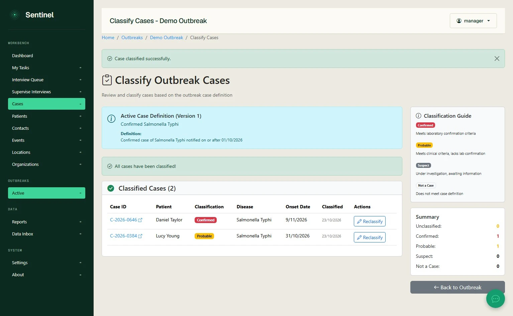
*Review classifications after applying them.*

> **Capture limitation:** In the source recording, the bulk-classification dialog is opened but then cancelled; the confirmed end state is achieved using individual **Classify** actions. The bulk confirmation workflow is visible but not fully demonstrated in this capture.

## 5. Add an investigation timeline event

1. From the outbreak record, select the **Timeline** tab.
2. Click **Add Event**.
3. Enter the required **Event Title** and **Event Date & Time**. Provide a **Description** if needed, and choose an **Event Type** (for example, **General Note**).
4. Select **Add Event** and verify that the entry appears in the investigation timeline.

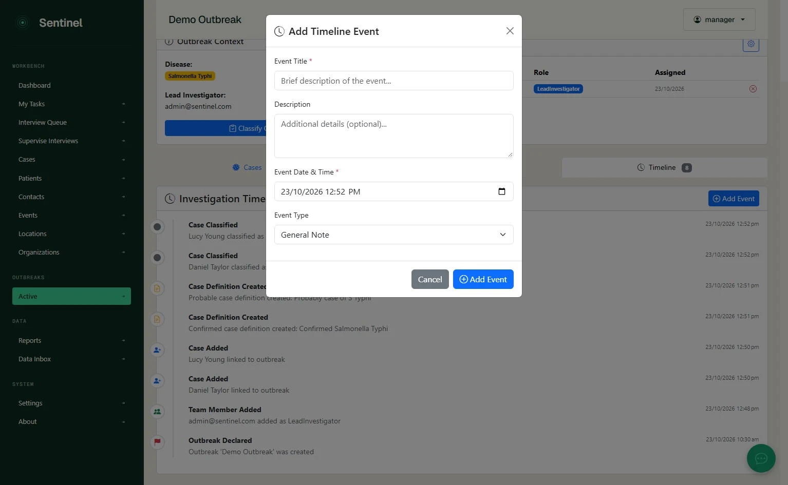
*Document a meeting, decision or other investigation milestone.*

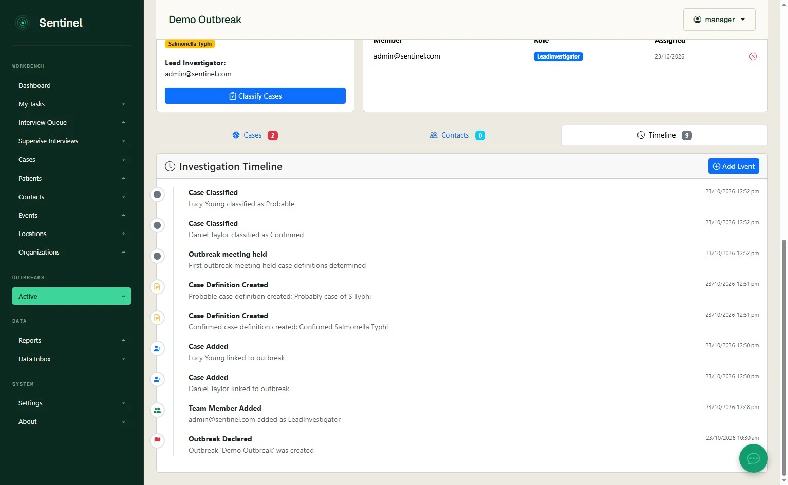
*The outbreak timeline also displays key automatically recorded activity.*

## 6. Manage the investigation team

1. Locate the **Investigation Team** section on the outbreak record.
2. Select the **settings/gear** icon to open **Manage Investigation Team**.
3. Under **Add Team Member**, select the **User** and their **Role**.
4. Click **Add to Team**. Verify the person appears in **Current Team Members** with the intended role.
5. Use **Back to Outbreak Details** to return to the investigation.

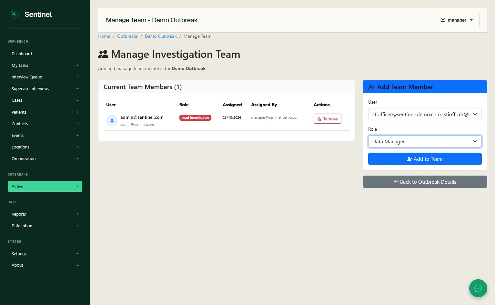
*Choose a user and their investigation role before adding them to the team.*

> **Capture limitation:** The recording shows the user and role selection, but does not show a completed **Add to Team** action or its success state.

## Verify your setup

Before handing the investigation to others, confirm the correct disease and lead investigator, that the intended cases are linked, that definitions reflect current outbreak criteria, and that classified cases, timeline entries and team members are visible. If a saved query uses automatic linking, confirm its scope.

---

*Prepared from a Mimik interaction recording on `demo.sentinelsurveillance.app`. This guide is an edited interpretation of the recorded interface, not an independent live acceptance test.*
