# Create or edit demographics

Including Language, Gender, Sex At Birth, Ancestries, Countries, States, Aboriginal or Torres Strait Islander Status.

Sentinel will default seed a number of demonstration values for most demographic fields, you can alter this in the Lookup Data Seed Service (the seeder service will only seed data to an empty table) https://github.com/christianpeut95/Sentinel/blob/master/Sentinel/Services/LookupDataSeedService.cs

*14 steps · Created Oct 16, 2026 · Source: demo.sentinelsurveillance.app*

---

## Step 01: Click link "Settings →"

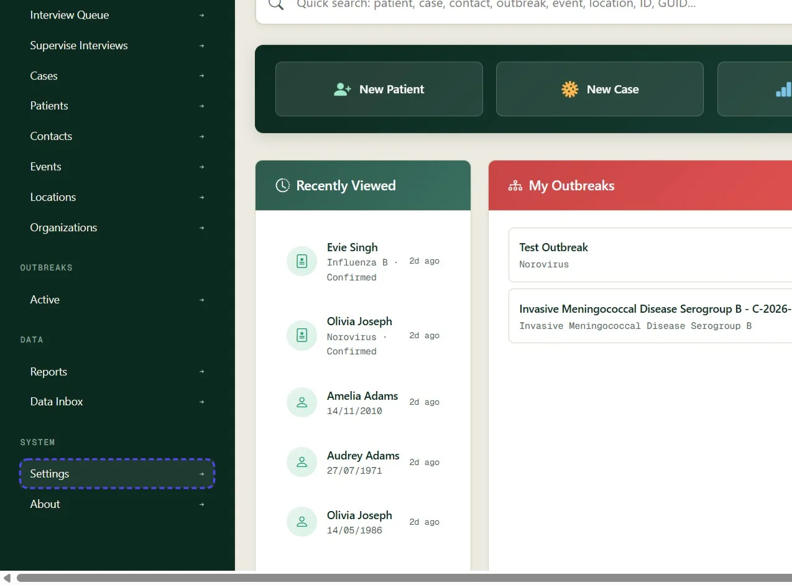

## Step 02: Click link "Demographics"

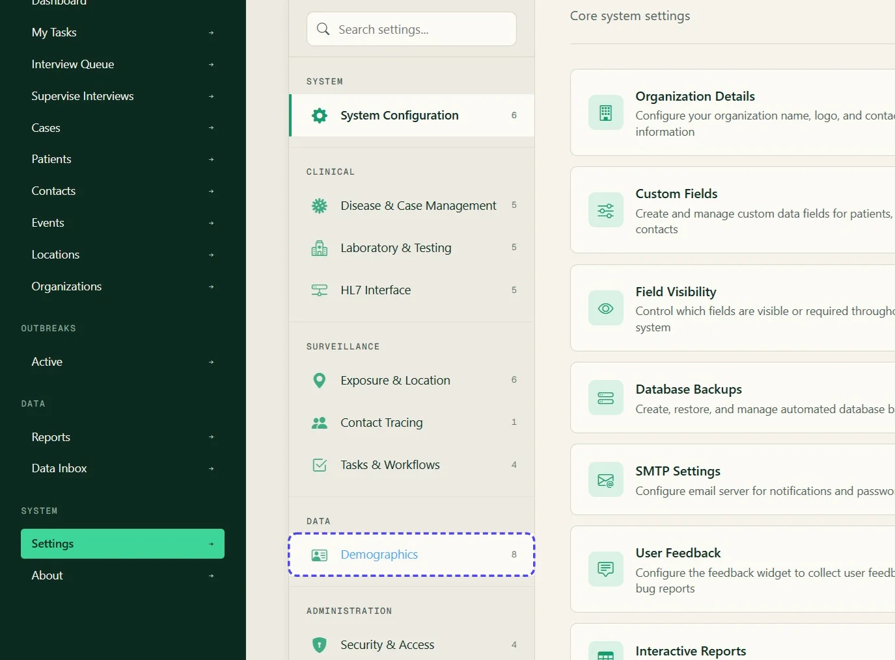

## Step 03: Click  "States" or the demographic you would like to update

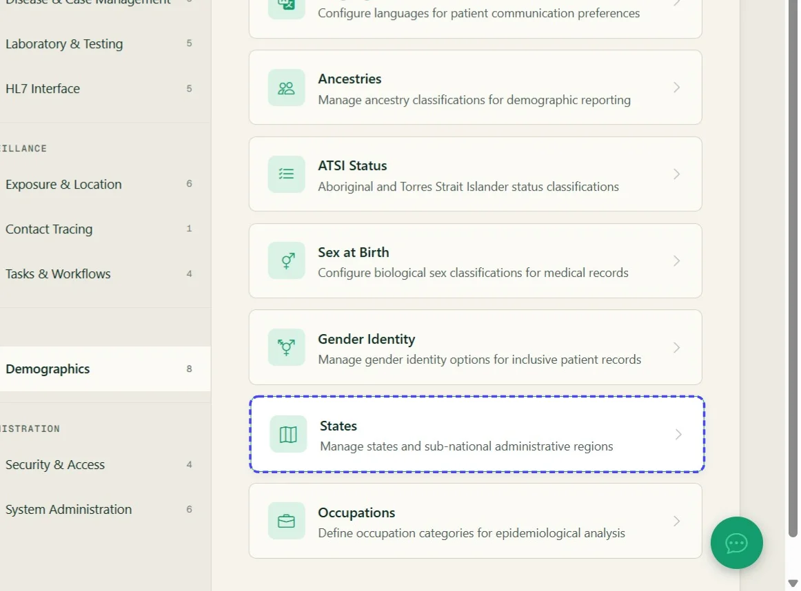

## Step 04: Review the existing demographic values

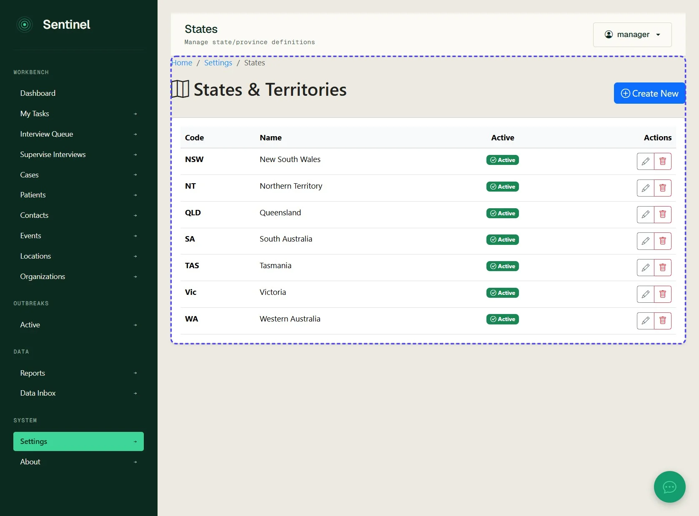

## Step 05: Click link "Create New"

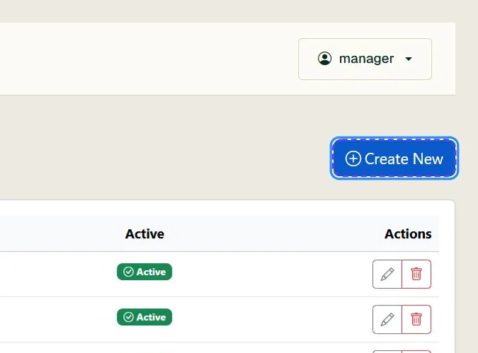

## Step 06: Enter the short or export code

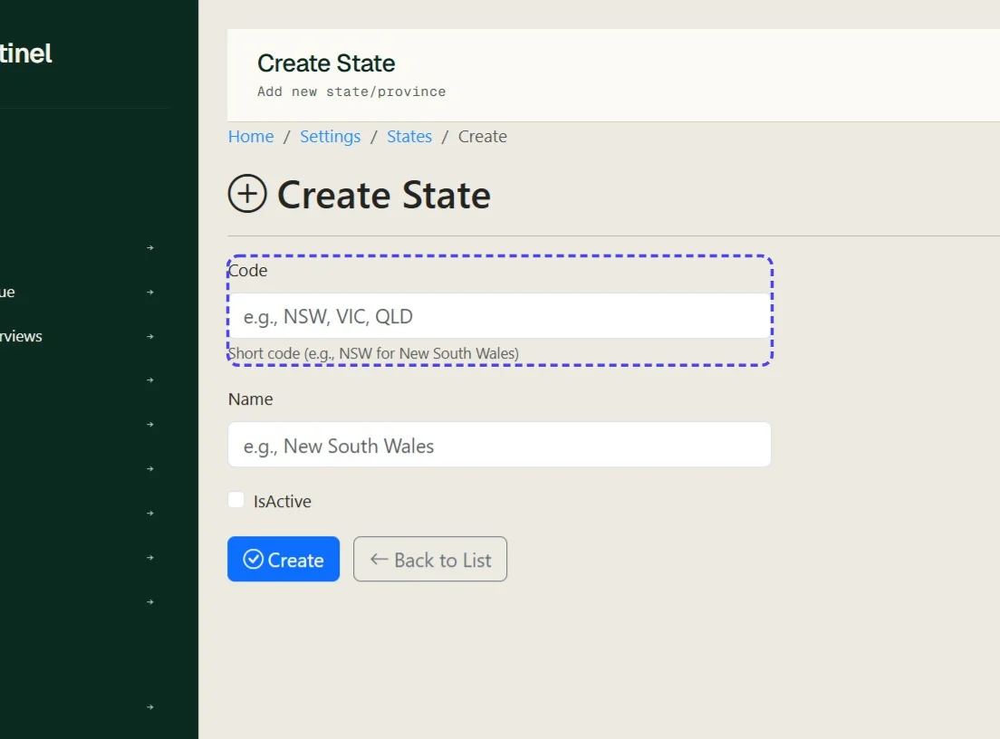

## Step 07: Type into text field e.g., NSW, VIC, QLD

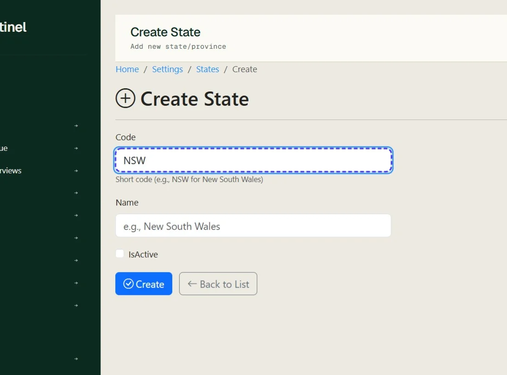

## Step 08: Mark IsActive and click 'Create'

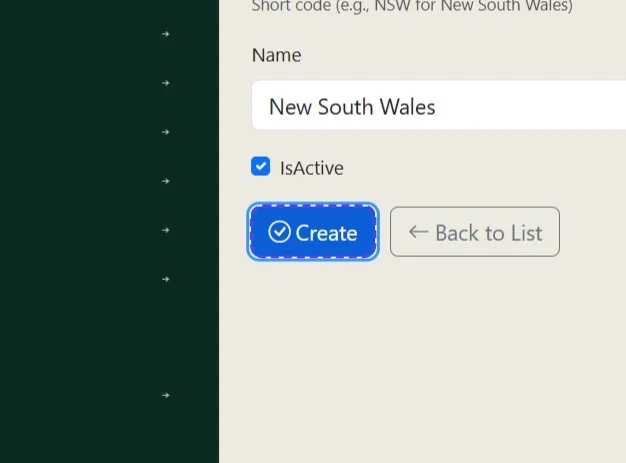

## Step 09: To Edit a demographic value

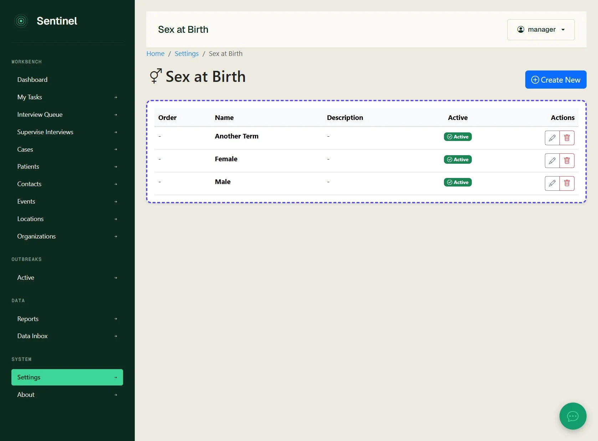

## Step 10: Click the pencil icon

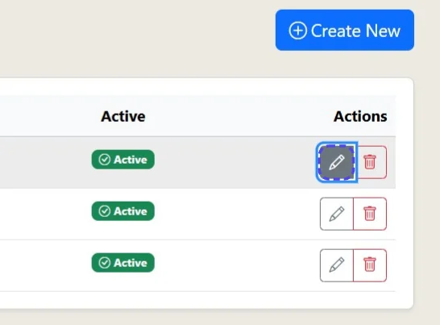

## Step 11: Edit as desired

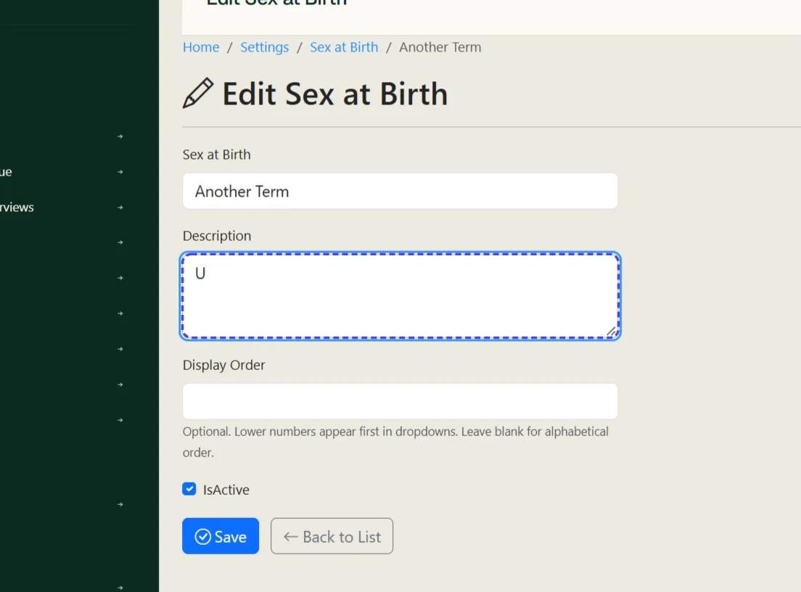

## Step 12: Update the description if required

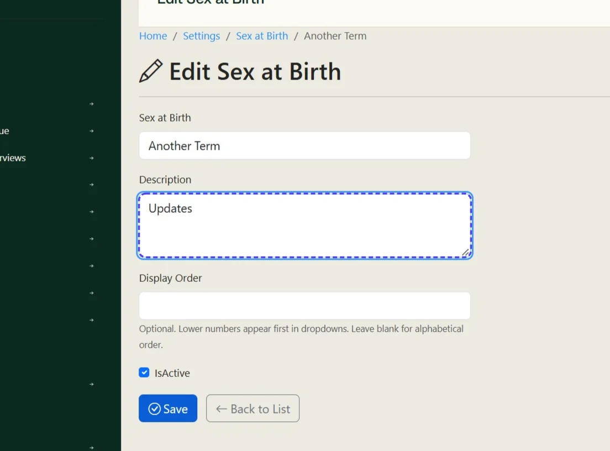

## Step 13: Click Save

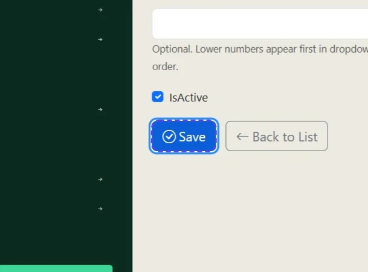

## Step 14: The field is updated

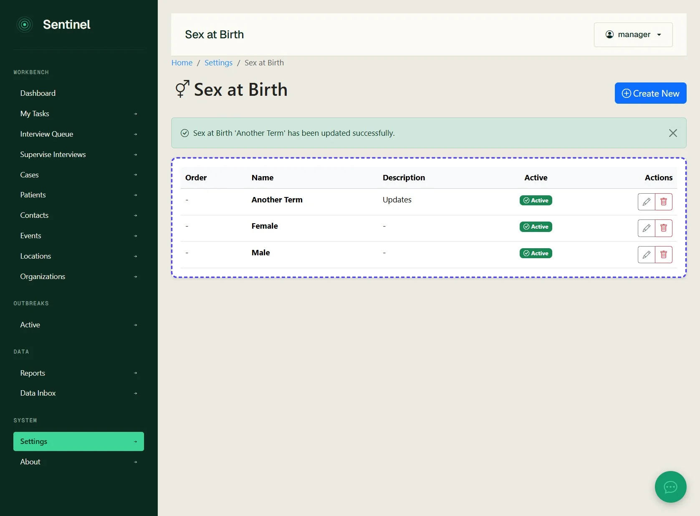
