# Creating a Case of a disease in Sentinel

This requires the database to have patients entered, and at least 1 disease entered

*15 steps · Created Oct 14, 2026 · Source: demo.sentinelsurveillance.app*

---

## Step 01: Click link "New Case"

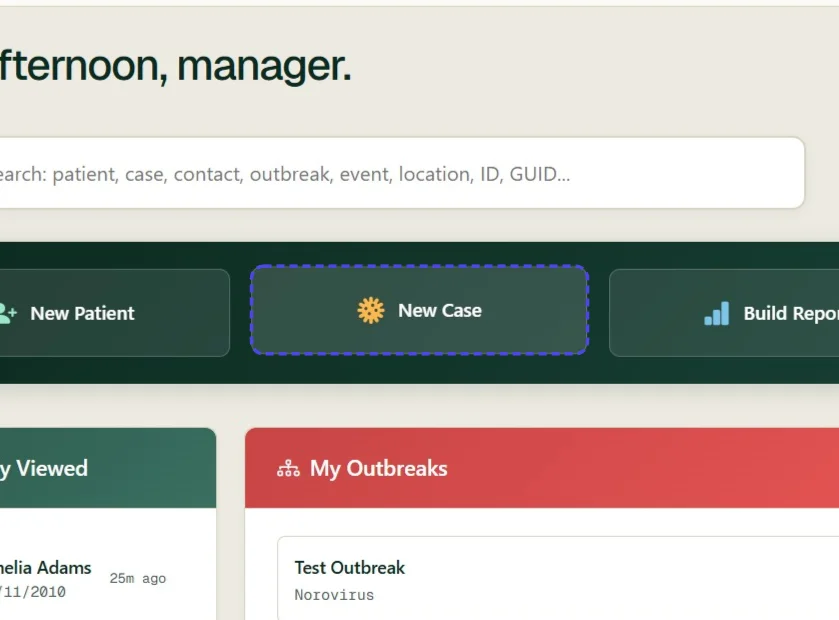

## Step 02: Search for the patient or create a new patient if the patient does not exist

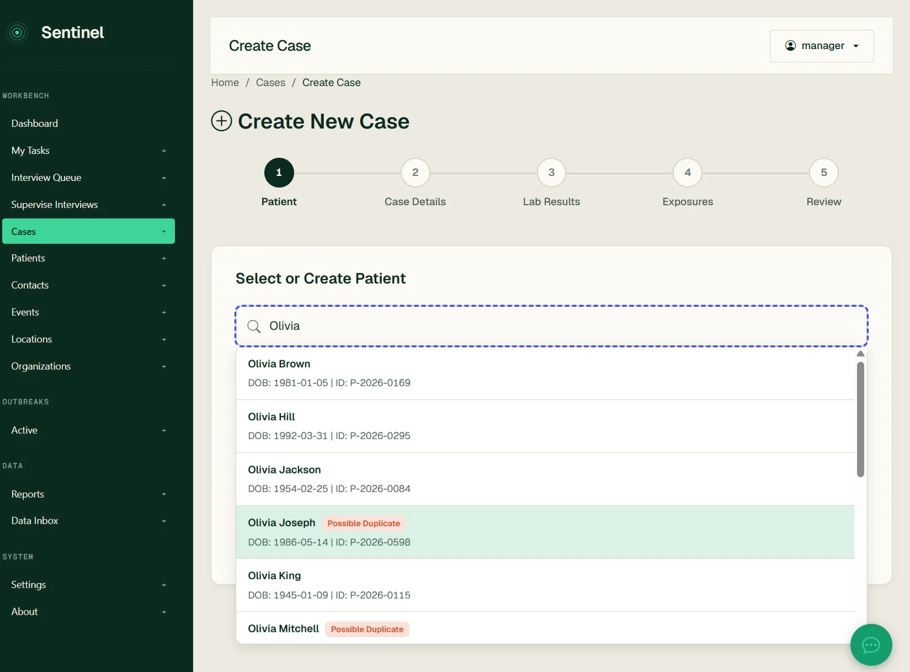

## Step 03: Review the patient details and update them if required before proceeding

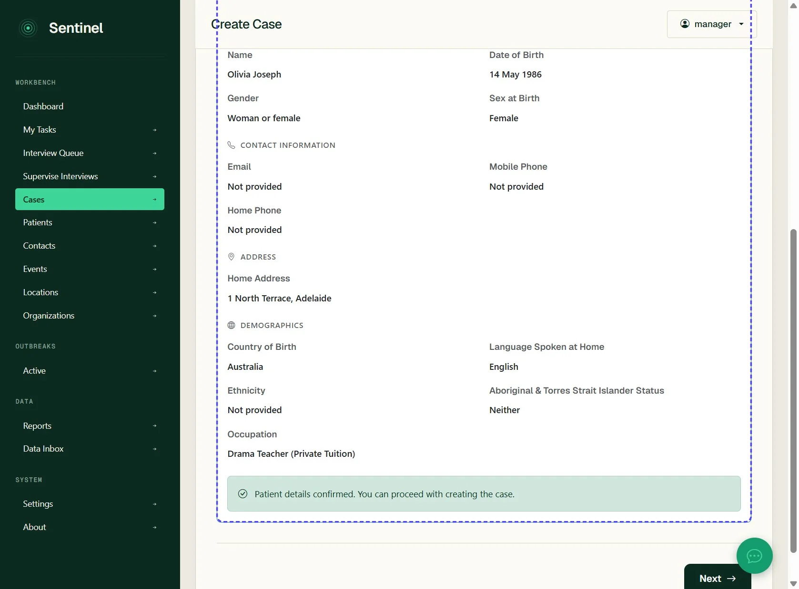

## Step 04: Click Next

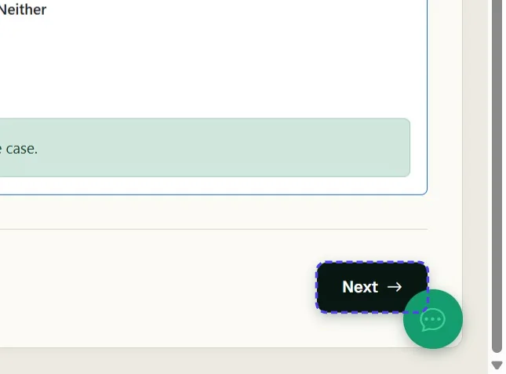

## Step 05: Click Type to search for diseases...

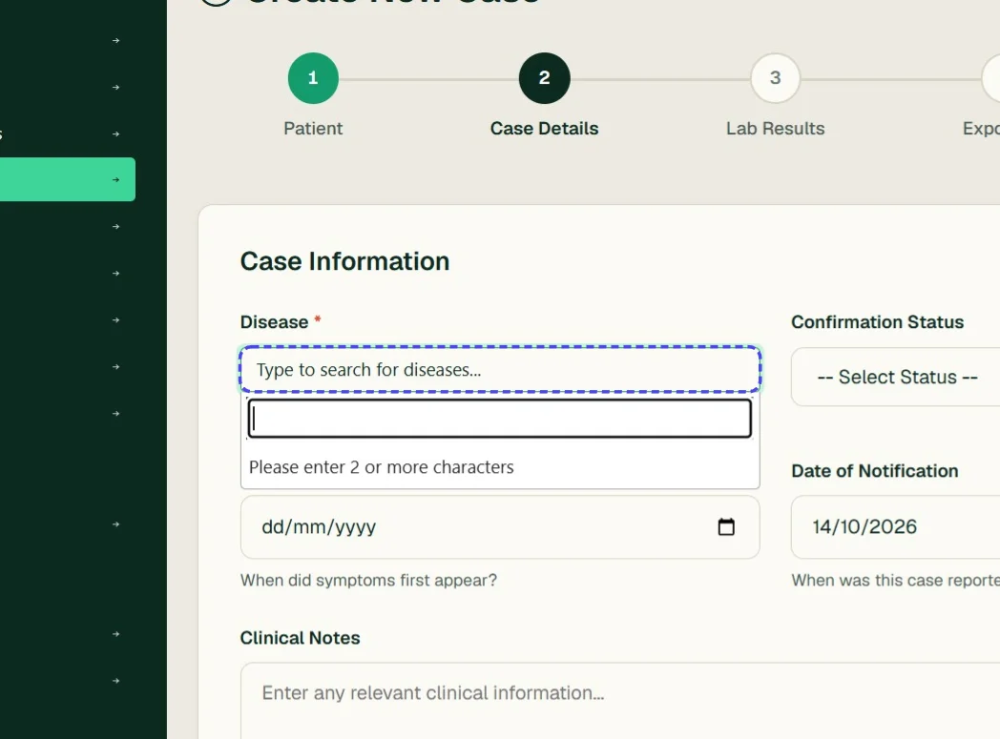

## Step 06: Enter the particular disease this is a case of

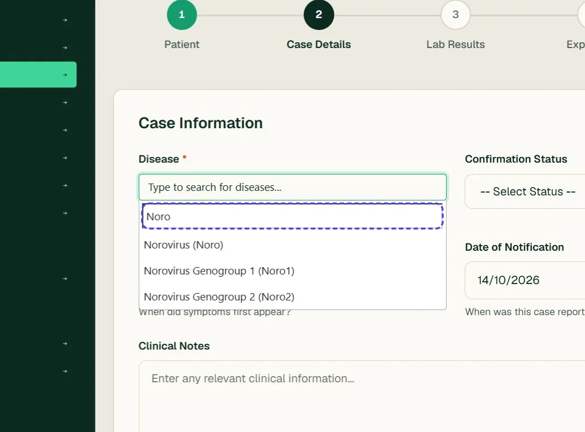

## Step 07: Select a confirmation status

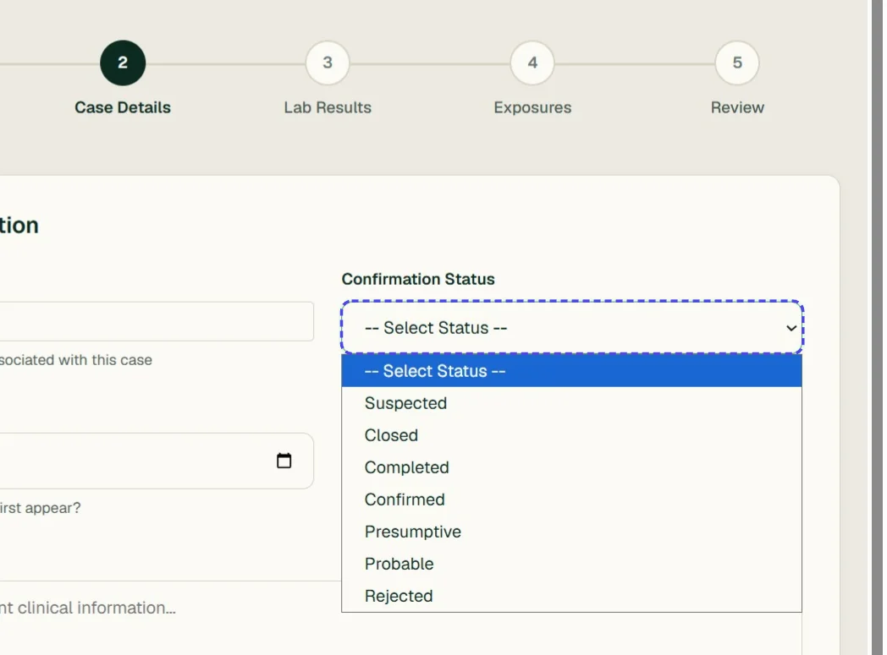

## Step 08: Enter a date of onset if known

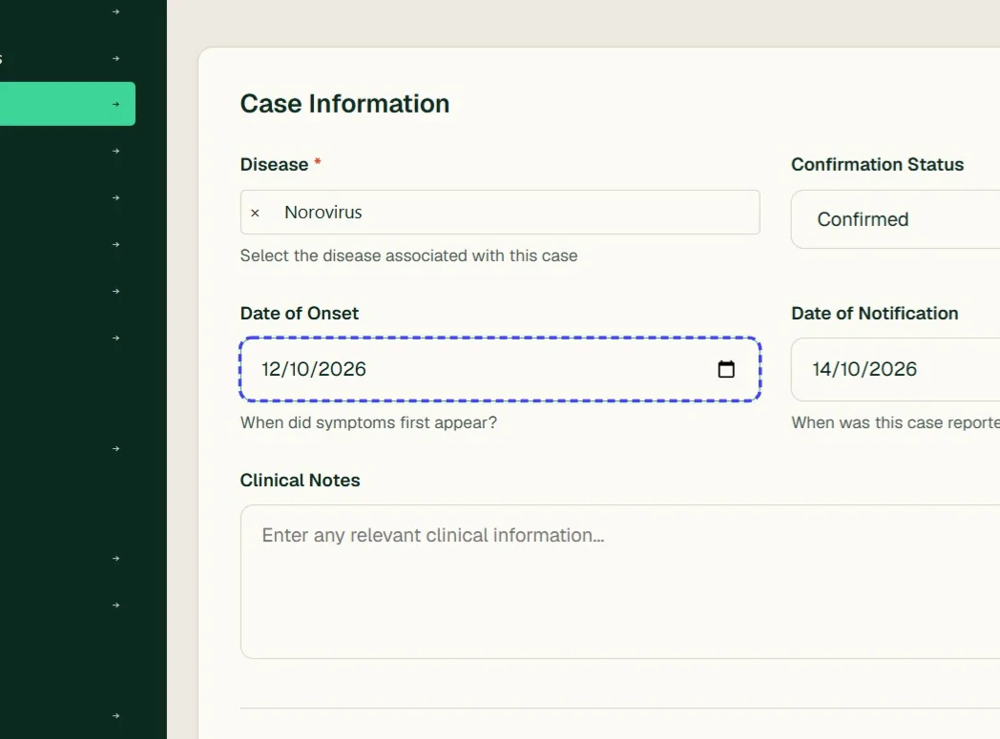

## Step 09: Click Next

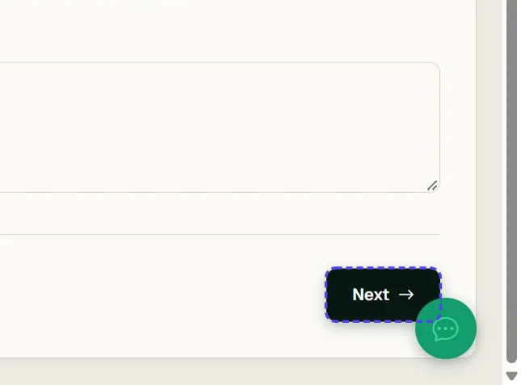

## Step 10: Optionally you can add laboratory results at the same time

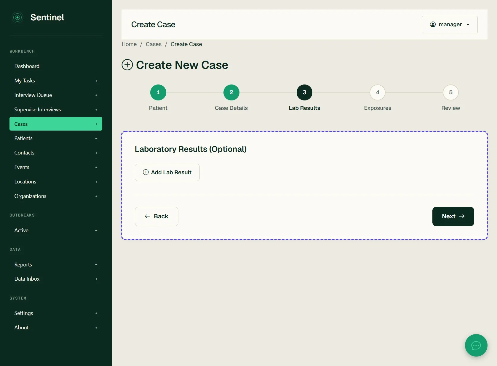

## Step 11: You can optionally add exposure information at the same time

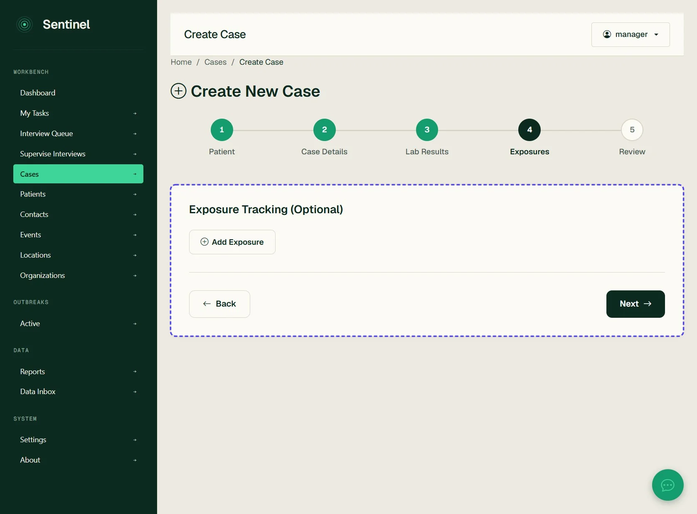

## Step 12: Click Next

## Step 13: Review the case details

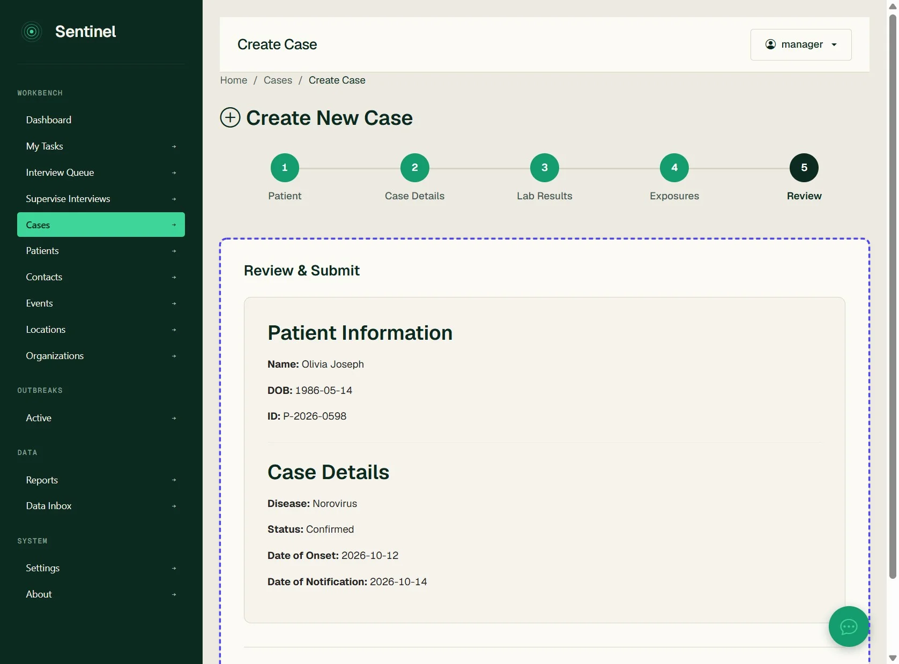

## Step 14: Click Create Case

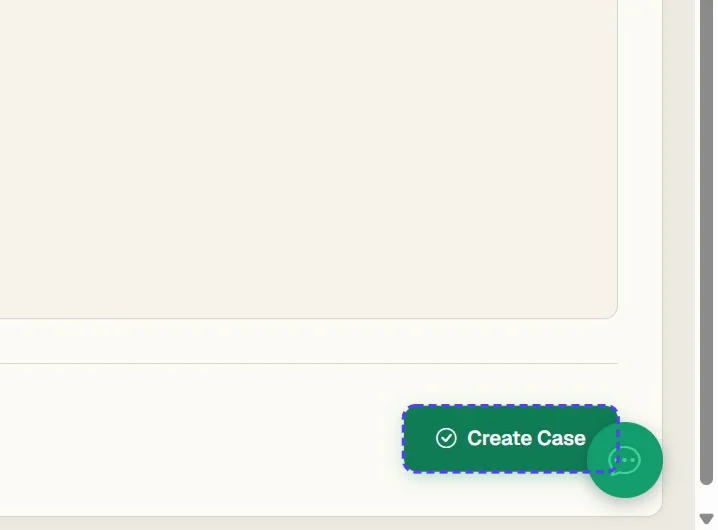

## Step 15: You are now displayed with the new case

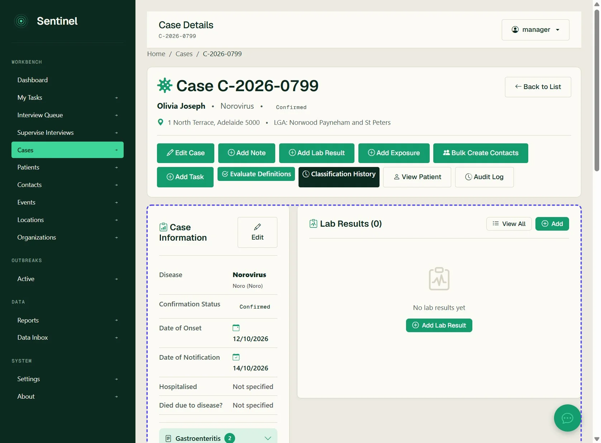
