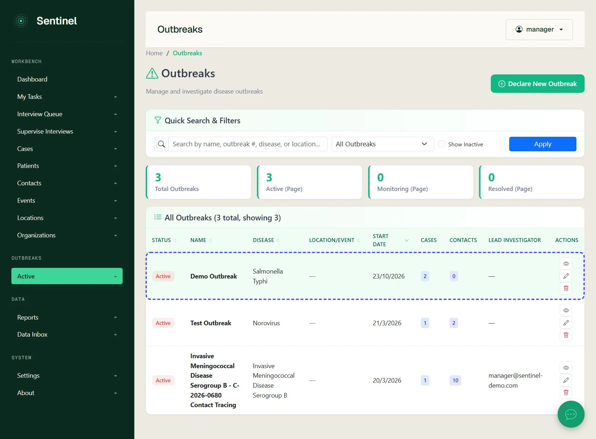
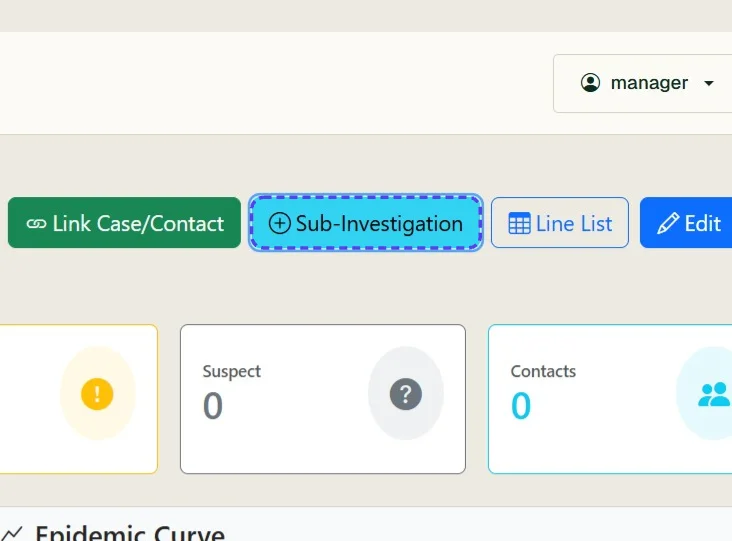
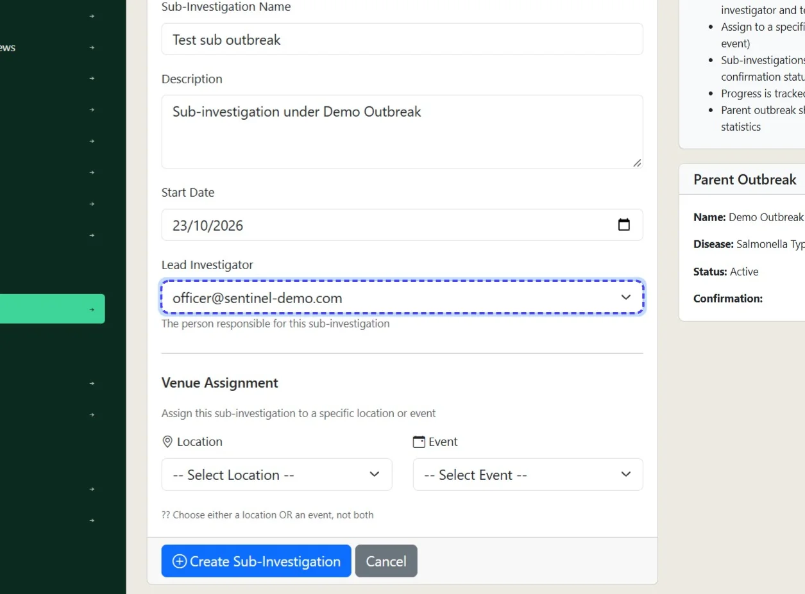
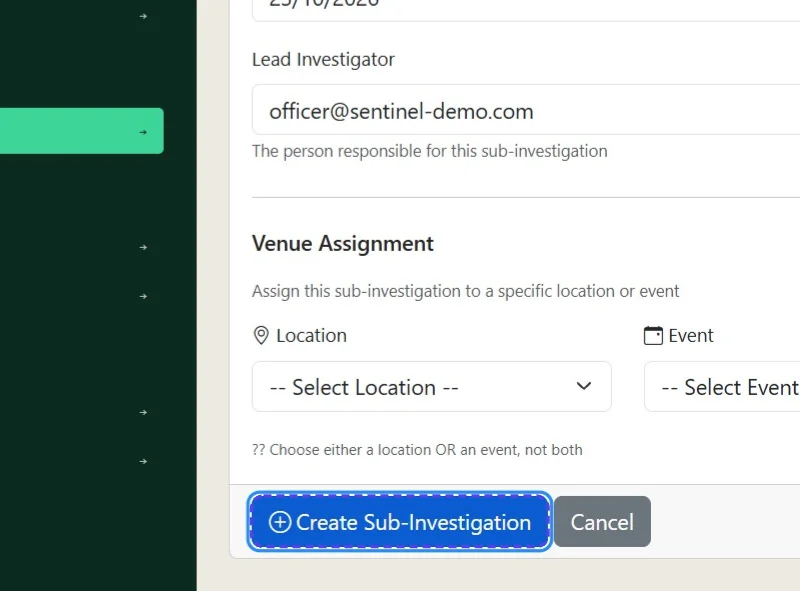
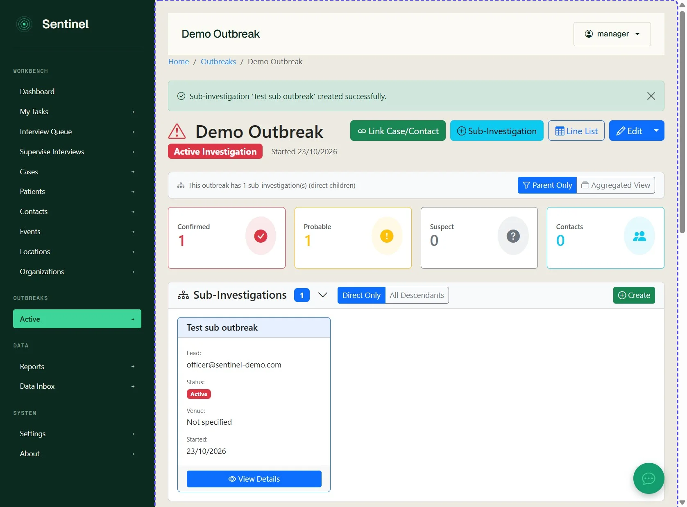
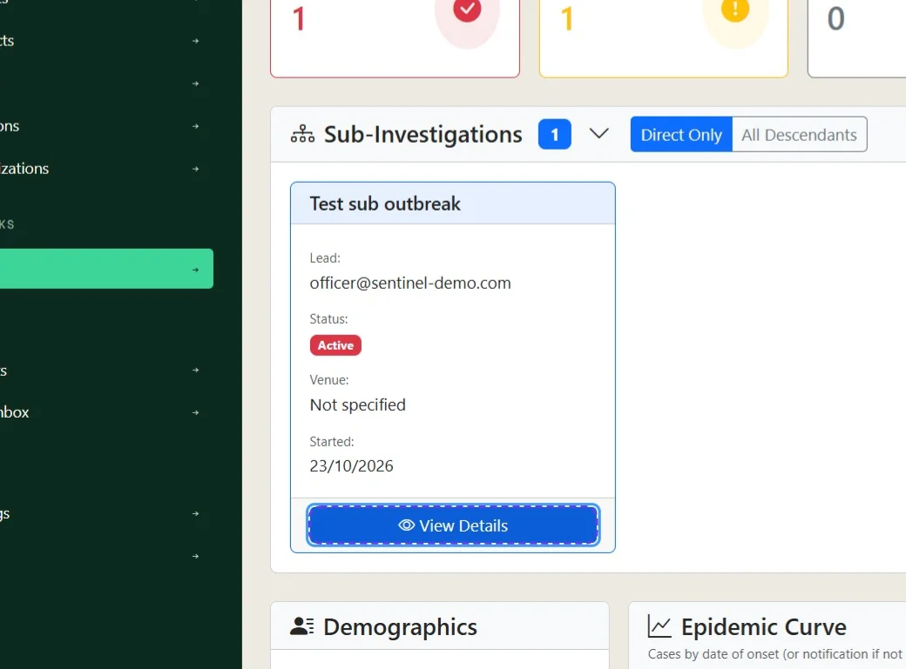
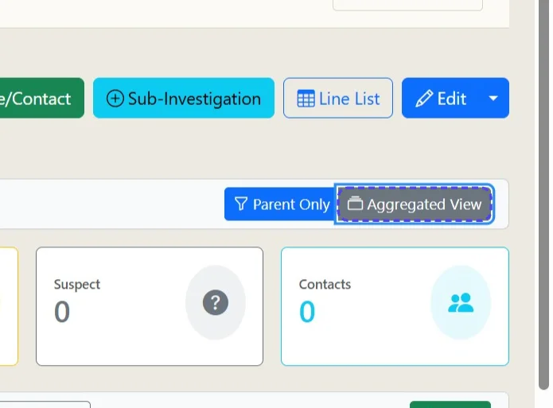
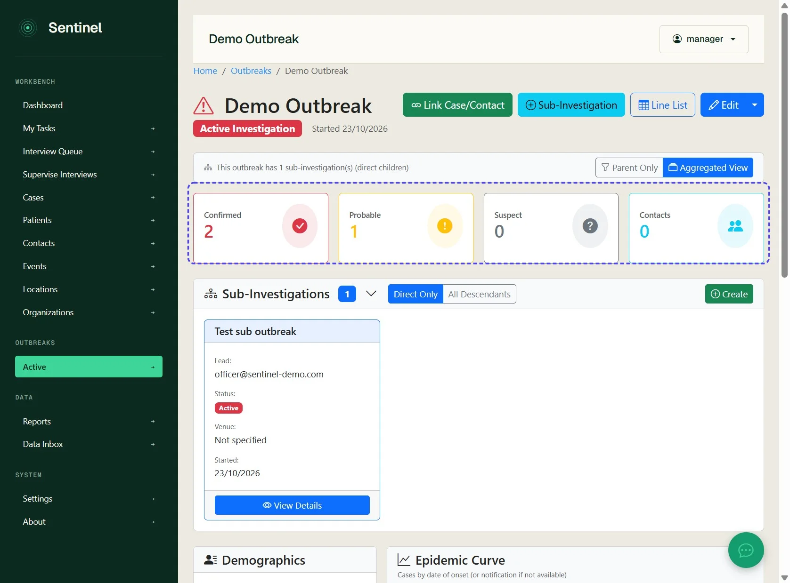

# Creating a sub-outbreak or investigation record

A Sub-outbreak or investigation may be required for logistic or record keeping purposes. For example a outbreak of Hepatitis A may initially occur in a food handler at a restaurant, however a subsequent outbreak may occur at multiple schools. Each investigation or outbreak may have separate individuals assigned to them, and may need independent reporting. The benefit of having sub-outbreaks or investigations is the ability to have overall visibility and reporting on multiple outbreaks or clusters and report on task status associated with them. You can create an unlimited number of sub outbreaks although for performance it is recommended not to exceed 3 generations.

A parent outbreak record can aggregate the cases and contacts of the sub investigation

*9 steps · Created Oct 23, 2026 · Source: demo.sentinelsurveillance.app*

---

## Step 01: From the dashboard, click Active under Outbreaks in the sidebar

## Step 02: On the Active Outbreaks page, open the outbreak

## Step 03: On the outbreak details page, click Sub-Investigation

## Step 04: Enter the details of the child investigation or outbreak, including the lead investigator

## Step 05: Click Create Sub-Investigation

## Step 06: On returning to the parent outbreak, review the Sub-Investigations panel

## Step 07: Choose direct descendants or all related generations

Click View Details to open a sub-outbreak. A child outbreak is managed in the same way as any other outbreak record.

## Step 08: At the top of the parent outbreak, click Aggregated View

## Step 09: Review the updated case counts at the top of the page

