# Edit or create confirmation status or case classification options

Update, edit or delete confirmation or case status options for case and contact records

*11 steps · Created Oct 14, 2026 · Source: demo.sentinelsurveillance.app*

---

## Step 01: Click link "Settings →"

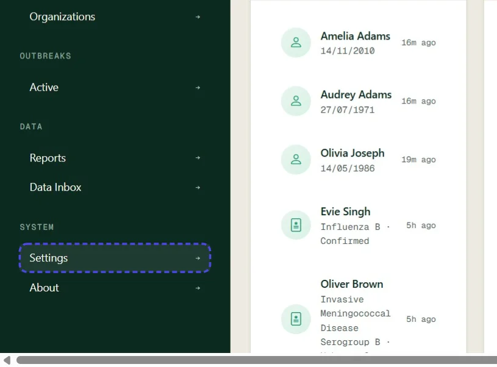

## Step 02: Click link "Disease & Case Management"

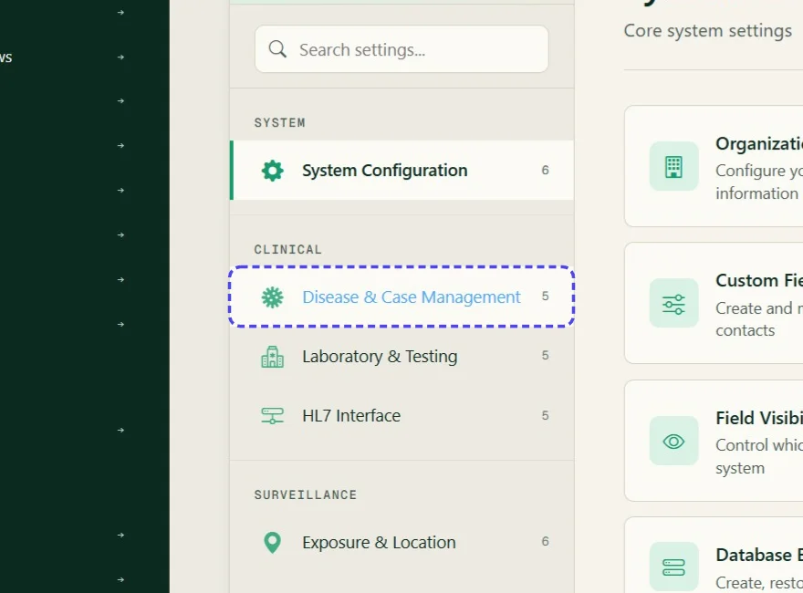

## Step 03: Click link "Case Statuses"

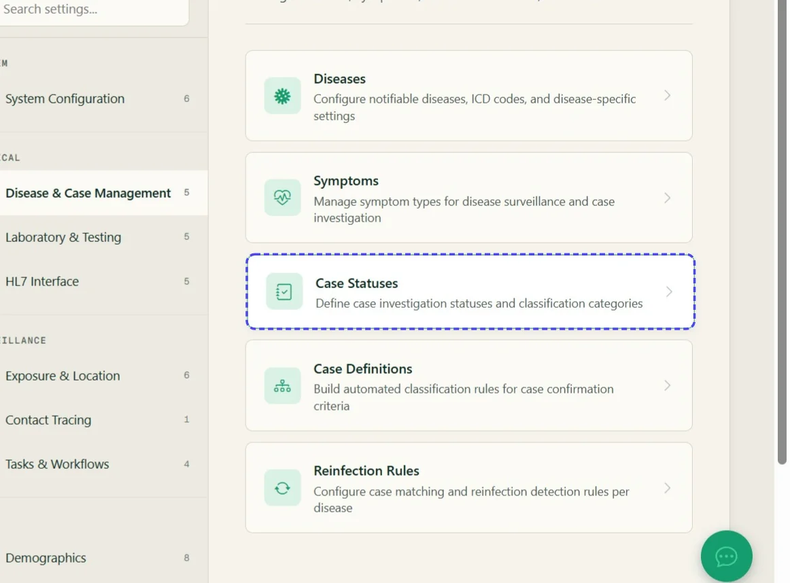

## Step 04: Click the pencil icon to modify an existing record

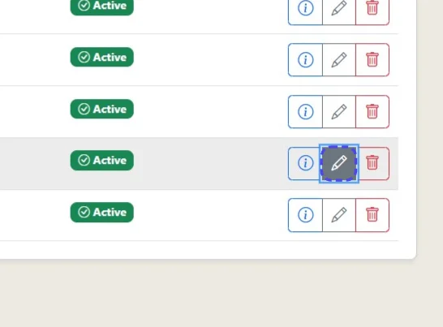

## Step 05: Make selected changes

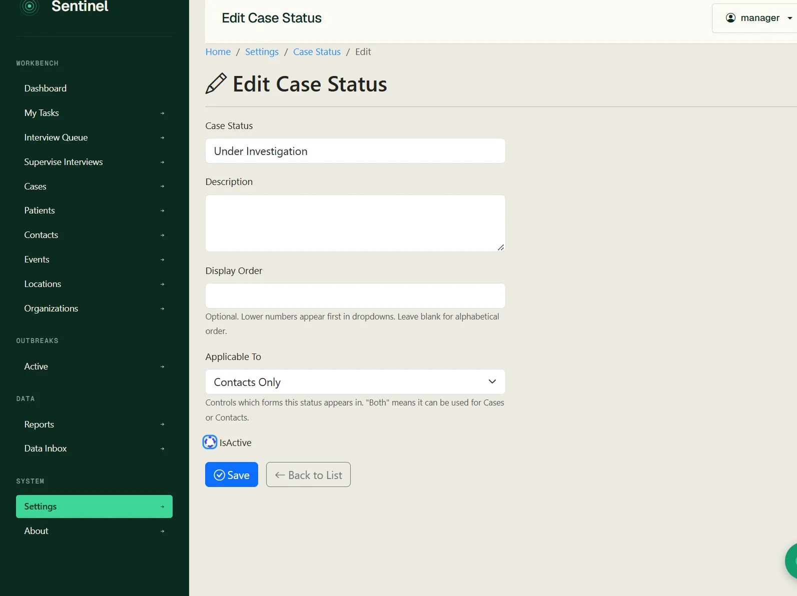

## Step 06: Click Save

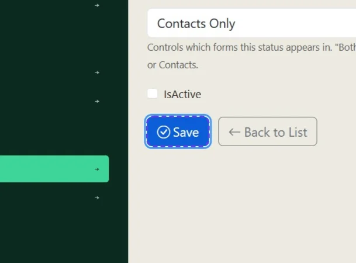

## Step 07: To create a new status option click 'Create New'

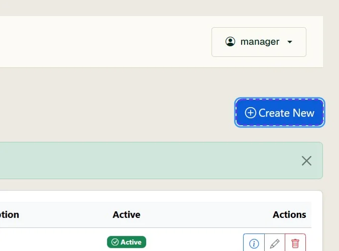

## Step 08: Enter applicable details

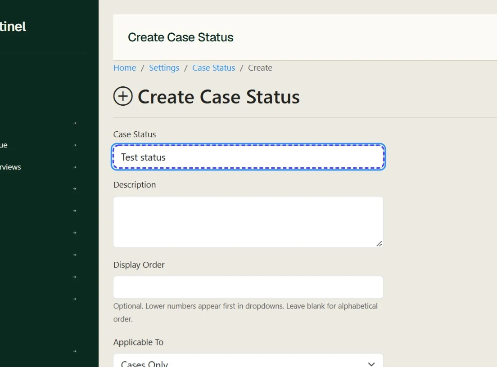

## Step 09: Choose where this status is applicable

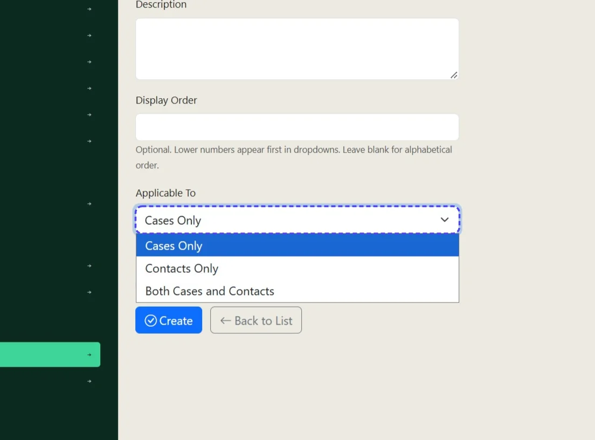

## Step 10: Select IsActive if it is ready to be used

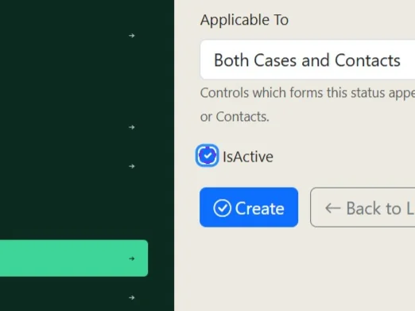

## Step 11: Click Create

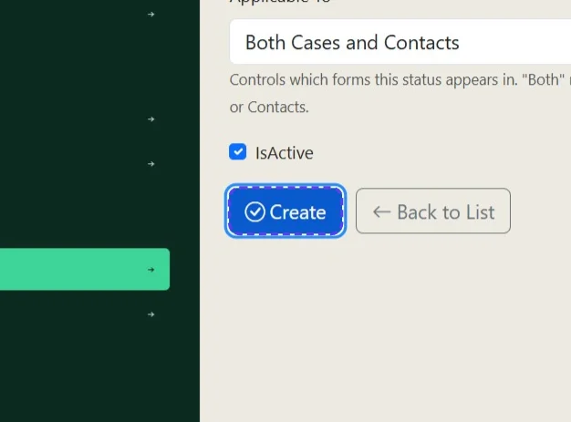
