# Editing a survey in the Survey Designer

*17 steps · Created Oct 23, 2026 · Source: demo.sentinelsurveillance.app*

---

## Step 01: On the Survey Templates page, click the pencil icon for the survey to open the Survey Designer

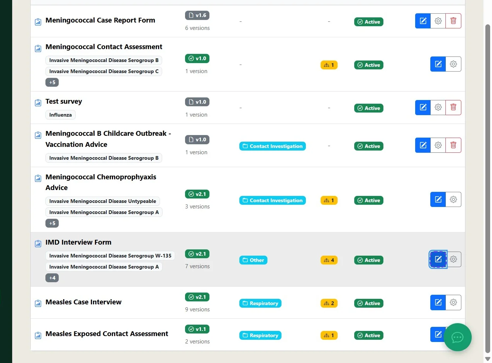

## Step 02: Use the Field Reference panel on the right to find fields to include in the survey

To display a field value in question text, wrap its name in curly brackets, for example `{patient_given_name}`.

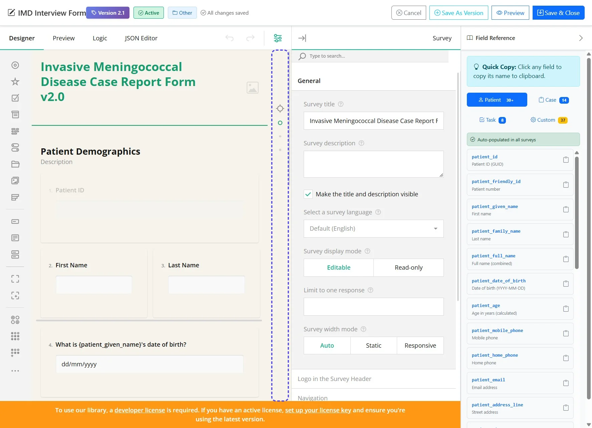

## Step 03: Set the Question name to prefill a field

Select the question and enter the field name in Question name without curly brackets, for example `patient_friendly_id`. When the operator opens the survey, the field value will prefill.

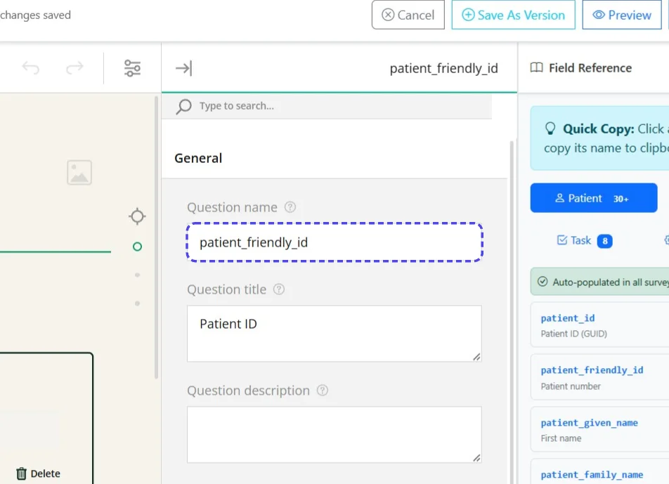

## Step 04: Click the date-of-birth question to edit it

The example uses `What is {patient_given_name}'s date of birth?` as the question text.

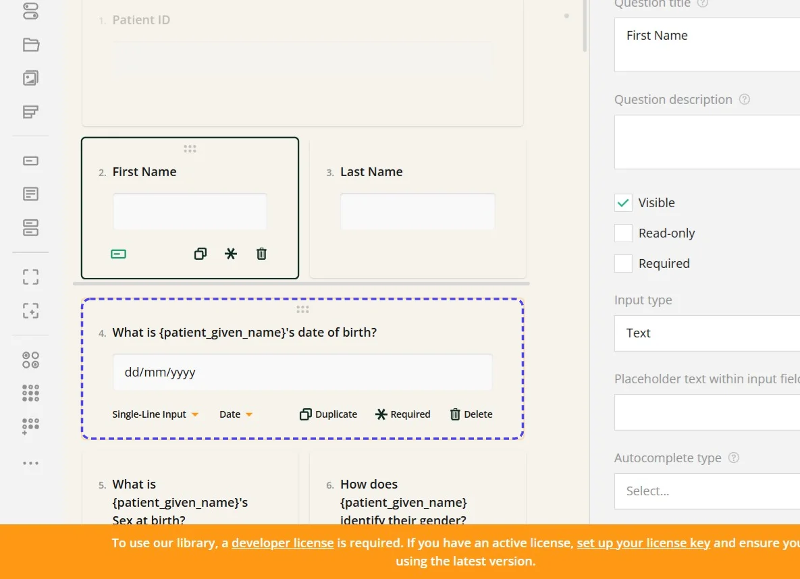

## Step 05: Use the question-type menu to change the input type

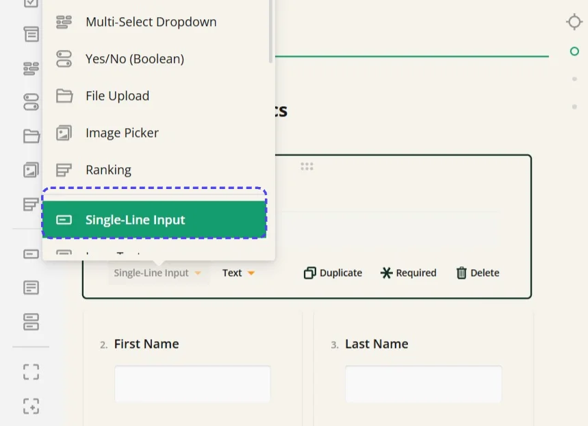

## Step 06: For the selected input type, choose the data type to be entered

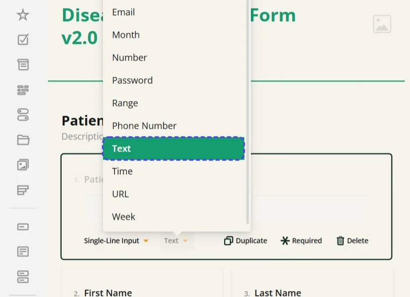

## Step 07: Add an Expression question for a calculation

Expressions can calculate values such as an earliest onset date or a period from entered dates. A hidden expression question can also provide a value for later calculations. See Expression basics below for the syntax.

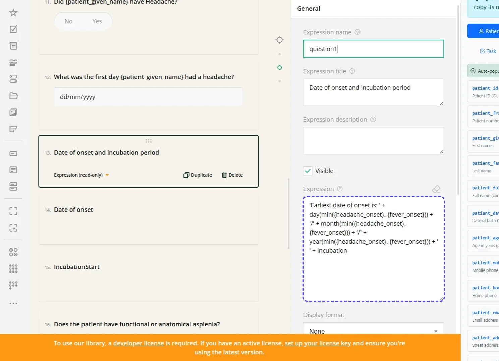

## Step 08: Add a dynamic question to collect a variable number of entries

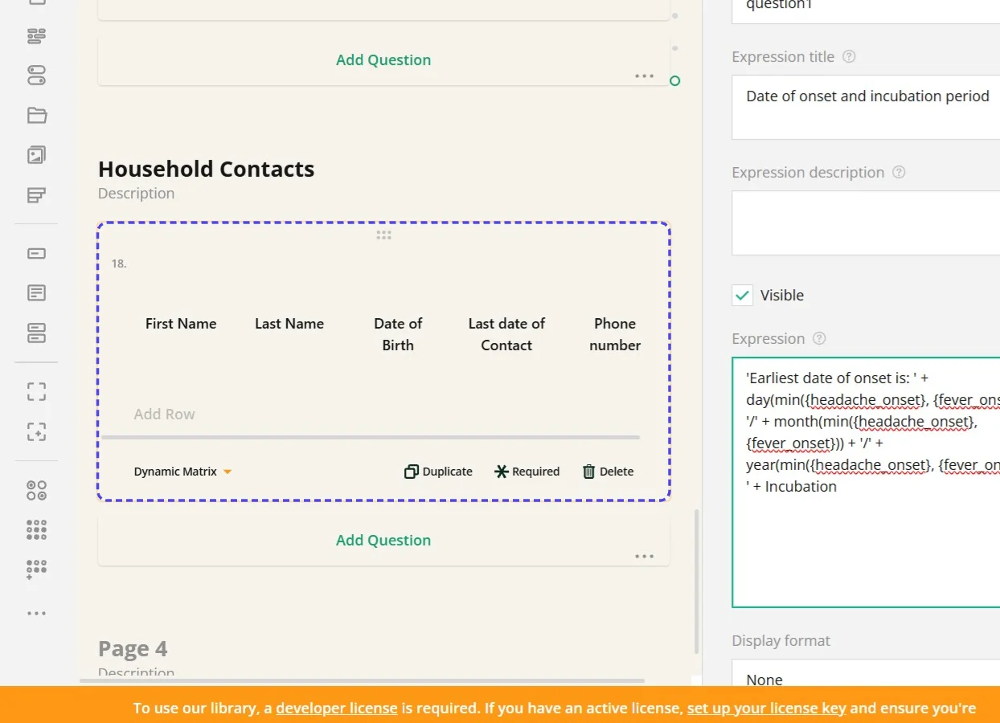

## Step 09: Click Preview to test the survey

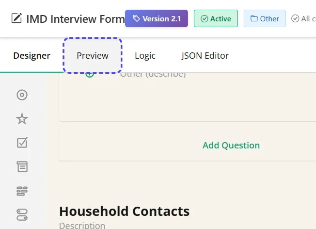

## Step 10: Review the survey in Preview

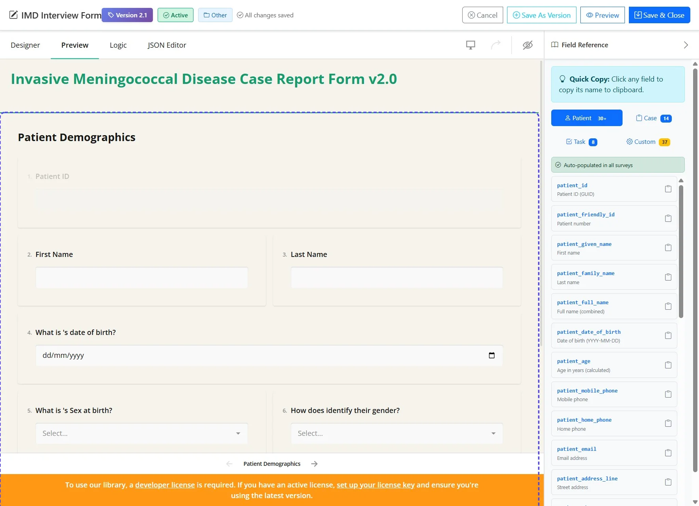

## Step 11: Open the Logic tab to review visibility, skip rules and other survey logic

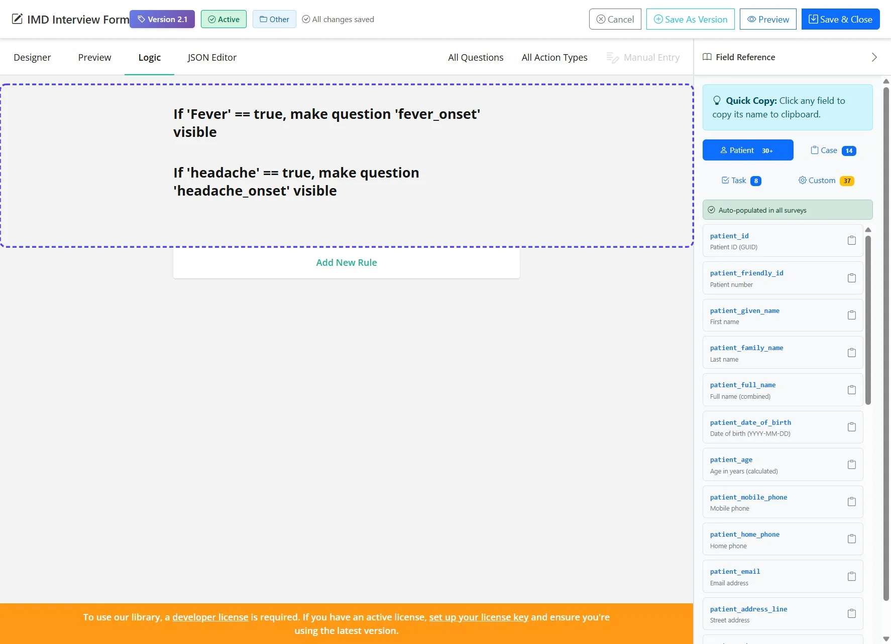

## Step 12: Open the JSON Editor tab to edit the survey definition

This can be useful when using generative AI to help produce a survey or convert a PDF or Word form.

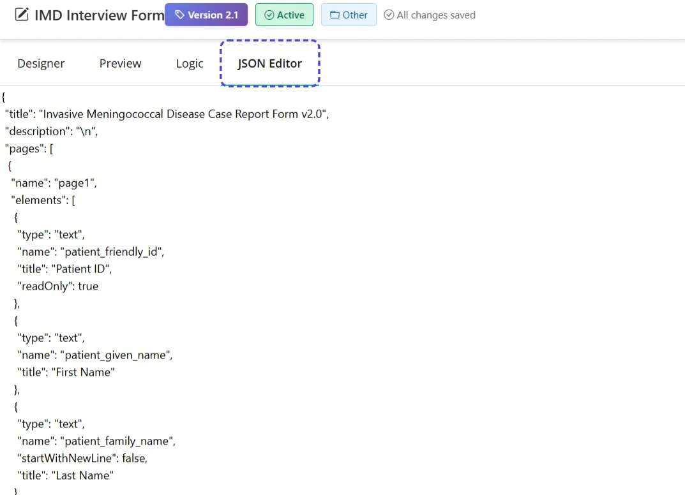

## Step 13: At the top of the designer, click Save As Version

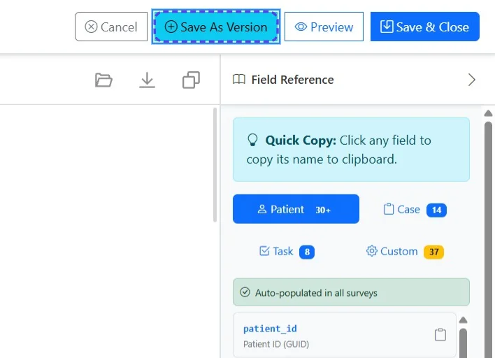

## Step 14: Enter a version number that differs from the current version

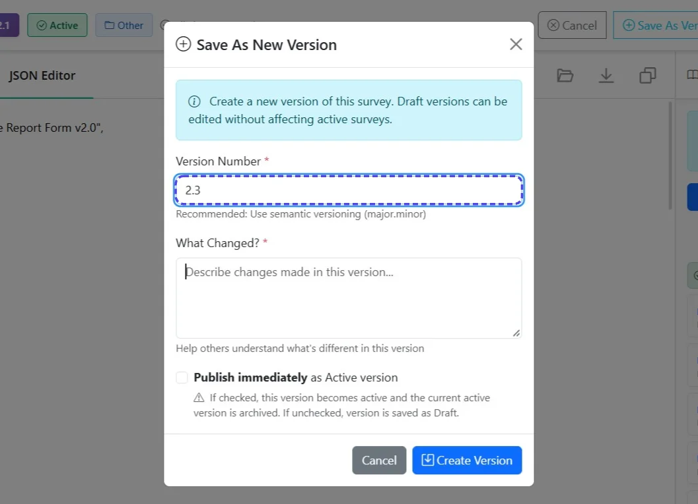

## Step 15: Enter a description of the changes

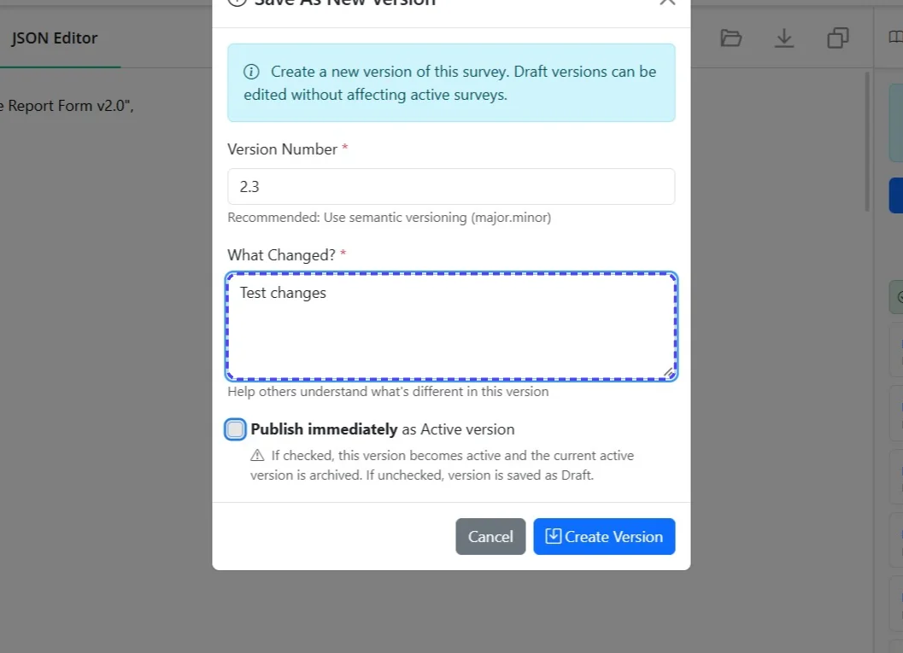

## Step 16: Select Publish immediately if this version should be used now

Tasks using the survey default to the latest published version.

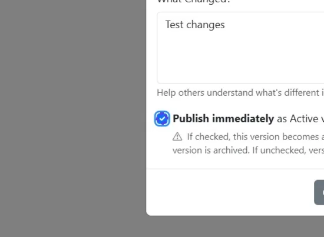

## Step 17: Click Create Version

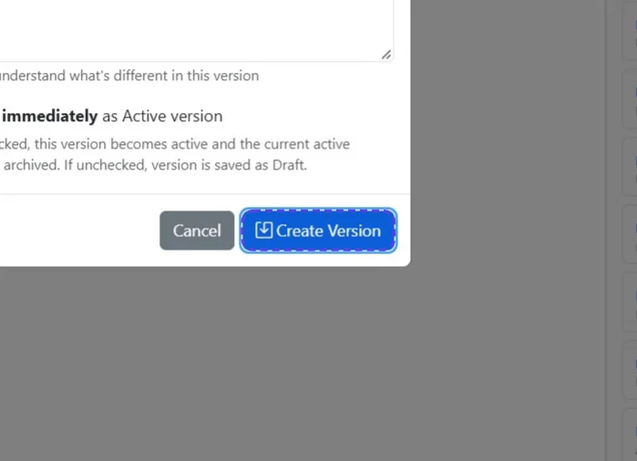

## Using the survey builder in detail

Review the [SurveyJS user guide](https://surveyjs.io/survey-creator/documentation/end-user-guide/user-interface) for the toolbox, question types, properties, pages and preview. Use the [display-logic guide](https://surveyjs.io/survey-creator/documentation/end-user-guide/form-display-logic) for conditional visibility and the Logic tab.

## Expression basics

Use `{question_name}` to refer to a question's value, using its Question name rather than its title. Put text values in single quotes; numbers and `true` or `false` do not need quotes. Comparisons are case-sensitive.

| Expression | Use |
| --- | --- |
| `{fever} = true` | True when the question named `fever` is checked. |
| `{fever_onset} notempty` | True when an onset value has been entered. |
| `{age} >= 18 and {consent} = true` | True when both conditions are met. Use `or` when either condition is enough. |
| `{total_days} + 1` | Add one to a numeric answer. |
| `iif({fever} = true, 'Yes', 'No')` | Return one value when a condition is true and another when it is false. |

To show a follow-up question only when fever is checked, select the follow-up question, open Conditions and enter `{fever} = true` in Make the question visible if. The magic-wand button opens the visual condition builder. Use an Expression question for a calculated value and test the result in Preview before publishing.

Replace the example names with the names used in your survey. See [SurveyJS expression syntax](https://surveyjs.io/survey-creator/documentation/end-user-guide/expression-syntax) for operators, date functions and calculations in dynamic questions.
