# Import ABS occupations into Sentinel

Download the latest ANZSCO occupations from the Australia Bureau of Statistics (ABS). The Excel file for upload will need modification if downloaded straight from the ABS. Upload only sheet 5 after you delete the header rows (i.e import only data rows). Save sheet 5 only as an XLSX.

*12 steps · Created Oct 16, 2026 · Source: demo.sentinelsurveillance.app*

---

## Step 01: Click link "Settings →"

## Step 02: Click link "Demographics"

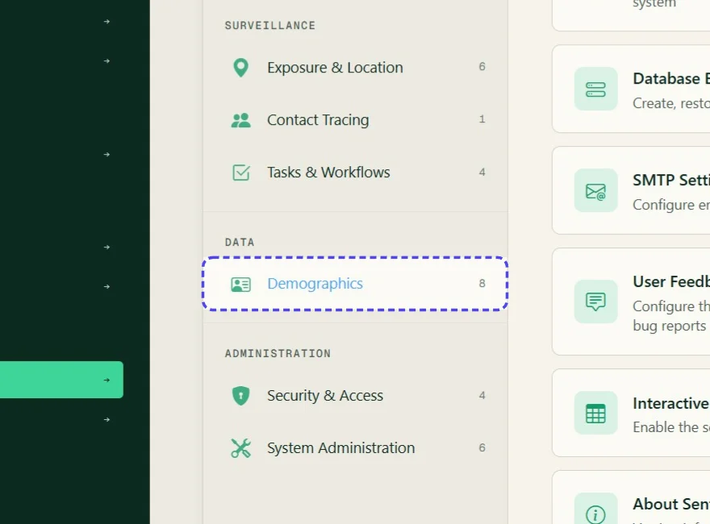

## Step 03: Click link "Occupations"

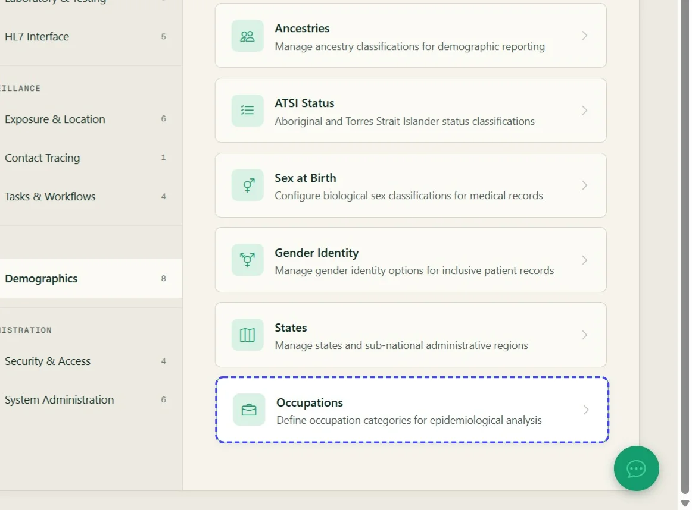

## Step 04: Click link "Upload Excel File"

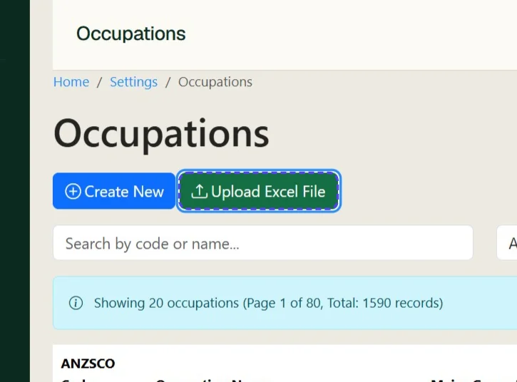

## Step 05: Click Classification structure

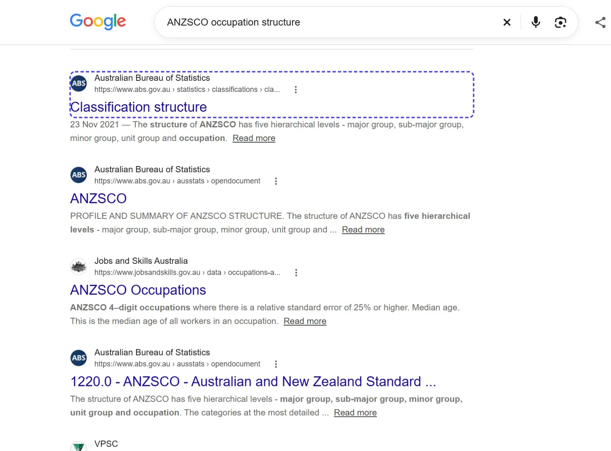

## Step 06: Click link "Classification structure"

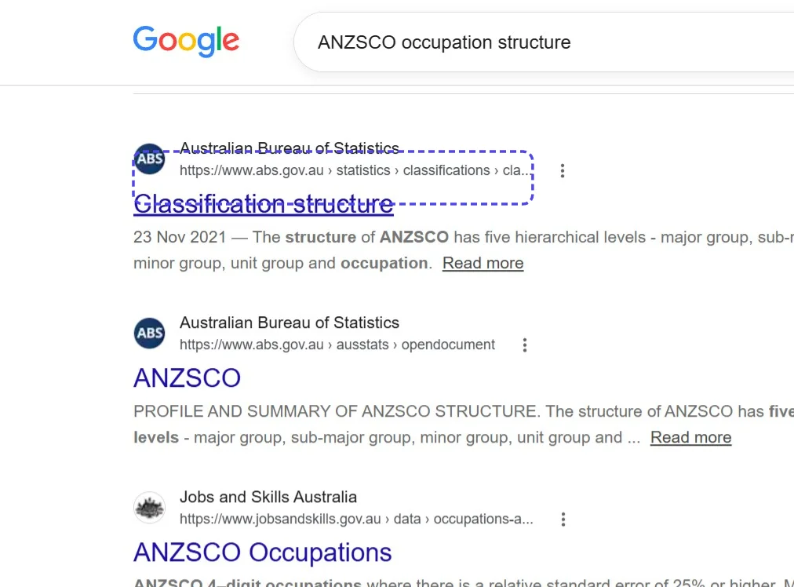

## Step 07: Click link "Data downloads"

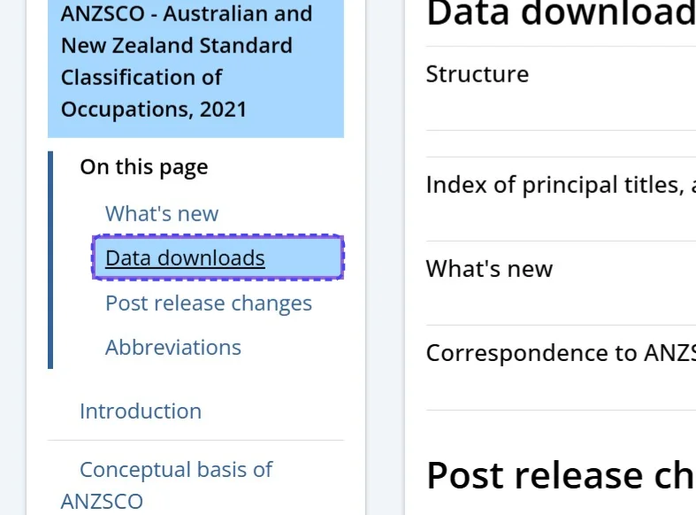

## Step 08: Click link "Download - Structure xlsx 201.02 KB"

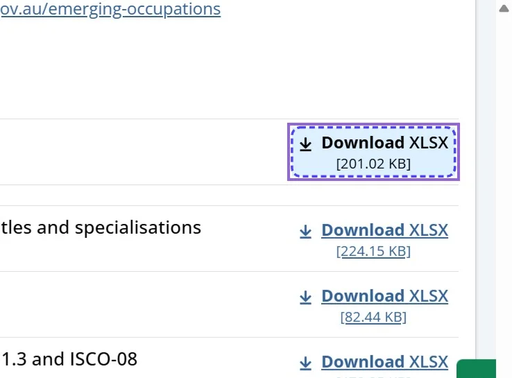

## Step 09: Usually on sheet 5 is the final hierarchy table with all occupations. Remove all the header rows so there is data only remaining. Save the file as an xlsx with sheet 5 only.

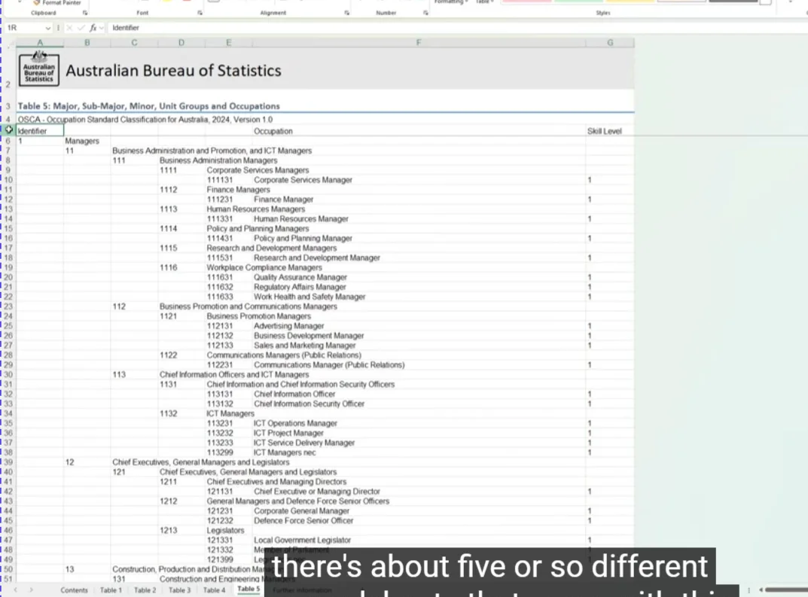

## Step 10: Upload the xlsx into Sentinel

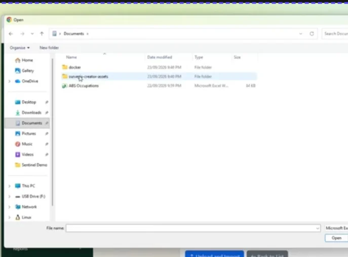

## Step 11: Sentinel will import the records

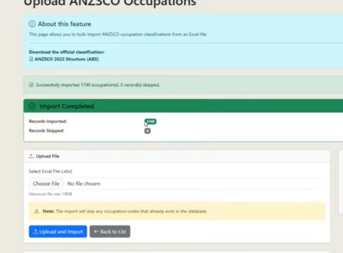

## Step 12: You can review the occupations

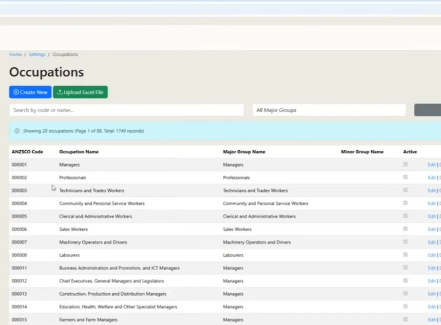
