# Merge two patients in Sentinel

The patient you are initiating the merge from will be deleted

*11 steps · Created Oct 14, 2026 · Source: demo.sentinelsurveillance.app*

---

## Step 01: Select a patient record

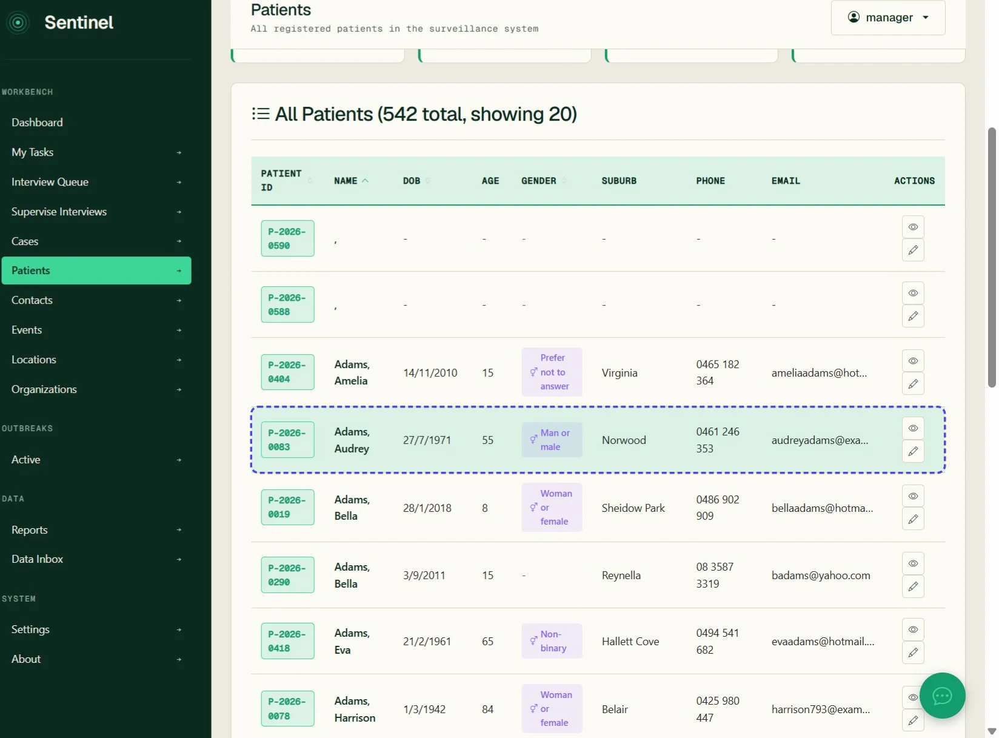

## Step 02: Click More

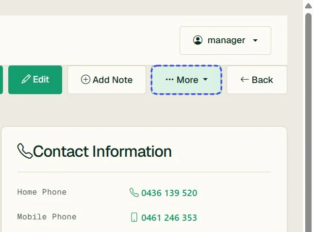

## Step 03: Click link "Merge Patient"

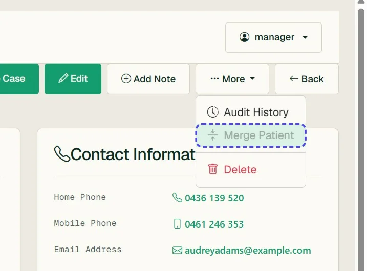

## Step 04: The source patient GUID will be present

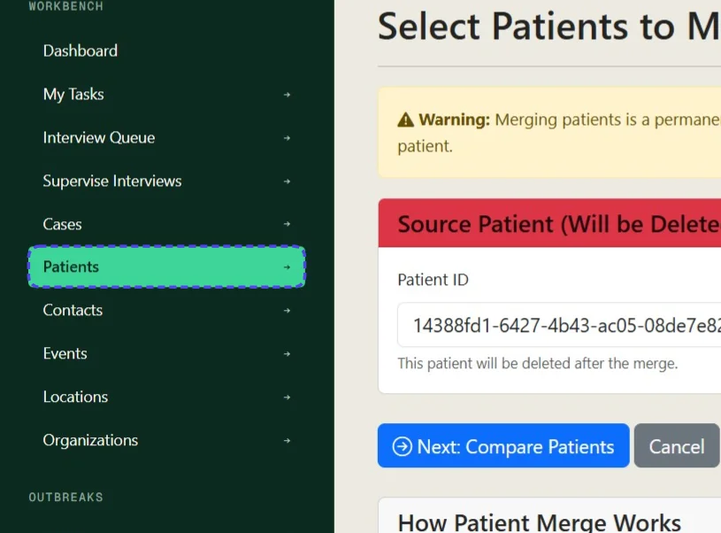

## Step 05: Enter the target patient ID - you can find this at the end of a patient details page URL in your web browser

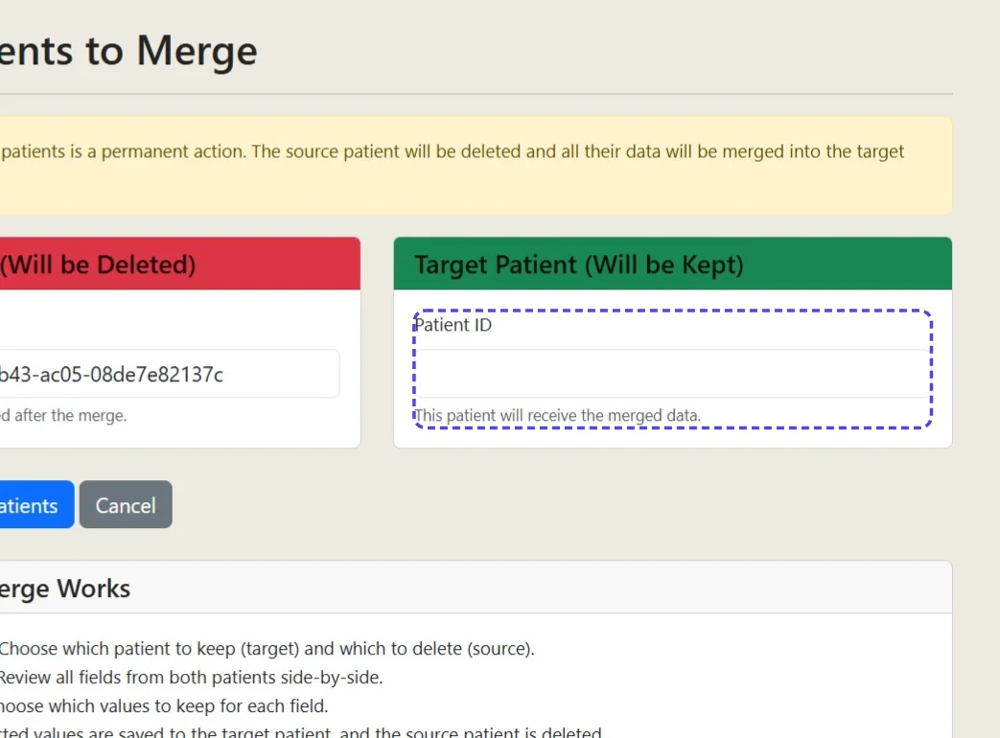

## Step 06: Enter the patient ID

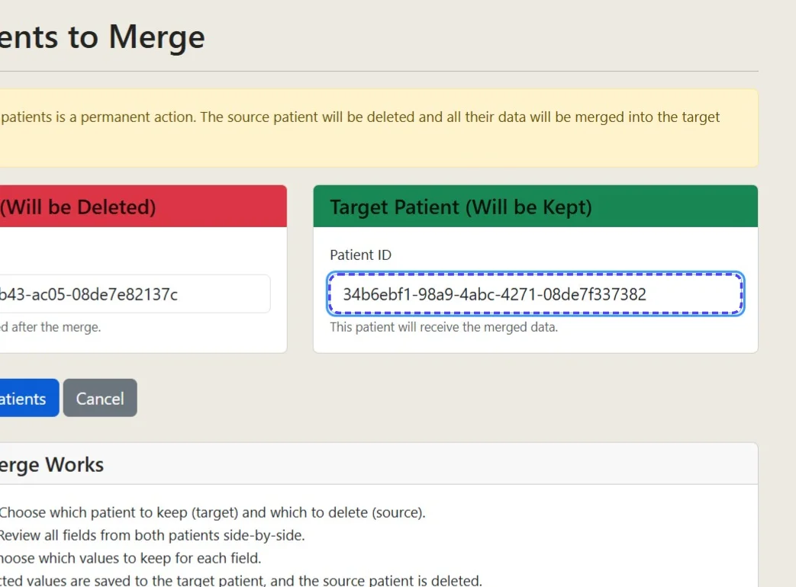

## Step 07: Click Next: Compare Patients

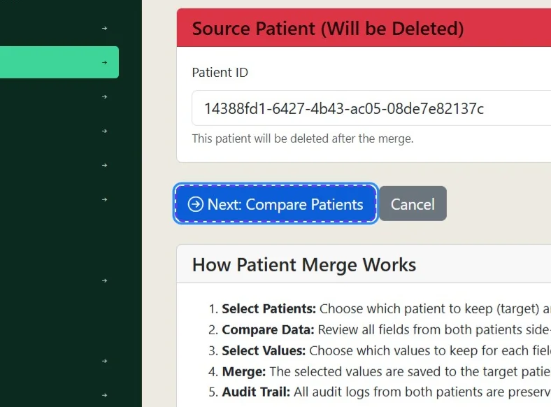

## Step 08: Sentinel will display all fields associated for merge and allow you to choose which value to accept

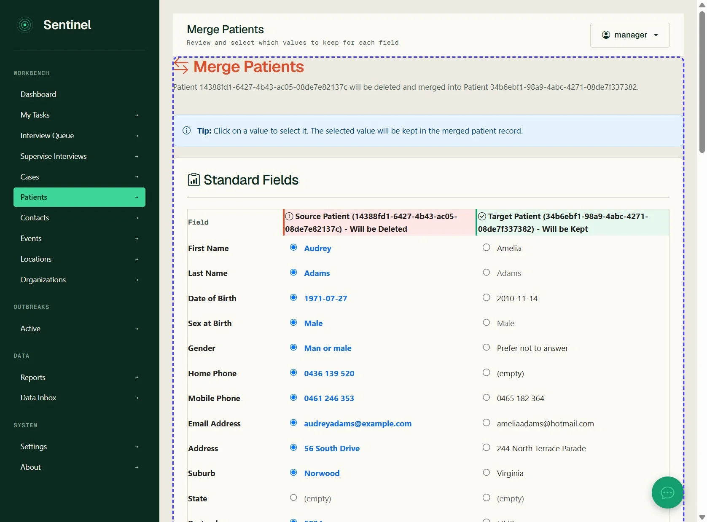

## Step 09: Select values as appropriate

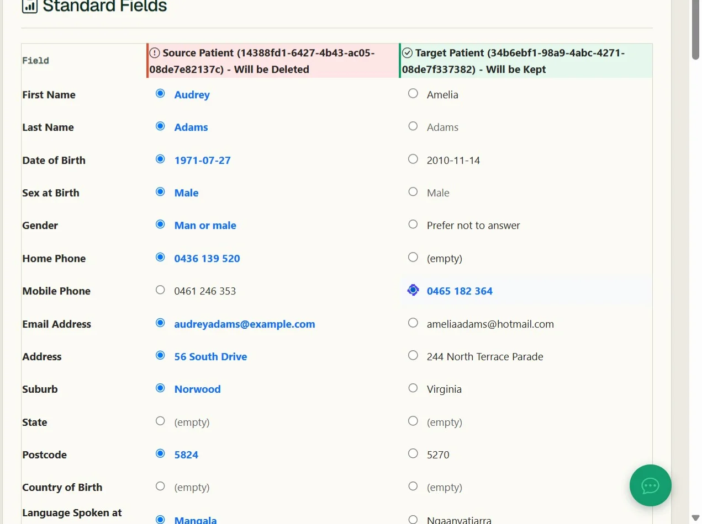

## Step 10: Click Additional Information

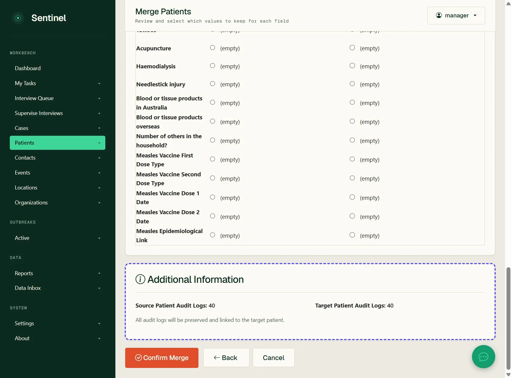

## Step 11: Click Confirm Merge

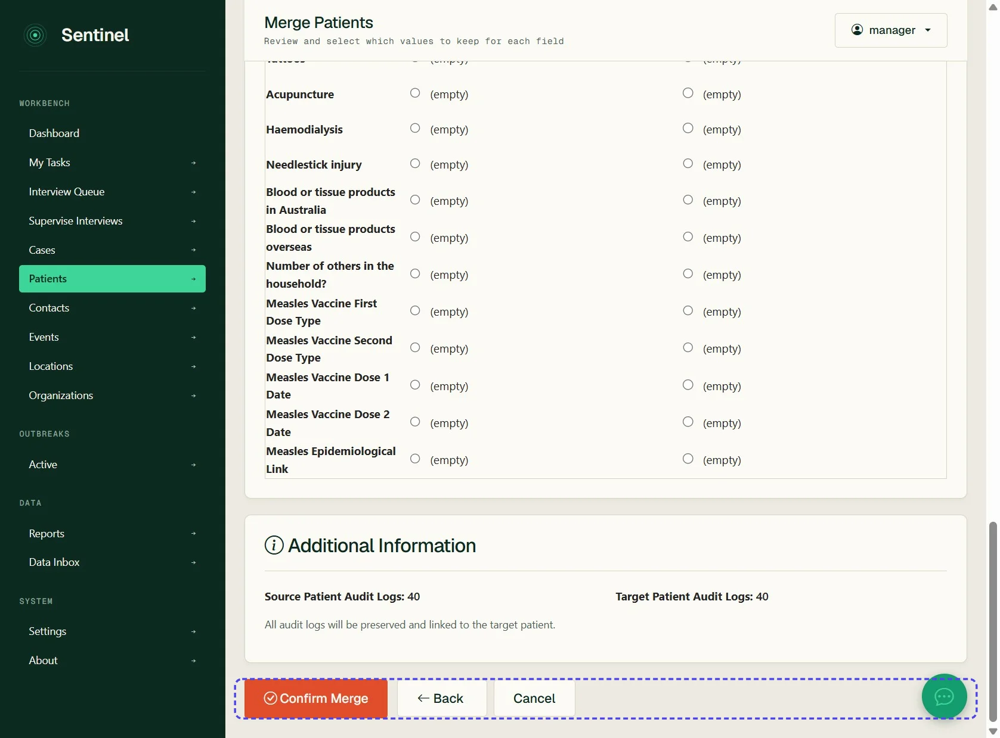
