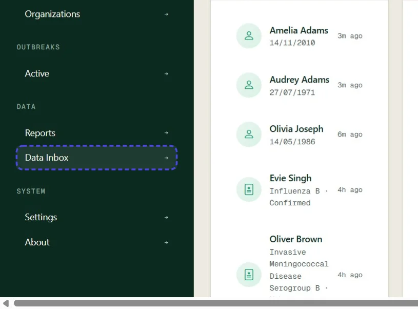
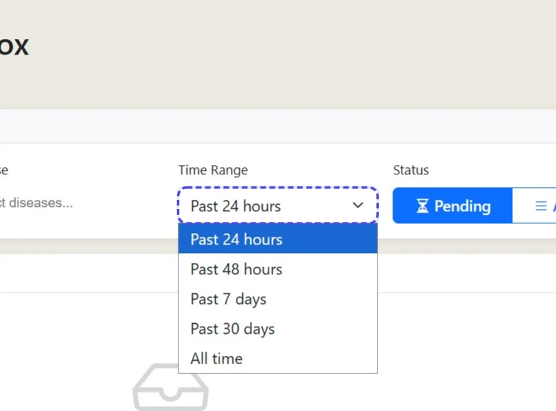
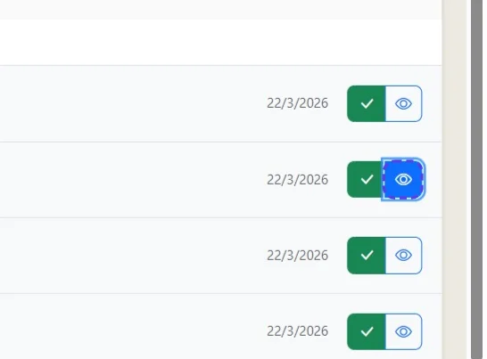
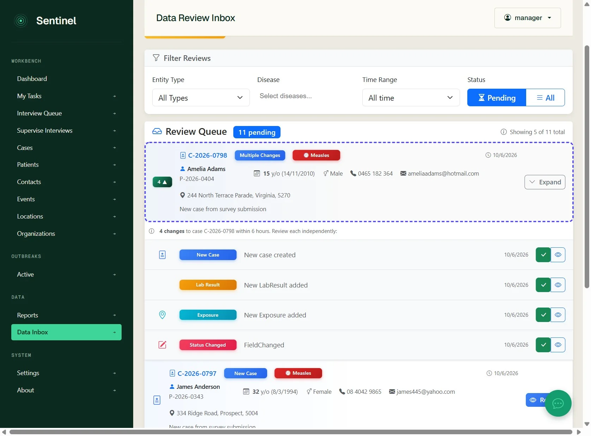
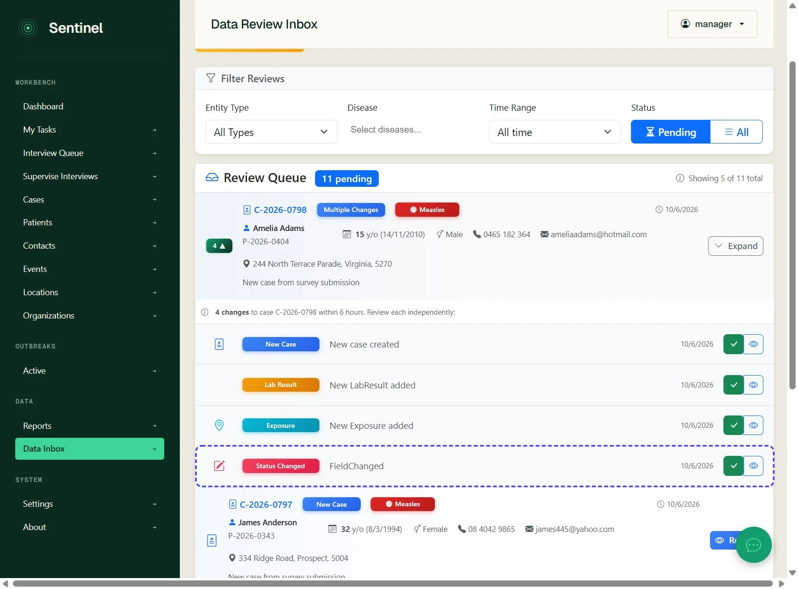
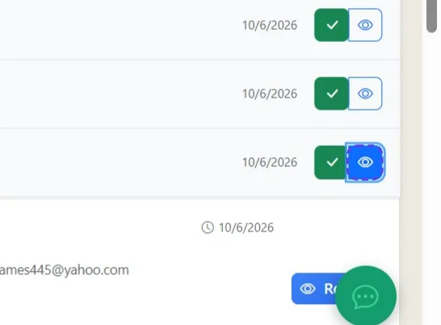
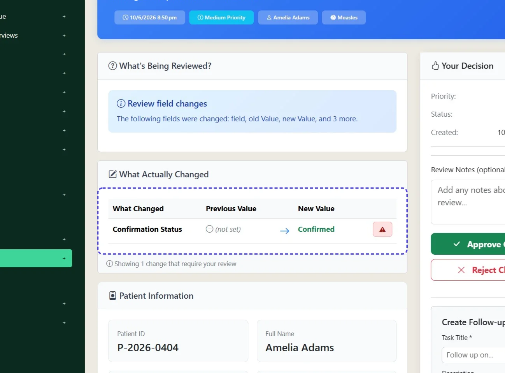
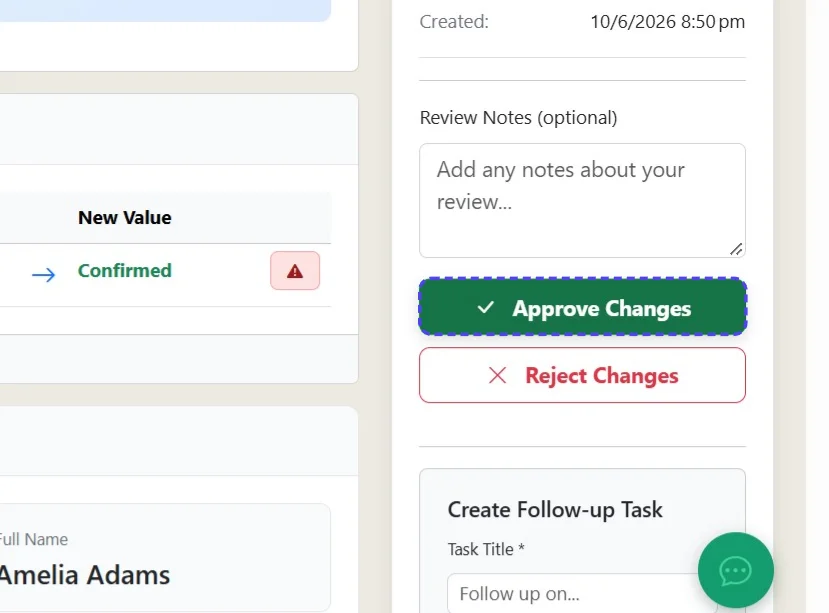

# Review an item in the Data Review Inbox

The data inbox is a central notification and review area. Depending on your surveillance system is configured will dictate what items are triggered to appear in the review box. New entity creation (e.g from a contact tracing survey) can stage data changes, meaning your approval of the review queue item will active committing the new changes to the database. Notifications for review are otherwise changes which have already been committed. The review queue will record your decision and it is up to you to check or manually roll back data on the case record if required.

*8 steps · Created Oct 14, 2026 · Source: demo.sentinelsurveillance.app*

---

## Step 01: Click link "Data Inbox →"

## Step 02: Adjust the time range to review items as appropriate

## Step 03: Click link "a"

## Step 04: If an item has an icon with a number on the left hand side it indicates there are multiple triggers for it to be in the review queue. Click the item to expand

## Step 05: Select the item you would like to review

## Step 06: To view more detail click the 'View' icon - click the green tick to approve the review without looking further (useful if you yourself have just made these changes or have just reviewed the record)

## Step 07: On the What is being reviewed page you can see which field has changed which triggered the review queue

## Step 08: Click Approve Changes. You can click reject changes but note this **does not** roll back data changes and this will need to be done manually 

Alternatively you can complete the 'Create a follow-up task' to follow up the specific change item and mark it as reviewed

