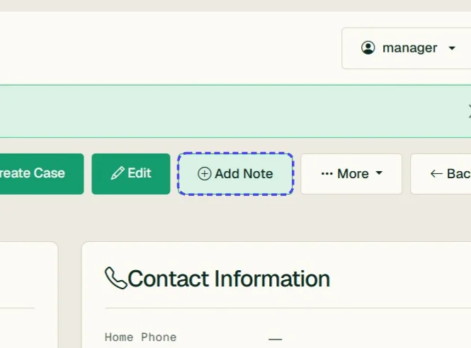
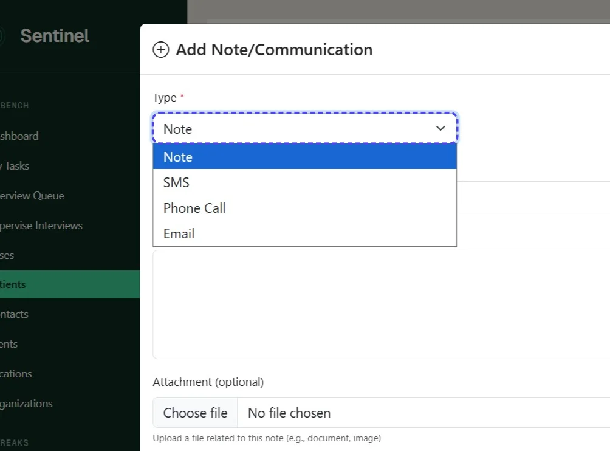
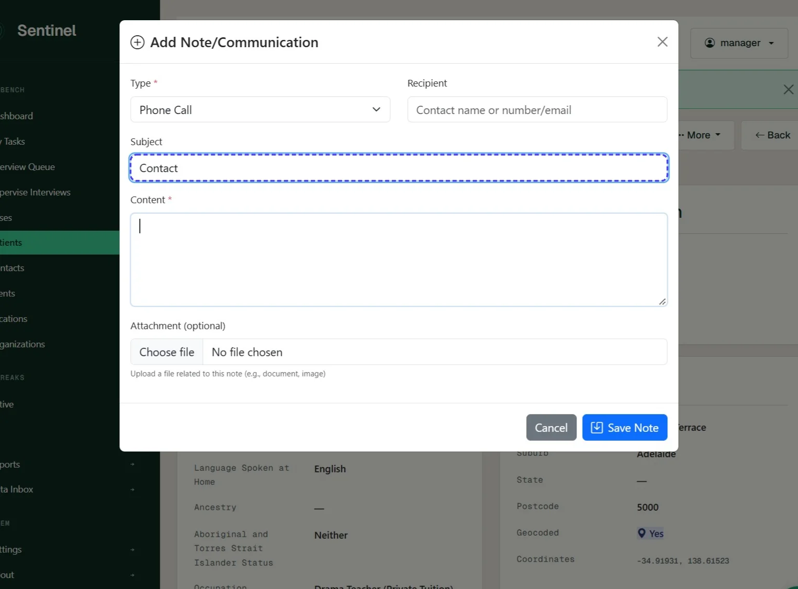
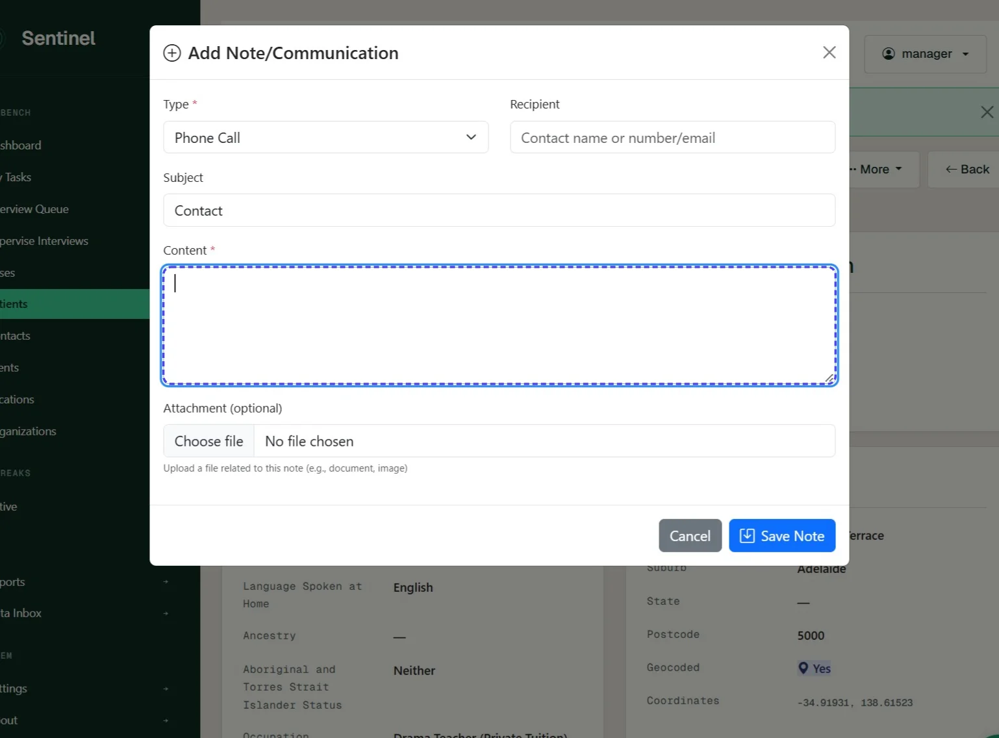
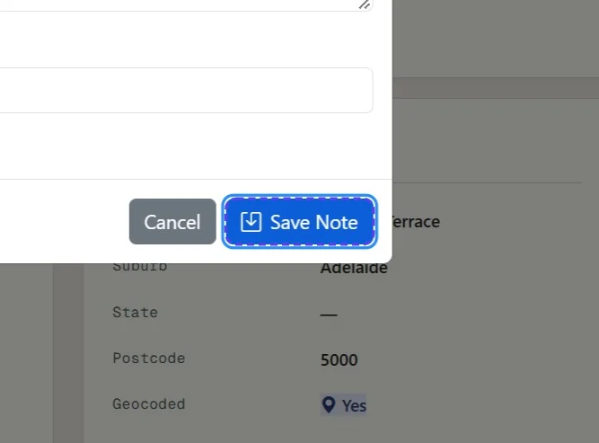
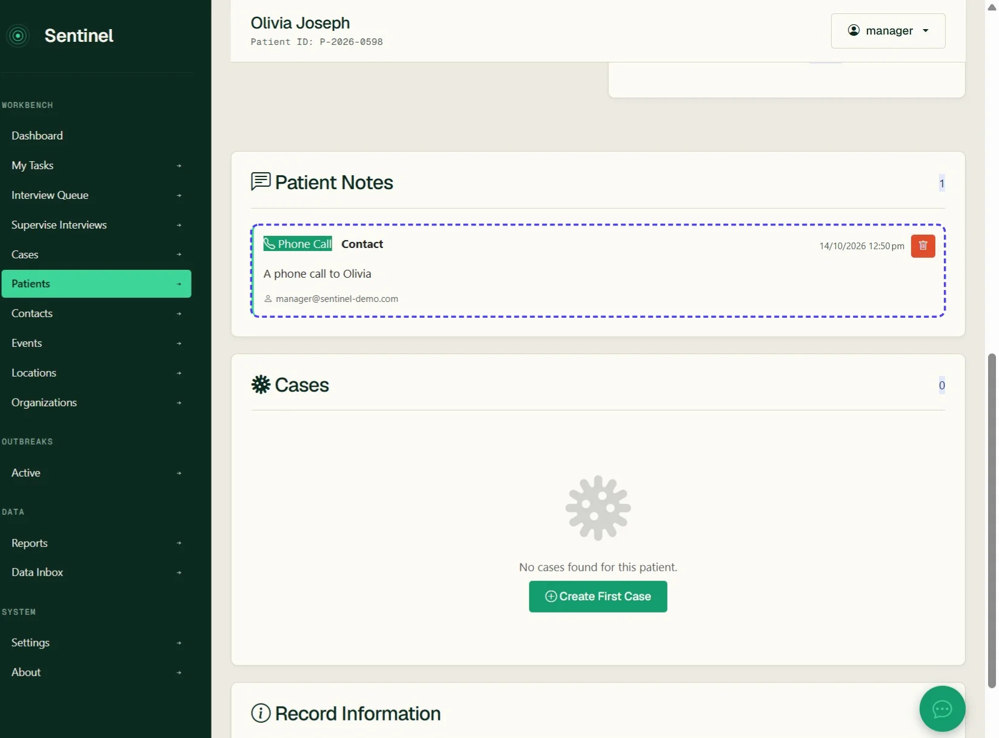

# Save a note on a patient record

*6 steps · Created Oct 14, 2026 · Source: demo.sentinelsurveillance.app*

---

## Step 01: On the patient details page Click Add Note

## Step 02: Select the type of note or communication

## Step 03: Enter a subject

## Step 04: Enter the content of the note to save

## Step 05: Click Save Note

## Step 06: You will be able to see the patient note on the patient record - note this does not automatically display on cases

