# Using the line list feature in Outbreaks

The line list feature enables a quick "glance" or report and allows for quick export of related outbreak records.

*14 steps · Created Oct 23, 2026 · Source: demo.sentinelsurveillance.app*

---

## Step 01: From the dashboard, click Active under Outbreaks in the sidebar

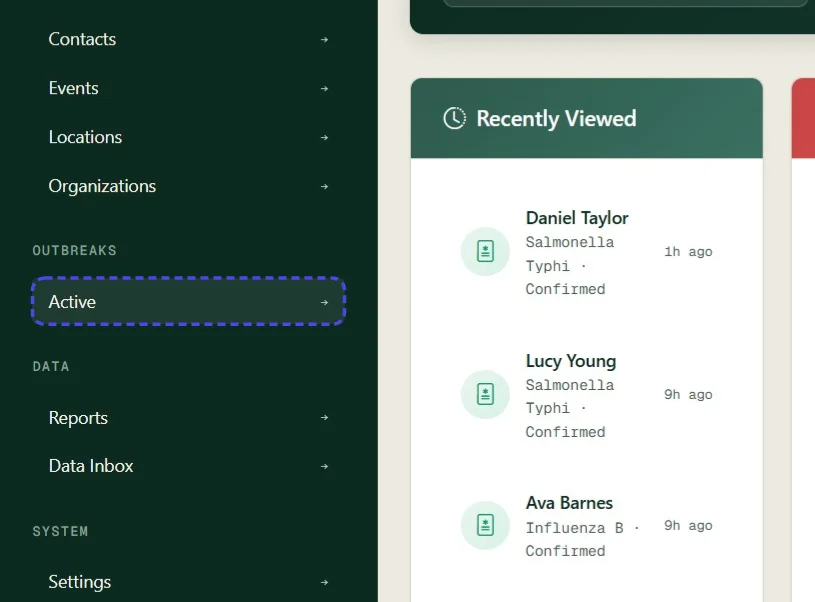

## Step 02: On the Active Outbreaks page, open the outbreak

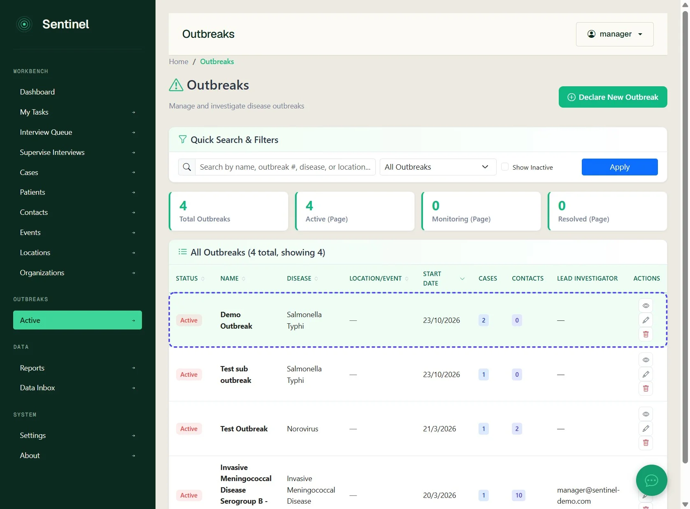

## Step 03: On the outbreak details page, click Line List

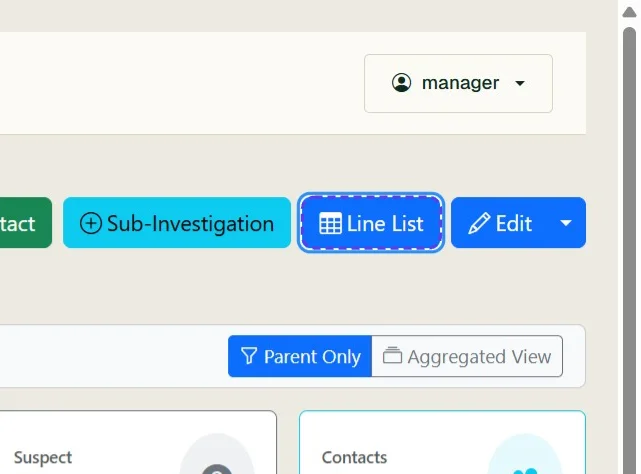

## Step 04: Review the line list of linked cases

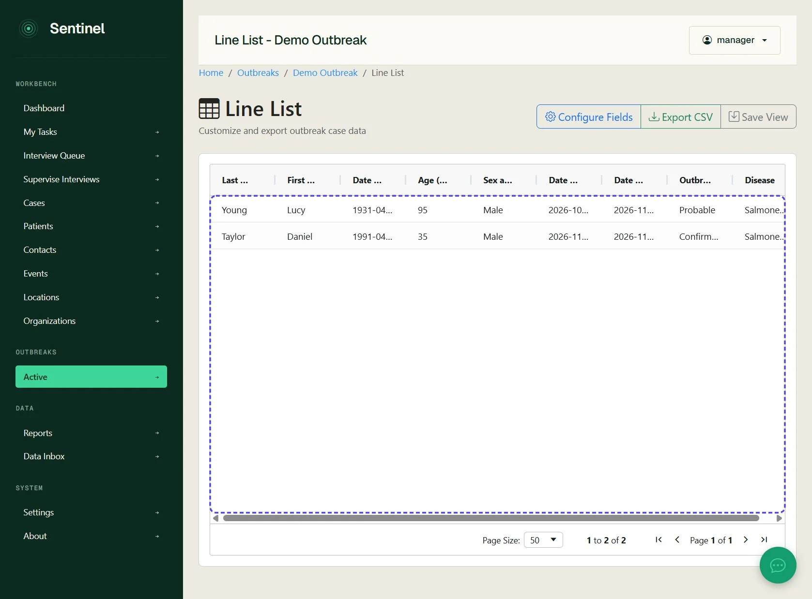

## Step 05: Above the line list, click Configure Fields

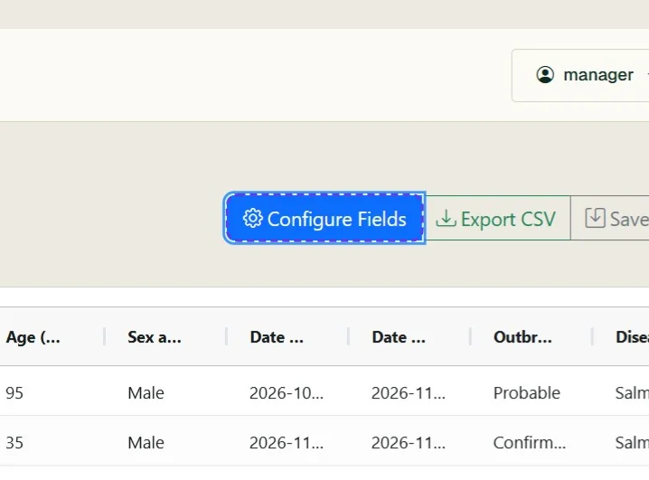

## Step 06: Review the saved views and available fields

Add or remove fields as needed.

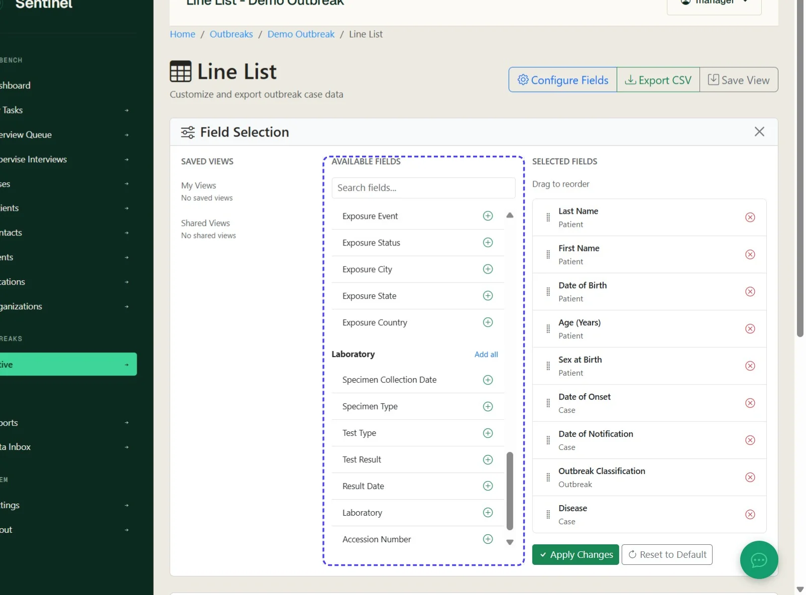

## Step 07: In Available Fields, click the plus icon next to Specimen Date

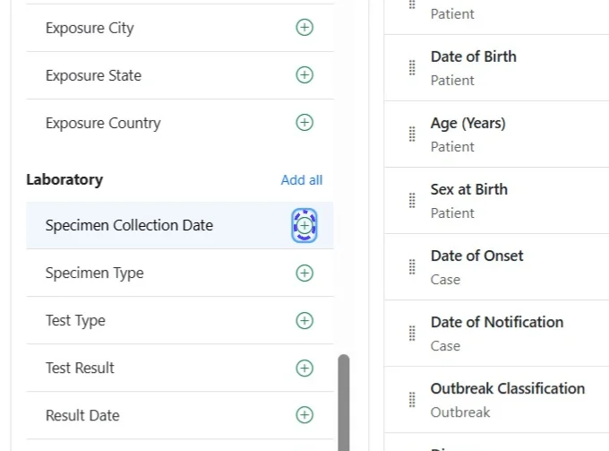

## Step 08: Click the plus icon next to Specimen Type

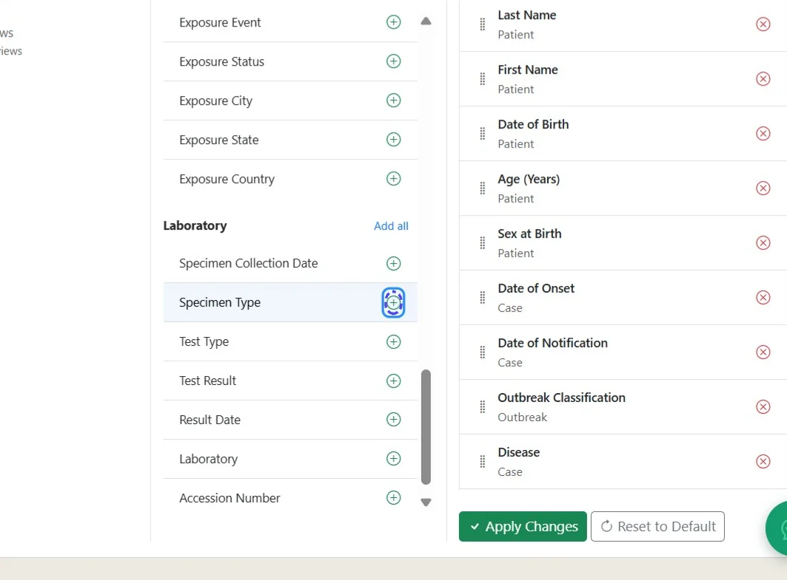

## Step 09: Click Apply Changes

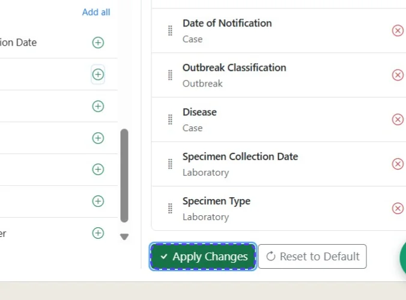

## Step 10: Check that the selected fields appear in the line list

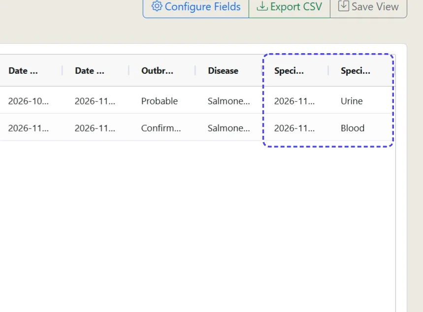

## Step 11: Above the line list, click Save View

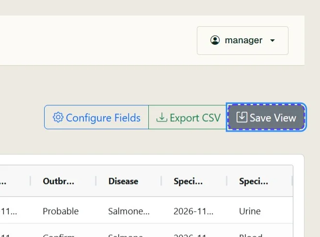

## Step 12: Enter a name for the view

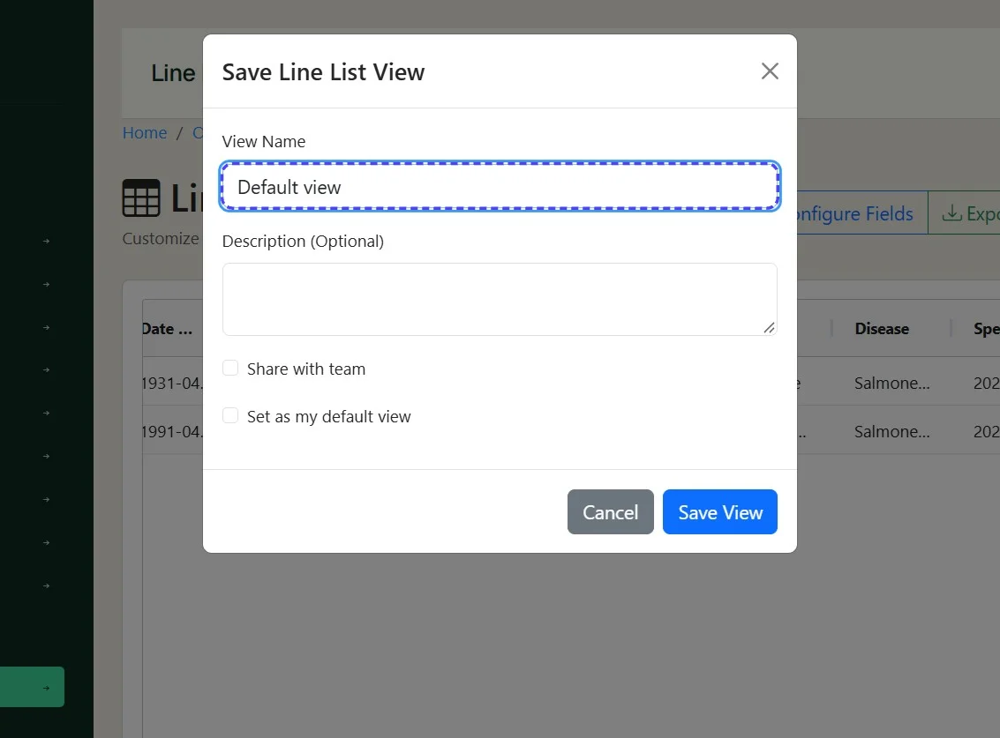

## Step 13: Choose whether to share the view with the outbreak team or keep it private

Select Set as my default view if required.

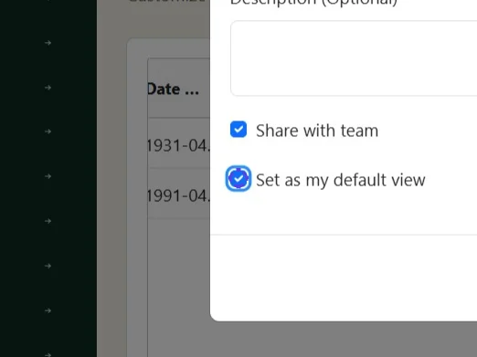

## Step 14: Click Save View to save the named view

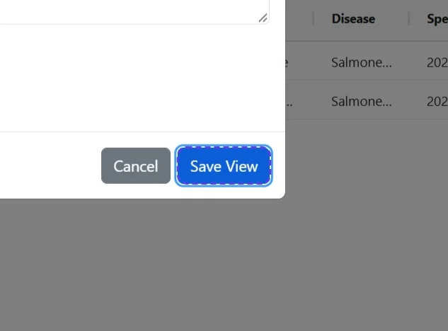
