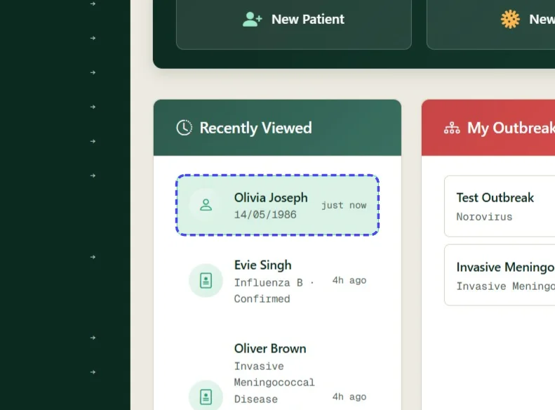
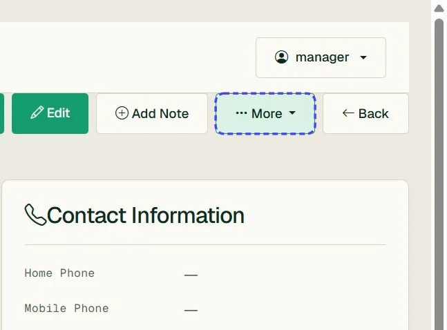
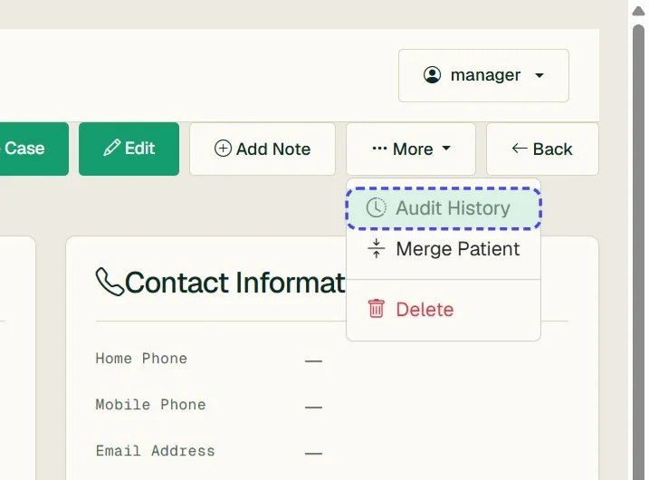
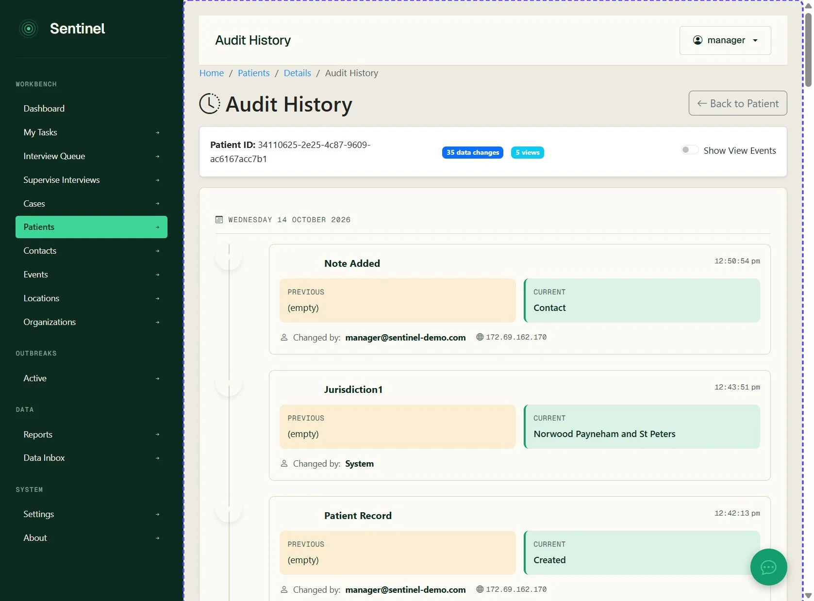
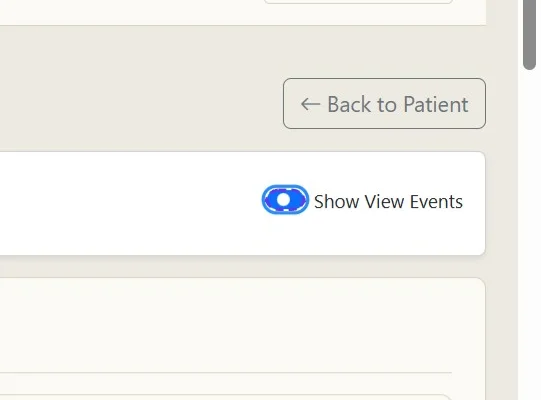
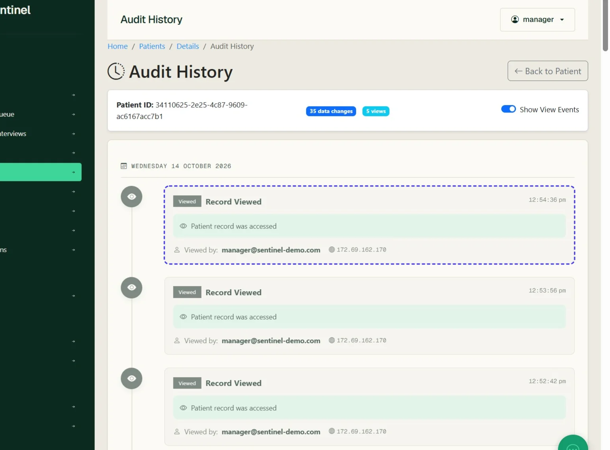
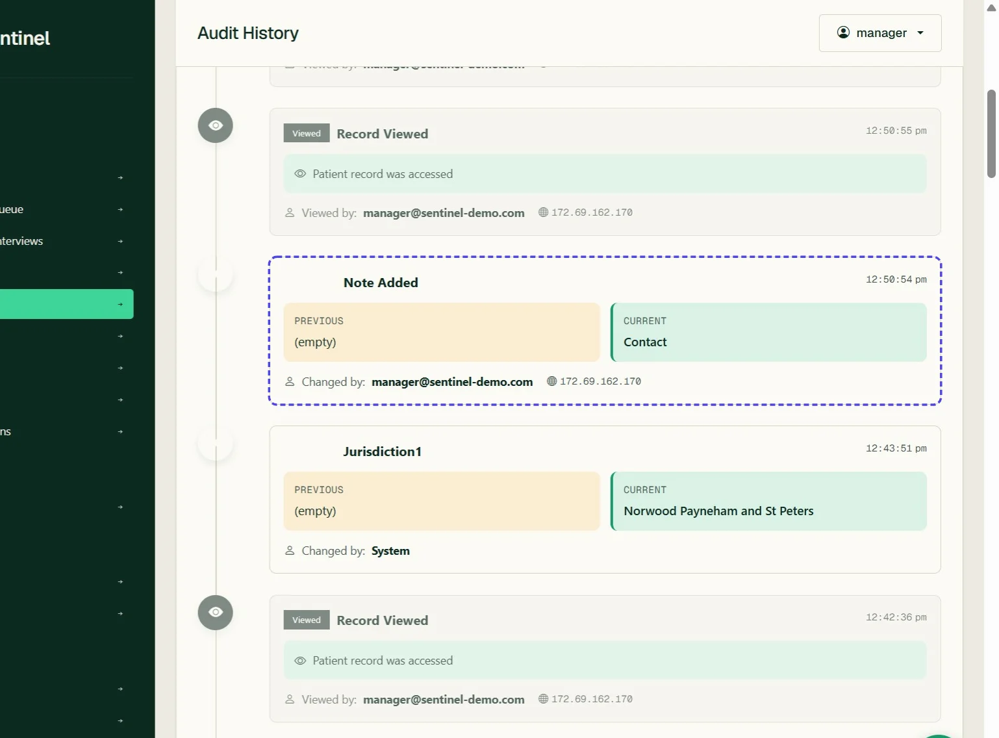
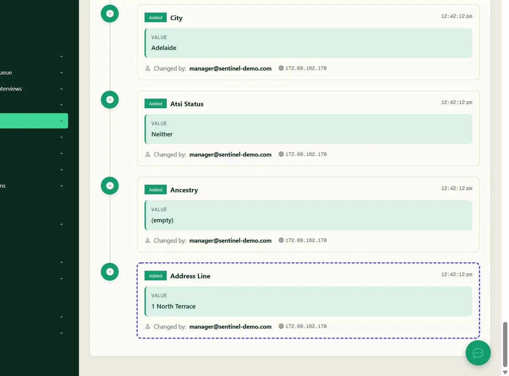

# View patient Audit History

View the audit log for a patient record

*8 steps · Created Oct 14, 2026 · Source: demo.sentinelsurveillance.app*

---

## Step 01: Select a patient to view

## Step 02: Click More

## Step 03: Click link "Audit History"

## Step 04: This will display the audit history page

## Step 05: Toggle 'Show View Events' to include views of the patient details page

## Step 06: This will highlight who has viewed the patient record and when

## Step 07: You can see when data fields are updated or changed

## Step 08: You can see when data fields are updated or changed

